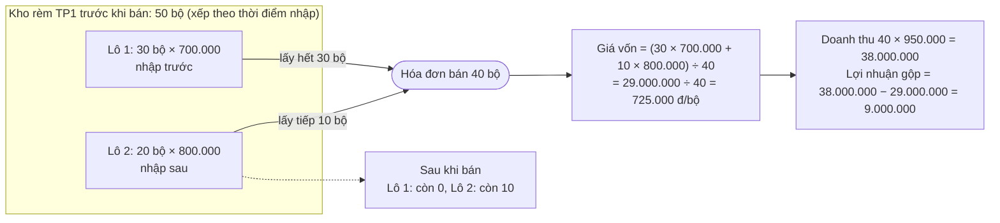
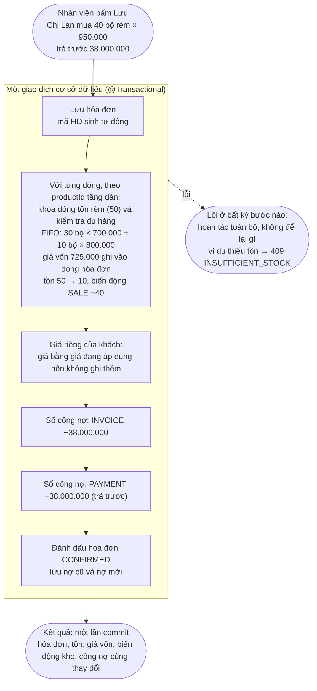

# BÁO CÁO KHÓA LUẬN TỐT NGHIỆP

> **Trạng thái:** bản hoàn thiện để đưa vào Word. Chương 4 mô tả lần chạy thử ngày 13/10/2026 và các ảnh trong `test/screenshots/`; nội dung mục 4.1 đến 4.7 đối chiếu với source `code/erp-platform/services/erp-backend` (ngày 13/10/2026, gồm cả thay đổi chưa commit).
>
> **Quy ước:** mỗi sơ đồ có placeholder dạng `> **[DIAGRAM — Hình n: ...]**`; mỗi ảnh chụp màn hình có placeholder dạng `> **[ẢNH CHỤP — Hình n: ... File: ...]**` (vị trí chèn ảnh trong Word). Số hình tăng tuần tự từ 1. Sơ đồ Hình 1 đến 40 có mã trong `MERMAID_CODE.md`; sơ đồ Hình 81 và 82 có mã ngay trong mục 4.8.7. Đường dẫn source viết từ thư mục gốc repo `DOAN/`.

**BỘ GIÁO DỤC VÀ ĐÀO TẠO**

**ĐẠI HỌC UEH - TRƯỜNG CÔNG NGHỆ VÀ THIẾT KẾ**

**KHOA CÔNG NGHỆ THÔNG TIN KINH DOANH**

**CHUYÊN NGÀNH KỸ THUẬT PHẦN MỀM**

> **KHOÁ LUẬN TỐT NGHIỆP**
>
> **THIẾT KẾ VÀ TRIỂN KHAI HỆ THỐNG ERP ĐA CHI NHÁNH THEO KIẾN TRÚC MODULAR MONOLITH** *(tên đề xuất, cần xác nhận với giáo viên hướng dẫn)*
>
> Họ tên sinh viên: **Nguyễn Quốc Thắng**
>
> Mã sinh viên: **33241022088**
>
> Lớp: **Kỹ thuật phần mềm 01 - VB2K27.2**
>
> Khóa: **27.2**
>
> Họ tên giáo viên hướng dẫn: **Trương Việt Phương**

Niên khóa: 2026

Tp Hồ Chí Minh, ngày…..tháng…..

# LỜI CẢM ƠN

> *[Lời cảm ơn: sinh viên tự viết trước khi nộp.]*

# DANH SÁCH CHỮ VIẾT TẮT, KÝ HIỆU

| **Từ viết tắt** | **Ý nghĩa** |
|---|---|
| ERP | Enterprise Resource Planning |
| HQ | Headquarter – Trụ sở chính |
| Branch | Chi nhánh |
| JWT | JSON Web Token |
| RS256 | RSA Signature with SHA-256 |
| ORM | Object-Relational Mapping |
| JPA | Jakarta Persistence API |
| NFR | Non-Functional Requirement |
| API | Application Programming Interface |
| FIFO | First In, First Out |
| CRUD | Create, Read, Update, Delete |
| E2E | End-to-End |
| AOP | Aspect-Oriented Programming |
| SQL | Structured Query Language |
| UI | User Interface |
| N-Instance | Nhiều instance của cùng ứng dụng với vai trò khác nhau (HQ hoặc BRANCH) |
| CSDL | Cơ sở dữ liệu |
| WAN | Wide Area Network – mạng diện rộng nối HQ và Branch |
| HTTP | HyperText Transfer Protocol |
| REST | Representational State Transfer |
| DTO | Data Transfer Object – đối tượng truyền dữ liệu giữa các lớp |
| UC | Use Case – ca sử dụng |
| CRM | Module khách hàng và công nợ trong mã nguồn |
| UTC | Coordinated Universal Time – giờ chuẩn quốc tế |
| ETL | Extract, Transform, Load – trích xuất, biến đổi, nạp dữ liệu |
| ELK | Elasticsearch, Logstash, Kibana – bộ công cụ quản lý log |
| BCrypt | Thuật toán băm mật khẩu |
| PostgreSQL | Hệ quản trị cơ sở dữ liệu quan hệ mã nguồn mở |
| Redis | Kho dữ liệu trong bộ nhớ, dùng lưu trạng thái token ở HQ |
| Docker | Nền tảng đóng gói và chạy ứng dụng trong container |
| JaCoCo | Công cụ đo độ phủ mã nguồn Java |
| JSON | JavaScript Object Notation – định dạng trao đổi dữ liệu |
| OpenAPI | Đặc tả API dạng máy đọc được |
| NCC | Nhà cung cấp (trên giao diện gọi là nhà phân phối) |

# CHƯƠNG 1. TỔNG QUAN ĐỀ TÀI

## 1.1. Bối cảnh và vấn đề giải quyết

Trong hoạt động kinh doanh vật liệu xây dựng và thiết bị thông minh nhà, việc quản lý hàng hóa, bán hàng, tồn kho và công nợ phải thu có mối quan hệ chặt chẽ với nhau. Khi cửa hàng mở rộng thành nhiều chi nhánh, bài toán không còn là một phần mềm bán hàng đơn lẻ mà trở thành bài toán quản lý dữ liệu và nghiệp vụ trên phạm vi toàn hệ thống.

Mô hình hoạt động được xét trong đề tài gồm một Trụ sở chính (Headquarters – HQ) và nhiều Chi nhánh (Branch). HQ quản lý tập trung dữ liệu dùng chung (**Master Data**) gồm chi nhánh, danh mục, sản phẩm, nhà cung cấp, bảng giá niêm yết, khách hàng và tài khoản. Mỗi Branch trực tiếp phát sinh dữ liệu giao dịch (**Transaction Data**) gồm hóa đơn bán hàng, phiếu trả hàng, phiếu nhập kho, biến động kho, công nợ và giá riêng của khách.

Mô hình này đặt ra ba vấn đề:

Thứ nhất, hoạt động của chi nhánh không thể phụ thuộc hoàn toàn vào HQ. Đường truyền WAN giữa chi nhánh và HQ có thể gián đoạn, nên chi nhánh phải tự bán hàng, nhập kho và ghi công nợ ngay cả khi mất kết nối.

Thứ hai, Master Data phải thống nhất. Sản phẩm, giá, khách hàng và nhà cung cấp không được quản lý độc lập tại từng chi nhánh. Hệ thống cần cơ chế phân phối Master Data từ HQ xuống Branch, và tổng hợp Transaction Data từ Branch lên HQ để báo cáo.

Thứ ba, dữ liệu phân tán kéo theo yêu cầu toàn vẹn và nhất quán. Hệ thống phải xác định dữ liệu nào thuộc quyền ghi của HQ, dữ liệu nào thuộc quyền ghi của Branch, và kiểm soát đồng bộ giữa các cơ sở dữ liệu.

Từ đó, đề tài xây dựng hệ thống ERP quản lý bán lẻ đa chi nhánh cho cửa hàng Thành Phương, trong đó kiến trúc phần mềm, cơ sở dữ liệu và cơ chế đồng bộ được thiết kế đồng thời.

## 1.2. Mục tiêu nghiên cứu

### 1.2.1. Mục tiêu tổng quát

Xây dựng hệ thống ERP đa chi nhánh có khả năng vận hành cục bộ liên tục tại các Branch khi mất kết nối mạng, đồng thời cho phép HQ quản lý, giám sát và tổng hợp dữ liệu tập trung.

### 1.2.2. Mục tiêu cụ thể

Để đạt mục tiêu tổng quát, đề tài tập trung giải quyết 11 mục tiêu cụ thể sau. Mỗi mục được đối chiếu với chức năng đã triển khai trong source.

1. **Bán hàng (Sales):** tạo và xác nhận hóa đơn trong một giao dịch (`createAndConfirm`). Nhân viên không thể lưu hóa đơn chưa xác nhận.
2. **Nhập hàng (Inbound):** tạo phiếu nháp rồi xác nhận phiếu nhập kho từ nhà cung cấp, sinh lớp giá vốn.
3. **Trả hàng (Goods Return):** lập phiếu trả nháp, xác nhận để hoàn kho và giảm công nợ. Có hóa đơn gốc thì kiểm soát số lượng trả cộng dồn theo cặp sản phẩm–đơn vị tính; không có hóa đơn gốc thì không kiểm soát số lượng (quyết định nghiệp vụ, mục 4.6.5). Phần tiền vượt số dư công nợ được hoàn cho khách (`refund_amount`).
4. **Tồn kho (Inventory):** tính giá vốn FIFO, không cho tồn kho âm, từ chối bán vượt tồn bằng lỗi HTTP 409 (`INSUFFICIENT_STOCK`).
5. **Công nợ phải thu (Receivable Debt):** theo dõi công nợ từng khách theo từng chi nhánh qua sổ biến động. Ghi nhận công nợ do bán hàng; giảm do trả trước trên hóa đơn và do trả hàng. Công nợ chỉ phát sinh từ hóa đơn bán hàng; không có thao tác tạo công nợ thủ công (số dư đầu kỳ) và không có luồng thu nợ độc lập (khách trả nợ không gắn hóa đơn; xem mục 1.4.2).
6. **Master Data:** quản lý tập trung tại HQ và phân phối xuống Branch qua Logical Replication.
7. **Phân quyền:** hai vai trò ADMIN và STAFF, phạm vi theo chi nhánh (HQ hoặc Branch) thực thi ở tầng controller/service qua `AuthUtils`.
8. **Đồng bộ hai chiều:** mỗi bảng có một chiều đồng bộ duy nhất. Bảng master đi từ HQ xuống; bảng giao dịch đi từ Branch lên HQ; hai bảng snapshot được lọc theo `branch_id`.
9. **Dashboard:** doanh thu và giá vốn theo số thuần (đã trừ phiếu trả đã xác nhận), top sản phẩm bán chạy, cảnh báo tồn kho thấp, xuất Excel.
10. **Giá bán theo khách hàng:** đơn giá gợi ý theo thứ tự giá riêng của khách còn hiệu lực → giá niêm yết của chi nhánh → nhập tay. Giá nhân viên sửa được lưu thành giá riêng khi xác nhận hóa đơn, kèm lịch sử. Đơn giá và giá vốn được snapshot vào dòng hóa đơn.
11. **Toàn vẹn, bảo mật, bảo trì:** khóa dòng tồn, lớp giá vốn và dòng công nợ khi bán, trả và nhập (các dòng khóa theo `productId` tăng dần), `@Version` cho entity giao dịch, idempotency bằng header `Idempotency-Key` ở năm endpoint, JWT RS256, một codebase.

## 1.3. Đối tượng nghiên cứu

- Quy trình nghiệp vụ ERP trong bán lẻ chuỗi phân tán (bán hàng, trả hàng, nhập kho, công nợ, báo cáo).
- Kiến trúc Modular Monolith triển khai theo mô hình HQ + N Branch dùng cùng một artifact.
- Cơ chế đồng bộ dữ liệu bằng PostgreSQL Logical Replication, gồm publication/subscription theo chi nhánh.
- Thuật toán giá vốn FIFO và cách ghi lớp giá vốn (Cost Layer) cho nhập kho và trả hàng.
- Cơ chế xác định giá bán theo khách hàng và kỹ thuật snapshot đơn giá, giá vốn tại thời điểm xác nhận chứng từ.
- Xác thực và phân quyền khi nhiều instance cùng chạy: HQ ký JWT, Branch xác thực token ngoại tuyến bằng khóa công khai; làm mới phiên vẫn cần HQ (mục 4.6.1).

## 1.4. Phạm vi nghiên cứu

### 1.4.1. Chức năng trong phạm vi phát triển

Hệ thống backend gồm các module nghiệp vụ sau. Mỗi module tương ứng một package trong `com.storename.erp`.

| Module (package) | Trách nhiệm chính | Trạng thái trong source |
|---|---|---|
| **identity** | Đăng nhập, refresh, thu hồi token, vai trò, quyền, tài khoản người dùng | Hoàn thành (chỉ chạy ở HQ) |
| **branch** | Danh sách chi nhánh (chỉ đọc; chi nhánh được khai báo bằng dữ liệu khởi tạo tại HQ) | Hoàn thành |
| **catalog** | Danh mục, sản phẩm, nhà cung cấp, bảng giá niêm yết (đọc) | Hoàn thành; bảng giá chưa có luồng ghi (UC04) |
| **crm** | Khách hàng, công nợ phải thu, sổ biến động | Hoàn thành |
| **order** | Hóa đơn bán hàng, phiếu trả hàng, giá riêng theo khách và lịch sử giá | Hoàn thành |
| **inventory** | Tồn kho, phiếu nhập kho, biến động kho, lớp giá vốn FIFO | Hoàn thành |
| **analytics** | Dashboard, cảnh báo tồn kho, xuất Excel; ETL kho dữ liệu | Dashboard và cảnh báo hoàn thành; ETL mới là khung |
| **common** | ApiResponse, xử lý lỗi, idempotency, bảo mật JWT, AOP | Hoàn thành; hai aspect Audit và LogExecutionTime chưa được gắn (xem mục 4.6.7 và phần Hạn chế hiện tại) |
| **Thành phần đang phát triển** | aspect Audit và LogExecutionTime; job ETL kho dữ liệu `AnalyticsEtlJob` (chưa bật) | Đang phát triển, xem phần Hạn chế hiện tại |

### 1.4.2. Giới hạn ngoài phạm vi

Các nghiệp vụ sau nằm ngoài phạm vi phát triển và được xem là định hướng mở rộng:

- Đặt hàng trước của khách hàng (Customer Order).
- Đơn đặt hàng từ nhà cung cấp (Purchase Order) và công nợ phải trả (Supplier Payable).
- Luân chuyển kho nội bộ (Stock Transfer) và phiếu xuất kho khác (Outbound Receipt).
- Yêu cầu báo giá (RFQ) và thanh toán trực tuyến (Online Payment).
- Chiết khấu và thuế GTGT trên chứng từ: chỉ có cột dữ liệu, chưa tham gia công thức doanh thu, giá vốn.
- Bán khi tồn kho âm (backorder): hệ thống chặn bán để đảm bảo giá vốn đúng.
- Quy trình phê duyệt thay đổi giá bán và chính sách giá theo nhóm khách/khuyến mãi.
- Thuật ngữ "Lô hàng" (Stock Lot) không dùng; hệ thống dùng thống nhất **Lớp giá vốn (Cost Layer)**.
- Hoàn tiền mặt cho khách: phiếu trả chỉ ghi nhận số tiền hoàn (`refund_amount`). Hệ thống không ghi nhận nghiệp vụ chi tiền, quỹ hay phương thức hoàn tiền.
- Thu nợ độc lập (khách trả nợ không gắn hóa đơn): đã bỏ theo quyết định nghiệp vụ. Công nợ chỉ giảm qua trả trước trên hóa đơn và trả hàng.
- Số dư đầu kỳ công nợ: không có. Công nợ chỉ phát sinh khi xác nhận hóa đơn bán hàng; hệ thống không cho tạo công nợ thủ công.
- Phương thức thanh toán: không phân loại. Tiền trả trước trên hóa đơn là tiền đã thu; phần còn lại ghi vào công nợ.
- Quản trị chi nhánh và giám sát đồng bộ qua API: không có. Chi nhánh được khai báo bằng dữ liệu khởi tạo (`R__reference_data.sql`) và script cấu hình replication; trạng thái đồng bộ được kiểm tra trực tiếp trên PostgreSQL (`pg_stat_replication`, `pg_stat_subscription`).
- Trang công khai (web-public): ngoài phạm vi báo cáo. Danh mục trên trang này hiện là dữ liệu mẫu.

## 1.5. Ý nghĩa của đề tài

**Ý nghĩa học thuật.** Đề tài minh họa cách áp dụng Modular Monolith cho hệ thống có nhiều cơ sở dữ liệu: một artifact chạy theo vai trò HQ hoặc Branch, đồng bộ bằng PostgreSQL Logical Replication, và kiểm soát đồng thời ở cả tầng ứng dụng lẫn cơ sở dữ liệu. Các quyết định kiến trúc được ghi nhận kèm lý do và giới hạn.

**Ý nghĩa thực tiễn.** Chi nhánh có thể bán hàng, nhập kho, trả hàng và ghi công nợ khi đường truyền tới HQ gián đoạn. HQ có dữ liệu tổng hợp để theo dõi doanh thu, lợi nhuận gộp, công nợ phải thu và cảnh báo tồn kho thấp của từng chi nhánh.

## 1.6. Cấu trúc báo cáo

- **Chương 1** trình bày bối cảnh, mục tiêu, đối tượng và phạm vi nghiên cứu.
- **Chương 2** phân tích yêu cầu chức năng và phi chức năng, so sánh phương án kiến trúc và mô tả thiết kế kiến trúc tổng thể.
- **Chương 3** mô hình hóa use case (UC01 đến UC14), sơ đồ lớp và mô hình dữ liệu.
- **Chương 4** mô tả triển khai theo module, các cơ chế kỹ thuật cốt lõi, và lần chạy thử hệ thống như một người dùng thật qua các tình huống có ảnh minh chứng.
- **Chương 5** nêu kết luận, các hạn chế hiện tại và hướng phát triển.

# CHƯƠNG 2. PHÂN TÍCH YÊU CẦU VÀ THIẾT KẾ KIẾN TRÚC HỆ THỐNG

## 2.1. Tổng quan Lý thuyết và Công trình Liên quan

Phần này trình bày nền tảng lý thuyết cho các quyết định kiến trúc. Các nguồn tham khảo được liệt kê ở cuối báo cáo.

### 2.1.1. Kiến trúc Modular Monolith

- **Cơ sở tham khảo:** nhiều nghiên cứu và thực tiễn công nghiệp cho thấy với hệ thống quy mô vừa, Modular Monolith giảm chi phí vận hành so với Microservices. Trường hợp Prime Video (Amazon, 2023) được đội kỹ thuật báo cáo là đã giảm đáng kể chi phí khi gộp một số thành phần phân tán thành một khối.
- **Kết luận:** Microservices gây overhead về quản lý phân tán và độ trễ giao tiếp. Modular Monolith giữ một mã nguồn với ranh giới module rõ ràng.
- **Liên hệ hệ thống:** một artifact Spring Boot duy nhất chạy cho cả HQ và Branch. Vai trò được chọn qua thuộc tính `instance.role` (giá trị `HQ`, `BRANCH` hoặc `ALL` cho môi trường phát triển). Các bean theo vai trò được bật bằng `@ConditionalOnExpression` (ví dụ `AuthService`, các controller ghi master ở HQ và các controller giao dịch ở Branch). Các module giao tiếp qua **Facade** (`CrmFacade`, `CatalogFacade`, `InventoryFacade`, `OrderFacade`, `BranchFacade`) thay vì gọi Repository của nhau. Kiểm tra source cho thấy một ngoại lệ: module Order gọi trực tiếp `ReceivableDebtService` của module CRM để ghi nhận công nợ (xem Phụ lục B, mục 29). Ngược lại, `ReceivableDebtController` của CRM phụ thuộc `OrderFacade`, nên hai module có phụ thuộc hai chiều ở mức Facade.

### 2.1.2. Đồng bộ dữ liệu phân tán (PostgreSQL Logical Replication)

- **Cơ sở tham khảo:** tài liệu chính thức của PostgreSQL mô tả Logical Replication cho phép nhân bản có chọn lọc theo bảng giữa các database độc lập (publication và subscription).
- **Kết luận:** giải pháp này đồng bộ hai chiều mà không cần middleware ứng dụng, phù hợp khi chi nhánh có CSDL riêng.
- **Liên hệ hệ thống:** HQ có publication `pub_hq_master` chứa bảng master. Mỗi Branch có publication `pub_<chi nhánh>_to_hq` chứa bảng giao dịch và hai bảng snapshot được lọc theo `branch_id`. Danh sách bảng nằm trong `scripts/replication-tables.conf` và là nguồn duy nhất cho `scripts/setup-replication.sh`. UUID được dùng cho bảng giao dịch để tránh trùng khóa khi nhiều Branch cùng đẩy dữ liệu về HQ (chi tiết ở mục 2.5.4).

### 2.1.3. Tính nhất quán cuối cùng (Eventual Consistency)

- **Cơ sở tham khảo:** định lý CAP (Gilbert & Lynch, 2002) cho thấy hệ phân tán không thể đồng thời đảm bảo nhất quán tuyệt đối, sẵn sàng và chịu phân vùng. Thiết kế Dynamo (DeCandia và cộng sự, 2007) ưu tiên sẵn sàng và chấp nhận nhất quán cuối cùng.
- **Kết luận:** ở cấp liên chi nhánh, sẵn sàng được ưu tiên. Chi nhánh luôn thao tác được, dữ liệu trên HQ có thể trễ và sẽ khớp khi kết nối phục hồi.
- **Liên hệ hệ thống:** trong một Branch, tính nhất quán được giữ bằng transaction cục bộ và khóa. Giữa HQ và Branch, dữ liệu hội tụ theo Logical Replication. Báo cáo tại HQ có thể trễ so với thời gian thực.

### 2.1.4. Kiểm soát đồng thời: khóa lạc quan và khóa bi quan

- **Cơ sở tham khảo:** khóa lạc quan (Optimistic Locking) dùng số phiên bản để phát hiện ghi đè khi cập nhật; khóa bi quan (Pessimistic Locking) khóa bản ghi ngay khi đọc để chặn giao dịch khác cùng sửa.
- **Kết luận:** khóa lạc quan phù hợp cho thao tác ít tranh chấp. Khóa bi quan cần cho thao tác có tranh chấp cao về số lượng (tồn kho, lớp giá vốn).
- **Liên hệ hệ thống:** `BaseEntity` có `@Version` cho các entity kế thừa. `StockOnHandRepository.findForUpdate`, `CostLayerRepository.findAvailableForFifoWithLock`, `ReceivableDebtRepository.findForUpdate` và `SalesInvoiceRepository.findByIdForUpdate` dùng `PESSIMISTIC_WRITE` (mục 4.5.4).

### 2.1.5. Hệ thống thực tế tương đương

- **Cơ sở tham khảo:** các ERP thương mại như SAP Business One và Odoo có chức năng quản lý nhiều công ty hoặc nhiều chi nhánh. Phần này chỉ nêu xu hướng chung, chưa so sánh chi tiết cơ chế đồng bộ của từng sản phẩm. *[Cần đối chiếu tài liệu chính thức và bổ sung trích dẫn cụ thể trước khi nộp.]*
- **Kết luận:** mô hình nhiều cơ sở dữ liệu có đồng bộ về trung tâm là hướng tiếp cận phổ biến khi một tổ chức có nhiều điểm bán.
- **Liên hệ hệ thống:** hệ thống dùng trực tiếp Logical Replication của PostgreSQL thay cho một bộ đồng bộ riêng, nên không cần thêm middleware đồng bộ.

## 2.2. Đặc điểm Kiến trúc của Bài toán

### 2.2.1. Vận hành địa lý phân tán (Multi-location)

Hệ thống gồm 1 HQ và nhiều Branch. Mỗi instance là một node trong mạng lưới. Trong triển khai thử nghiệm có hai chi nhánh tên `TP1` và `TP2` (cấu hình `docker-compose.yml`, `nginx-branch-tp1.conf`, `nginx-branch-tp2.conf`).

### 2.2.2. Vận hành cục bộ (Local Operation)

Mỗi Branch có backend và CSDL riêng. Nghiệp vụ bán hàng, nhập kho, trả hàng và ghi công nợ chạy hoàn toàn trên CSDL của Branch. Branch chỉ cần kết nối HQ để nhận Master Data mới và đẩy Transaction Data lên.

### 2.2.3. Chia sẻ dữ liệu gốc và quản lý giao dịch cục bộ

HQ nắm quyền ghi Master Data. Branch sở hữu Transaction Data phát sinh nội bộ. Ràng buộc này dẫn đến yêu cầu **Integrity** và nguyên tắc **Single-writer-per-table** (mục 2.5.4). Trong source, ràng buộc được thi hành ở hai tầng: (1) quyền SQL trên CSDL Branch (`R__branch_db_security.sql`) và (2) cổng controller theo `instance.role`.

## 2.3. Yêu cầu Chức năng và Phi chức năng

### 2.3.1. Yêu cầu Chức năng

- **Identity:** đăng nhập, làm mới token, thu hồi refresh token (`/api/v1/auth/login`, `/refresh`, `/revoke`).
- **Catalog & CRM:** quản lý danh mục, sản phẩm, nhà cung cấp, khách hàng; đọc bảng giá niêm yết; xem công nợ và sổ biến động. Công nợ giảm qua trả trước trên hóa đơn và trả hàng.
- **Sales & Return:** lập hóa đơn bán hàng (tạo và xác nhận một bước) và phiếu trả hàng (nháp, sau đó xác nhận). Trả hàng có hóa đơn gốc kiểm soát số lượng trả cộng dồn; phần công nợ vượt số dư được hoàn tiền mặt.
- **Pricing:** xác định đơn giá theo thứ tự giá riêng của khách (còn hiệu lực) → giá niêm yết của chi nhánh → nhập tay. Nhân viên được sửa đơn giá trên màn hình. Giá đã sửa được lưu thành giá riêng khi hóa đơn xác nhận, kèm lịch sử, và áp dụng cho đơn sau. Đơn giá trên dòng hóa đơn là snapshot bất biến.
- **Inventory & Inbound:** nhập kho, xem tồn kho và biến động kho, tính giá vốn FIFO. Từ chối bán khi không đủ tồn (HTTP 409, mã `INSUFFICIENT_STOCK`).
- **Return costing:** giá vốn hàng trả lấy theo giá vốn snapshot của dòng hóa đơn gốc. Trả không có hóa đơn gốc lấy giá vốn lần bán gần nhất của khách; nếu không có, lấy lớp giá vốn mới nhất; cuối cùng là 0. Lớp giá vốn hoàn trả mang đúng giá vốn này.
- **Analytics:** dashboard, cảnh báo tồn kho thấp, xuất Excel. Doanh thu và giá vốn hiển thị theo số thuần (hóa đơn đã xác nhận trừ phiếu trả đã xác nhận, mỗi loại theo kỳ xác nhận của chính nó).

### 2.3.2. Yêu cầu Phi chức năng (NFR)

- **Availability (sẵn sàng cục bộ):** khi HQ không truy cập được, Branch vẫn bán hàng, nhập kho, trả hàng và ghi công nợ trên CSDL riêng. *Tiêu chí kiểm chứng:* thao tác ghi tại Branch thành công trong lúc HQ ngừng (kịch bản ngắt HQ). *Kết quả kiểm chứng ngày 13/10/2026 (mục 4.8.9):* bán hàng và nhập kho tại TP1 thành công khi HQ tắt, và HQ nhận đủ dữ liệu sau khi bật lại; tuy nhiên làm mới token cần HQ nên phiên Staff hết hạn khi HQ tắt không tiếp tục được. Thời gian đồng bộ lại chỉ có cận trên khoảng một phút; độ trễ replication chưa được đo chính xác.
- **Integrity (toàn vẹn):** tồn kho không âm và tổng hàng bán không vượt tồn đầu khi có giao dịch đồng thời. *Tiêu chí kiểm chứng:* trong kiểm thử đồng thời (`CoreBusinessConcurrencyPostgresIT`, mục 4.6.8), số giao dịch thành công không vượt tồn và tồn cuối luôn ≥ 0.
- **Security (bảo mật):** mọi API nghiệp vụ yêu cầu JWT hợp lệ; token sai hoặc hết hạn bị từ chối với HTTP 401, sai quyền hoặc sai chi nhánh bị từ chối với HTTP 403. *Tiêu chí kiểm chứng:* các kiểm thử `AuthServiceTest`, `JwtTokenProviderTest` và `BranchRbacIT` đạt.
- **Scalability (mở rộng):** thêm chi nhánh bằng một instance BRANCH và script `scripts/add-branch.sh`, không đổi mã nguồn. *Tiêu chí:* chưa kiểm chứng trên chi nhánh thứ ba thực tế.
- **Maintainability (bảo trì):** một codebase cho HQ và Branch; module chỉ giao tiếp qua Facade, trừ một ngoại lệ đã ghi nhận (Phụ lục B, mục 29). *Tiêu chí kiểm chứng:* không có Repository chéo module (tìm kiếm mã nguồn, mục 2.5.2).
- **Performance (hiệu năng):** phạm vi đề tài không đặt mục tiêu định lượng về thời gian phản hồi; chưa đo. Dashboard tính trực tiếp trên bảng nghiệp vụ, được ghi nhận là hạn chế (mục 4.6.6).

## 2.4. Phân tích và Lựa chọn Phương án Kiến trúc

| **Tiêu chí** | **Monolith tập trung (1 CSDL)** | **Microservices** | **Modular Monolith + N-instance** *(đã chọn)*  |
|---|---|---|---|
| Availability (khi mất WAN) | Không đạt — Branch phụ thuộc CSDL trung tâm | Đạt, nhưng cần hạ tầng message queue để bù độ trễ | Đạt — mỗi Branch có CSDL riêng, vận hành độc lập |
| Integrity | Cao (1 CSDL) | Khó đảm bảo xuyên service nếu không có saga | Cao trong phạm vi Branch, đồng bộ dần về HQ |
| Security | Đơn giản (1 điểm kiểm soát) | Phức tạp hơn (nhiều điểm vào) | Trung bình — cần xác thực ngoại tuyến tại Branch (mục 2.5.5) |
| Scalability (thêm chi nhánh) | Kém — mọi Branch tải lên 1 CSDL | Tốt nhưng chi phí vận hành cao | Tốt — thêm instance BRANCH, không đổi mã nguồn |
| Maintainability | Cao (1 codebase) | Thấp — nhiều service, nhiều pipeline | Cao — 1 codebase, ranh giới module rõ |

**Phương án được chọn: Modular Monolith + N-instance**, vì đáp ứng cả năm tiêu chí: Branch độc lập (CSDL riêng), phát triển đơn giản (1 codebase), nhất quán cục bộ mạnh, và tận dụng trực tiếp Logical Replication.

## 2.5. Thiết kế Kiến trúc Tổng thể

### 2.5.1. Kiến trúc Hệ thống Tổng thể

> **[DIAGRAM — Hình 1: Kiến trúc tổng thể HQ + Branch]**

Hệ thống theo mô hình Hub-and-Spoke. HQ là Hub, chạy ứng dụng Spring Boot và PostgreSQL, có thêm Redis (chỉ HQ) để lưu trạng thái refresh token và token đã thu hồi. Mỗi Branch (Spoke) chạy một backend và một PostgreSQL riêng, kết nối với HQ qua Logical Replication. Frontend là ứng dụng React/Vite (`code/erp-platform/apps/erp-frontend`), gọi API qua Nginx của từng nơi.

### 2.5.2. Cấu trúc Module Backend

> **[DIAGRAM — Hình 2: Kiến trúc module backend]**

Backend có 8 package nghiệp vụ và nền tảng: identity, branch, catalog, crm, order, inventory, analytics, common. Mỗi package nghiệp vụ chia bốn lớp: `api` (controller, facade, DTO phản hồi), `application` (service, DTO yêu cầu), `domain` (entity, enum, exception) và `infrastructure` (Spring Data repository). Source không có trường hợp nào import Repository chéo module (kiểm tra bằng tìm kiếm mã nguồn; xem mục 4.3).

### 2.5.3. Mô hình Triển khai (Runtime Topology)

> **[DIAGRAM — Hình 3: Runtime topology (Docker)]**

Triển khai bằng Docker Compose (`code/docker-compose.yml`). Mỗi instance là một cụm gồm Nginx, backend và PostgreSQL riêng. Port được gắn với `127.0.0.1` cho CSDL (HQ 5432, TP1 5433, TP2 5434); Redis chỉ có ở HQ và không mở port ra máy chủ. Chi nhánh được bật/tắt bằng `scripts/branch.sh on|off`. Các script `add-branch.sh` và `remove-branch.sh` thêm hoặc gỡ một chi nhánh.

### 2.5.4. Cơ chế nhân bản dữ liệu (Logical Replication)

> **[DIAGRAM — Hình 4: Logical Replication]**

Đồng bộ theo nguyên tắc **Single-writer-per-table**: mỗi bảng chỉ có một bên được ghi. Source chia thành ba nhóm trong `scripts/replication-tables.conf`:

- **MASTER (HQ → Branch):** `branch`, `role`, `permission`, `role_permission`, `user_account`, `user_branch_role`, `category`, `product`, `supplier`, `price_list`, `customer`, `inventory_alert_config`, `dim_date`. HQ là bên duy nhất ghi các bảng này. Branch nhận bằng subscription với `copy_data = true`.
- **TRANSACTION (Branch → HQ):** `sales_invoice`, `sales_invoice_line`, `goods_return`, `goods_return_line`, `inbound_receipt`, `inbound_receipt_line`, `stock_movement`, `cost_layer`, `receivable_debt_movement`, `customer_product_price`, `customer_product_price_history`. Branch là bên duy nhất ghi.
- **SNAPSHOT (Branch → HQ, lọc `branch_id = <chi nhánh>`):** `stock_on_hand`, `receivable_debt`. Đây là bảng số dư, cần `REPLICA IDENTITY` gồm `branch_id` (`V8__replication_support.sql`).

Các bảng không đồng bộ: `idempotency_record` (cục bộ mỗi instance).

Quy trình thiết lập (`setup-replication.sh <chi nhánh>`): tạo publication ở HQ, publication ở Branch, subscription hai chiều, sau đó chờ subscription sẵn sàng. Khi thêm hoặc bớt bảng, phải sửa `replication-tables.conf`, `R__branch_db_security.sql` và chạy lại script.

### 2.5.5. Thiết kế Bảo mật và Kiểm soát Đồng thời

> **[DIAGRAM — Hình 5: Kiến trúc bảo mật]**

- **Xác thực:** HQ là nơi duy nhất phát hành JWT, ký bằng **RS256** với khóa riêng (`secrets/private_key.pem`, mount vào HQ, thư mục đã được gitignore). Branch chỉ mount khóa công khai và xác minh chữ ký ngoại tuyến (`JwtTokenProvider.getClaimsFromToken` dùng `verifyWith(publicKey)`). Mật khẩu được băm bằng `BCryptPasswordEncoder`. Access token hết hạn sau 30 phút (`jwt.expiration-ms`), refresh token sau 7 ngày (`jwt.refresh-expiration-ms`). Subject của token là `publicId` (UUID). Claim gồm `role`, `branchId`, `tokenId`, `type` và `tv` (giá trị `user_account.token_version` lúc phát hành). Khi khởi động, `JwtTokenProvider` từ chối chạy nếu HQ thiếu khóa riêng hoặc HQ/Branch thiếu khóa công khai.
- **Kiểm tra phiên theo dữ liệu:** ngoài chữ ký, `JwtAuthenticationFilter` gọi `UserSessionValidator` để kiểm tra user còn tồn tại, đang hoạt động và `tv` trong token bằng `token_version` hiện tại. Kết quả được cache 30 giây. Vì `user_account` là bảng Master được replicate xuống chi nhánh, việc khóa tài khoản hoặc đăng xuất có hiệu lực ở cả HQ và Branch mà Branch không cần Redis.
- **Làm mới và thu hồi:** refresh token được xoay vòng. `AuthService.refresh` đọc lại user và vai trò từ CSDL, dùng Redis (`SET NX refresh_used:<tokenId>`) để chỉ một request thắng. Các request trùng trong 30 giây (nhiều tab, retry mạng) nhận lại đúng cặp token đã cấp (`refresh_result:<tokenId>`), nên thao tác làm mới có tính idempotent. Dùng lại refresh token sau khoảng này bị coi là dấu hiệu lộ token và mọi phiên của user bị thu hồi. Đăng xuất (`POST /api/v1/auth/revoke`) tăng `token_version`, nên mọi access và refresh token của user trên mọi thiết bị hết hiệu lực.
- **Phân quyền theo chi nhánh:** ở Branch, `JwtAuthenticationFilter` so khớp claim `branchId` với biến môi trường `BRANCH_ID` (id số của bảng `branch`). Lệch thì trả HTTP 403 `FORBIDDEN_BRANCH`. ADMIN toàn hệ thống (token không có `branchId`) được gán chi nhánh của server, nên các API đọc dữ liệu chi nhánh trả đúng dữ liệu của server đó. Trong service, `AuthUtils.getBranchIdOrNull()` lấy chi nhánh hiệu lực để lọc dữ liệu.
- **Toàn vẹn xử lý:** `@Version` (optimistic) trên `BaseEntity` và entity giao dịch; `PESSIMISTIC_WRITE` (pessimistic) trên dòng tồn `stock_on_hand`, các lớp giá vốn `cost_layer`, hóa đơn gốc khi trả hàng và dòng công nợ `receivable_debt`. Các luồng ghi nhiều dòng khóa theo `productId` tăng dần để tránh deadlock. Năm endpoint ghi chứng từ (tạo hóa đơn bán hàng; tạo và xác nhận phiếu trả hàng và phiếu nhập kho) có thể gắn header `Idempotency-Key`; `IdempotencyAspect` lưu bản ghi `idempotency_record` và trả lại kết quả cũ nếu gửi lại cùng nội dung (mục 4.5.3).

# CHƯƠNG 3. PHÂN TÍCH NGHIỆP VỤ VÀ THIẾT KẾ HỆ THỐNG

Chương này phân tích hệ thống từ tổng quát đến chi tiết: sơ đồ use case tổng quát; với từng use case (UC01 đến UC14), mục 3.2 gồm mô tả quy trình, sơ đồ hoạt động và sơ đồ tuần tự đặt trong cùng một mục; cuối cùng là sơ đồ lớp tổng quát. Mỗi mã UC được dùng thống nhất trong bảng tóm tắt, đặc tả, sơ đồ và chương triển khai.

| **Nghiệp vụ** | **Mã UC** | **Đặc tả** | **Activity** | **Sequence** | **Mục triển khai** |
|---|---|---|---|---|---|
| Đăng nhập, làm mới và đăng xuất | UC01 | 3.2.1 | Hình 8 | Hình 9, Hình 10 | 4.6.1 |
| Xem danh sách chi nhánh | UC02 | 3.2.2 | Hình 11 | Hình 12 | 4.6.1 |
| Quản lý danh mục và sản phẩm | UC03 | 3.2.3 | Hình 13 | Hình 14 | 4.6.2 |
| Thiết lập giá niêm yết khi tạo sản phẩm (chỉ HQ) | UC04 | 3.2.4 | Hình 15 | Hình 16 | 4.6.2 |
| Quản lý khách hàng | UC05 | 3.2.5 | Hình 17 | Hình 18 | 4.6.3 |
| Quản lý nhà cung cấp | UC06 | 3.2.6 | Hình 19 | Hình 20 | 4.6.2 |
| Lập hóa đơn bán hàng (gọi UC14) | UC07 | 3.2.7 | Hình 21 | Hình 22 | 4.5.1, 4.6.5 |
| Lập phiếu trả hàng | UC08 | 3.2.8 | Hình 23 | Hình 24 | 4.5.2, 4.6.5 |
| Lập phiếu nhập kho | UC09 | 3.2.9 | Hình 25 | Hình 26 | 4.5.2, 4.6.4 |
| Tra cứu tồn kho và biến động | UC10 | 3.2.10 | Hình 27 | Hình 28 | 4.6.4 |
| Công nợ phải thu | UC11 | 3.2.11 | Hình 29 | Hình 30 | 4.5.4, 4.6.3 |
| Dashboard và xuất Excel | UC12 | 3.2.12 | Hình 31 | Hình 32 | 4.6.6 |
| Cảnh báo tồn kho thấp | UC13 | 3.2.13 | Hình 33 | Hình 34 | 4.6.6 |
| Xác định giá bán theo khách hàng | UC14 | 3.2.14 | Hình 35 | Hình 36 | 4.5.5, 4.6.5 |

Ghi chú: UC04 là luồng mục tiêu. Giá niêm yết chỉ do HQ ghi, và chỉ khi tạo sản phẩm (mục 3.2.4 và Phụ lục B). UC14 được UC07 gọi trong bước lập hóa đơn (quan hệ «include»). Cơ chế đồng bộ (Hình 37) được trình bày ở mục 3.2.15, không phải use case.

## 3.1. Mô hình hoá Use Case

### 3.1.1. Sơ đồ Use Case tổng quát

Hệ thống có hai tác nhân: **Admin** (vai trò ADMIN) và **Staff** (vai trò STAFF). Vai trò được gán theo chi nhánh trong bảng `user_branch_role`. Trong thực tế, ADMIN chủ yếu thực hiện ở HQ; STAFF thực hiện nghiệp vụ tại Branch.

- **Admin** xem danh sách chi nhánh; quản lý danh mục, sản phẩm, nhà cung cấp, khách hàng (giá niêm yết khi tạo sản phẩm là luồng mục tiêu UC04); xem dashboard và cảnh báo tồn kho.
- **Staff** lập hóa đơn, lập phiếu trả hàng, lập phiếu nhập kho, tra cứu tồn kho, xem công nợ và sổ biến động; xem danh mục và khách hàng.

Theo mã nguồn, UC05 (quản lý khách hàng) chỉ cho ADMIN ghi (`CustomerWriteController` có `@PreAuthorize("hasAuthority('ADMIN')")`); STAFF chỉ đọc.

> **[DIAGRAM — Hình 6: Use case Admin]**

> **[DIAGRAM — Hình 7: Use case Staff]**

### 3.1.2. Danh sách và đặc tả tóm tắt các Use Case

| **Mã UC** | **Tên UC** | **Mô tả tóm tắt** | **Actor** | **Điều kiện sau khi thực hiện** |
|---|---|---|---|---|
| UC01 | Đăng nhập, làm mới và đăng xuất | Xác thực tài khoản, cấp access token và refresh token, thu hồi phiên. Chỉ HQ thực hiện (`AuthService`). | Admin, Staff | Nhận JWT chứa `role`, `branchId`; phiên được ghi nhận hoặc thu hồi |
| UC02 | Xem danh sách chi nhánh | Xem các chi nhánh đã khai báo. Không có API tạo, sửa hay xóa chi nhánh; chi nhánh được khai báo bằng dữ liệu khởi tạo tại HQ. | Admin (HQ) | Không thay đổi dữ liệu |
| UC03 | Quản lý danh mục và sản phẩm | Tạo, sửa, xóa sản phẩm; sản phẩm chỉ gắn vào danh mục con. | Admin (ghi), Staff (đọc) | Sản phẩm được lưu tại HQ và replicate xuống chi nhánh |
| UC04 | Thiết lập giá niêm yết khi tạo sản phẩm | Chỉ HQ ghi bảng giá, và chỉ khi tạo sản phẩm. Mỗi cặp (sản phẩm, chi nhánh) có đúng một giá; chi nhánh chỉ đọc. | Admin (HQ) | Giá niêm yết theo chi nhánh được ghi cùng lúc với sản phẩm (luồng mục tiêu) |
| UC05 | Quản lý khách hàng | Tạo, sửa, xóa mềm khách hàng. Khách có `branchId` null là khách dùng chung. | Admin (ghi), Staff (đọc) | Hồ sơ khách được tạo hoặc cập nhật tại HQ, sao chép xuống chi nhánh |
| UC06 | Quản lý nhà cung cấp | Tạo, sửa, xóa nhà cung cấp dùng chung (không có `branch_id`). | Admin | Hồ sơ NCC được tạo hoặc cập nhật tại HQ, sao chép xuống chi nhánh |
| UC07 | Lập hóa đơn bán hàng | Tạo và xác nhận hóa đơn trong một giao dịch. Đơn giá gợi ý theo khách, nhân viên được sửa. Thiếu tồn thì từ chối (409). | Staff | Hóa đơn xác nhận; tồn giảm theo FIFO (không âm); giá sửa được lưu thành giá riêng; công nợ tăng |
| UC08 | Lập phiếu trả hàng | Tạo phiếu nháp rồi xác nhận. Giá vốn hàng trả lấy theo snapshot lúc bán. | Staff | Tồn tăng bằng lớp giá vốn RETURN; công nợ giảm tối đa bằng số dư; phần vượt được hoàn tiền (`refund_amount`) |
| UC09 | Lập phiếu nhập kho | Tạo phiếu nháp rồi xác nhận nhập hàng từ nhà cung cấp. | Staff | Tồn tăng; sinh lớp giá vốn NORMAL |
| UC10 | Tra cứu tồn kho và biến động | Xem tồn theo chi nhánh và lịch sử biến động của một sản phẩm. Chỉ đọc. | Staff, Admin | Không thay đổi dữ liệu |
| UC11 | Xem công nợ phải thu | Staff xem công nợ và sổ biến động của khách tại chi nhánh. Công nợ chỉ phát sinh từ hóa đơn; giảm qua trả trước và trả hàng. Không có số dư đầu kỳ và thu nợ độc lập. | Staff, Admin (xem) | Số dư khớp với sổ biến động; mỗi thay đổi có một dòng biến động |
| UC12 | Xem dashboard và xuất Excel | Doanh thu, giá vốn, lợi nhuận là số thuần sau hàng trả; xuất Excel. | Admin (HQ) | Admin xem số liệu và tải file |
| UC13 | Xem cảnh báo tồn kho | Liệt kê các cặp (sản phẩm, chi nhánh) có tồn ≤ ngưỡng cấu hình hoặc tồn âm. | Admin (HQ) | Danh sách cảnh báo hiển thị |
| UC14 | Xác định giá bán theo khách hàng | Gợi ý đơn giá theo thứ tự: giá riêng → giá niêm yết → nhập tay; lưu giá riêng khi hóa đơn được xác nhận. Được UC07 gọi. | Staff | Đơn giá từng dòng được gợi ý và lưu đúng |

Mã UC được đánh số liên tục từ UC01 đến UC14. Mỗi UC có luồng cơ bản đánh số ở mục 3.2, làm căn cứ cho sơ đồ hoạt động và sơ đồ tuần tự cùng số bước.

## 3.2. Đặc tả và mô hình hoạt động theo Use Case

Mỗi use case có một mục riêng và được trình bày theo cùng một thứ tự: (1) mô tả quy trình bằng một đoạn văn, nêu nghiệp vụ và cách hệ thống xử lý; (2) luồng cơ bản đánh số và luồng thay thế, mỗi nhánh ghi rõ bước quay lại; (3) sơ đồ hoạt động, có số bước trùng với luồng cơ bản; (4) sơ đồ tuần tự của chính use case đó. Các sơ đồ nằm ngay trong mục của use case để người đọc đối chiếu luồng, hoạt động và tương tác mà không phải lật tìm ở nơi khác.

### 3.2.1. UC01 – Đăng nhập, làm mới phiên và đăng xuất

Tác nhân: Admin, Staff. Chỉ chạy ở HQ. Tiền điều kiện: tài khoản tồn tại và đang hoạt động; có đúng một vai trò trong `user_branch_role`.

**Mô tả quy trình.** Đăng nhập chỉ thực hiện tại HQ, nơi quản lý tập trung tài khoản và vai trò. `AuthService.login` tìm tài khoản, kiểm tra trạng thái hoạt động và so khớp mật khẩu bằng BCrypt; vai trò và chi nhánh được đọc từ `user_branch_role`, và tài khoản không có vai trò bị từ chối. Sau khi xác thực, hệ thống cấp access token JWT RS256 (chứa `role` và `branchId`) cùng refresh token. Redis của HQ chỉ lưu trạng thái làm mới và token đã thu hồi (mục 4.6.7). Ở các request sau, `JwtAuthenticationFilter` kiểm tra chữ ký, chi nhánh và trạng thái phiên trong cơ sở dữ liệu; `UserSessionValidator` tra người dùng theo `public_id` (claim `sub`), nên token của người dùng không còn tồn tại bị từ chối với HTTP 401. Làm mới phiên có tính idempotent trong 30 giây và thu hồi toàn bộ phiên khi phát hiện dùng lại refresh token; đăng xuất tăng `token_version` để mọi token cũ mất hiệu lực. Khi Redis của HQ lỗi, các API làm mới và đăng xuất trả 503 `AUTH_STORE_UNAVAILABLE`.

**Luồng cơ bản**

1. Người dùng nhập tên đăng nhập và mật khẩu, gửi `POST /api/v1/auth/login`.
2. Hệ thống tìm tài khoản và kiểm tra tài khoản đang hoạt động.
3. Hệ thống so khớp mật khẩu bằng BCrypt.
4. Hệ thống đọc vai trò và chi nhánh từ `user_branch_role`.
5. Hệ thống cấp access token (JWT RS256, chứa `role`, `branchId`) và refresh token.
6. Hệ thống trả token; giao diện chuyển đến trang theo vai trò.

**Luồng thay thế**

- 2a. Tài khoản không tồn tại hoặc bị khóa: trả lỗi xác thực chung; quay lại bước 1.
- 3a. Sai mật khẩu: trả HTTP 401; quay lại bước 1.
- 4a. Không có vai trò: từ chối đăng nhập.

**Luồng làm mới phiên** (`POST /api/v1/auth/refresh`, Hình 10)

1. Client gửi refresh token.
2. Hệ thống kiểm tra token chưa bị thu hồi và đọc lại tài khoản, vai trò từ CSDL.
3. Hệ thống cấp cặp token mới. Nếu là request trùng trong 30 giây, hệ thống trả lại cặp token đã cấp.
- 2a. Token đã bị thu hồi hoặc tài khoản không còn hợp lệ: trả HTTP 401.
- 3a. Refresh token đã được dùng lại sau 30 giây: tăng `token_version`, thu hồi mọi phiên của người dùng và trả HTTP 401.

**Luồng đăng xuất** (`POST /api/v1/auth/revoke`)

1. Client gửi refresh token.
2. Hệ thống tăng `token_version` và ghi token vào danh sách đã thu hồi; mọi token cũ của người dùng mất hiệu lực.

> **[DIAGRAM — Hình 8: Activity: Đăng nhập và làm mới phiên]**

> **[DIAGRAM — Hình 9: Sequence: Đăng nhập và JWT]**

> **[DIAGRAM — Hình 10: Sequence: Làm mới và thu hồi phiên (bổ sung)]**

### 3.2.2. UC02 – Xem danh sách chi nhánh

Tác nhân: Admin (HQ). Tiền điều kiện: đăng nhập với vai trò ADMIN, token không gắn chi nhánh.

**Mô tả quy trình.** Chi nhánh là thực thể gốc của mô hình đa chi nhánh. Hệ thống không có API tạo, sửa hay xóa chi nhánh: chi nhánh TP1 và TP2 được `R__reference_data.sql` tạo tại HQ với id cố định 1 và 2, và chi nhánh mới chỉ vận hành được sau khi chạy `scripts/add-branch.sh` (script này gọi `scripts/setup-replication.sh`). Vì vậy việc thêm chi nhánh là thao tác triển khai, không phải nghiệp vụ hằng ngày. Trong ứng dụng, Admin tại HQ chỉ xem danh sách chi nhánh: `BranchController` nhận yêu cầu, `BranchService` kiểm tra tài khoản không gắn chi nhánh, rồi `BranchRepository` trả danh sách.

**Luồng cơ bản**

1. Admin mở màn hình chi nhánh.
2. Giao diện gọi `GET /api/v1/branches`.
3. Hệ thống kiểm tra tài khoản không gắn chi nhánh (Admin HQ).
4. Hệ thống đọc danh sách chi nhánh tại HQ.
5. Giao diện hiển thị mã, tên, cổng web (`internal_url`) và trạng thái hoạt động.

**Luồng thay thế**

- 3a. Tài khoản gắn chi nhánh: trả HTTP 403; kết thúc.
- Gọi `POST` hoặc `DELETE` lên `/api/v1/branches` bị từ chối (không có API ghi).

> **[DIAGRAM — Hình 11: Activity: Xem danh sách chi nhánh]**

> **[DIAGRAM — Hình 12: Sequence: Xem danh sách chi nhánh]**

### 3.2.3. UC03 – Quản lý danh mục và sản phẩm

Tác nhân: Admin (ghi, chỉ HQ), Staff (đọc). Danh mục gốc `vlxd` và `ttnt` do `R__reference_data.sql` tạo sẵn; danh mục con dùng để gắn sản phẩm.

**Mô tả quy trình.** Sản phẩm được quản lý tập trung tại HQ theo cấu trúc danh mục hai cấp: danh mục gốc `vlxd` và `ttnt` đã có sẵn, còn sản phẩm chỉ gắn vào danh mục con. Admin chọn danh mục con, nhập tên và đơn vị tính; nếu để trống mã, giao diện đặt theo quy ước `PRD-<epoch ms>`. `ProductWriter` kiểm tra mã không trùng và danh mục được chọn là danh mục con, rồi `ProductRepository` lưu sản phẩm tại HQ. Chi nhánh không có API ghi sản phẩm: publication `pub_hq_master` đưa sản phẩm xuống các chi nhánh, và Staff tại chi nhánh chỉ thấy sản phẩm sau khi replication đồng bộ.

**Luồng cơ bản**

1. Admin mở danh sách danh mục (`GET /api/v1/catalog/categories`) và danh sách sản phẩm.
2. Admin chọn Thêm mới hoặc Sửa sản phẩm.
3. Admin nhập tên sản phẩm, chọn danh mục con và đơn vị tính. Nếu để trống mã, giao diện đặt mã theo quy ước `PRD-<epoch ms>`. Giá niêm yết theo chi nhánh được nhập cùng lúc theo UC04 (luồng mục tiêu, chưa triển khai).
4. Hệ thống kiểm tra mã không trùng và danh mục được chọn là danh mục con.
5. Hệ thống lưu sản phẩm tại HQ (`POST /api/v1/catalog/products` hoặc `PUT /{id}`).
6. Logical replication (publication `pub_hq_master`) đưa sản phẩm xuống các chi nhánh.

**Luồng thay thế**

- 4a. Mã trùng: trả HTTP 409; quay lại bước 3.
- 4b. Chọn danh mục gốc (`vlxd`, `ttnt`): từ chối; quay lại bước 3.
- 6a. Chi nhánh chưa thấy sản phẩm: sản phẩm xuất hiện sau khi replication đồng bộ. Chi nhánh không có API ghi sản phẩm.

> **[DIAGRAM — Hình 13: Activity: Quản lý danh mục và sản phẩm]**

> **[DIAGRAM — Hình 14: Sequence: Quản lý danh mục và sản phẩm]**

### 3.2.4. UC04 – Thiết lập giá niêm yết khi tạo sản phẩm

Tác nhân: Admin tại HQ. Trạng thái: luồng mục tiêu, chưa triển khai. Giá demo được nạp bởi `R__seed_data.sql` (xem Phụ lục B).

**Quyết định nghiệp vụ (Q4).** Bảng giá niêm yết chỉ do HQ ghi, và chỉ ghi khi tạo sản phẩm (cùng lúc với UC03). Chi nhánh chỉ đọc giá qua replication, không ghi giá. Không có luồng sửa giá riêng trong phạm vi đề tài; việc đổi giá sau khi tạo sản phẩm được ghi là hạn chế (xem phần Hạn chế hiện tại).

**Mô tả quy trình.** Bảng giá niêm yết là giá bán mặc định của từng sản phẩm tại từng chi nhánh; mỗi cặp (sản phẩm, chi nhánh) có đúng một dòng trong `price_list`, được bảo đảm bởi ràng buộc `uk_price_list_product_branch`. Khi Admin tạo sản phẩm mới tại HQ, giá niêm yết được nhập theo từng chi nhánh cùng thông tin sản phẩm. Hệ thống kiểm tra giá không âm, rồi thêm một dòng `price_list` cho mỗi cặp (sản phẩm, chi nhánh) có giá. Giá được lưu tại HQ và đưa xuống chi nhánh qua replication. Sơ đồ dưới đây mô tả luồng mục tiêu.

**Luồng cơ bản**

1. Admin tại HQ mở form tạo sản phẩm.
2. Admin nhập thông tin sản phẩm và giá niêm yết theo từng chi nhánh.
3. Hệ thống kiểm tra giá không âm.
4. Hệ thống lưu sản phẩm và thêm một dòng `price_list` cho mỗi cặp (sản phẩm, chi nhánh) có giá.
5. Hệ thống lưu tại HQ; replication đưa sản phẩm và giá xuống chi nhánh.
6. Giao diện bán hàng của chi nhánh lấy giá mới ở lần truy vấn sau.

**Luồng thay thế**

- 3a. Giá âm: từ chối, quay lại bước 2.

> **[DIAGRAM — Hình 15: Activity: Thiết lập giá niêm yết khi tạo sản phẩm (luồng mục tiêu)]**

> **[DIAGRAM — Hình 16: Sequence: Thiết lập giá niêm yết khi tạo sản phẩm (luồng mục tiêu)]**

### 3.2.5. UC05 – Quản lý khách hàng

Tác nhân: Admin (ghi, chỉ HQ), Staff (đọc).

**Mô tả quy trình.** Khách hàng là hồ sơ dùng chung hoặc riêng của một chi nhánh: `branch_id` để trống nghĩa là khách dùng chung, còn có giá trị là khách riêng của chi nhánh đó. Admin tại HQ thêm, sửa hoặc xóa hồ sơ qua `CustomerWriteController` và `CustomerWriteService`. Nếu mã khách để trống, backend sinh mã `KH` kèm 8 ký tự UUID viết hoa; mã trùng bị từ chối với `CUSTOMER_CODE_EXISTS` (HTTP 409). Xóa là xóa mềm (`is_deleted`) để không làm mất các hóa đơn và công nợ đã tham chiếu tới khách. Staff chỉ đọc hồ sơ qua `CustomerReadController`, mọi thao tác ghi bị chặn với HTTP 403. Hồ sơ được replication xuống các chi nhánh để phục vụ bán hàng.

**Luồng cơ bản**

1. Admin mở danh sách khách hàng (`GET /api/v1/customers`).
2. Admin chọn Thêm mới, Sửa hoặc Xóa.
3. Admin nhập họ tên, điện thoại, địa chỉ, mã số thuế; chọn chi nhánh riêng hoặc để trống (khách dùng chung). Mã khách để trống thì backend sinh `KH` và 8 ký tự UUID viết hoa.
4. Hệ thống kiểm tra mã khách không trùng.
5. Hệ thống lưu khách (`POST /api/v1/customers`, `PUT /{id}`). Khi xóa, hệ thống đánh dấu `is_deleted` (xóa mềm).
6. Replication đưa hồ sơ khách xuống các chi nhánh.

**Luồng thay thế**

- 2a. Staff gọi thao tác ghi: trả HTTP 403; giao diện không hiển thị nút ghi.
- 4a. Mã trùng: trả HTTP 409 (`CUSTOMER_CODE_EXISTS`); quay lại bước 3.

> **[DIAGRAM — Hình 17: Activity: Quản lý khách hàng]**

> **[DIAGRAM — Hình 18: Sequence: Quản lý khách hàng]**

### 3.2.6. UC06 – Quản lý nhà cung cấp

Tác nhân: Admin (ghi, chỉ HQ). NCC dùng chung toàn hệ thống, không có `branch_id`.

**Mô tả quy trình.** Nhà cung cấp dùng chung toàn hệ thống nên không gắn với chi nhánh (không có `branch_id`). Admin tại HQ thêm, sửa hoặc xóa qua `SupplierWriteController` và `SupplierWriteService`; mã để trống được giao diện đặt theo `SUP-<epoch ms>`, và mã trùng bị từ chối với HTTP 409. Thao tác ghi từ chi nhánh bị chặn vì chỉ HQ là nơi ghi. NCC được replication xuống mọi chi nhánh, và chi nhánh chọn NCC khi lập phiếu nhập kho ở UC09.

**Luồng cơ bản**

1. Admin mở danh sách nhà cung cấp (`GET /api/v1/suppliers`).
2. Admin chọn Thêm mới, Sửa hoặc Xóa.
3. Admin nhập tên, điện thoại, email, địa chỉ, mã số thuế. Mã để trống thì giao diện đặt `SUP-<epoch ms>`.
4. Hệ thống kiểm tra mã không trùng (unique).
5. Hệ thống lưu tại HQ (`POST /api/v1/suppliers`, `PUT`/`DELETE /{id}`).
6. Replication đưa NCC xuống các chi nhánh; chi nhánh dùng NCC khi lập phiếu nhập (UC09).

**Luồng thay thế**

- 4a. Mã trùng: trả HTTP 409; quay lại bước 3.
- 5a. Chi nhánh gọi thao tác ghi: bị chặn (chỉ HQ).

> **[DIAGRAM — Hình 19: Activity: Quản lý nhà cung cấp]**

> **[DIAGRAM — Hình 20: Sequence: Quản lý nhà cung cấp]**

### 3.2.7. UC07 – Lập hóa đơn bán hàng (Sales Invoice)

**Mô tả quy trình.** Bán hàng là nghiệp vụ trung tâm tại chi nhánh. Khi nhân viên chọn khách, giao diện gọi `GET /api/v1/customer-prices/{customerId}/resolve` để lấy đơn giá gợi ý (UC14); nhân viên có thể sửa đơn giá từng dòng. Khi bấm Lưu, yêu cầu `POST /api/v1/sales-invoices` được gửi kèm `Idempotency-Key` để không ghi trùng khi người dùng bấm lặp hoặc mạng gửi lại. `SalesInvoiceService.createAndConfirm` xử lý trong một transaction: kiểm tra khách thuộc chi nhánh, dựng hóa đơn (số trả trước nằm trong khoảng 0 đến tổng tiền), rồi với từng dòng khóa dòng tồn, kiểm tra đủ hàng, tính giá vốn FIFO và trừ tồn; thiếu hàng bị từ chối với `INSUFFICIENT_STOCK` (HTTP 409). Sau đó hệ thống lưu giá riêng nếu đơn giá khác giá đang áp dụng, tăng công nợ theo tổng tiền, giảm công nợ theo số trả trước và chuyển hóa đơn sang CONFIRMED. Nếu bất kỳ bước nào lỗi, toàn bộ giao dịch bị rollback, không có hóa đơn, biến động kho, công nợ hay giá riêng nào được ghi dở dang.

**Luồng cơ bản**

Trong một transaction, `SalesInvoiceService.createAndConfirm` thực hiện theo thứ tự:

1. Kiểm tra khách hàng tồn tại tại chi nhánh (`CrmFacade.customerExists`).
2. Dựng hóa đơn và các dòng; kiểm tra số tiền trả trước trong khoảng `[0, tổng tiền]`; sinh mã hóa đơn nếu không nhập (`HD` + 8 ký tự UUID).
3. Lưu hóa đơn để có ID.
4. Các dòng được sắp theo `productId` tăng dần. Với từng dòng, `InventoryFacade.recordSaleAndGetCost` khóa dòng tồn (`findForUpdate`), kiểm tra đủ hàng, gọi `FifoCostService.consume` để lấy giá vốn bình quân snapshot, trừ tồn kho và ghi biến động `SALE`. Nếu thiếu hàng, ném `StockInsufficientException` (mã `INSUFFICIENT_STOCK`, HTTP 409) và rollback toàn bộ.
5. Gọi `CustomerProductPriceService.applyFromInvoice` để lưu giá riêng của khách cho dòng có đơn giá khác giá đang áp dụng.
6. Tăng công nợ khách theo tổng tiền (`INVOICE`). Nếu có trả trước, giảm công nợ theo số tiền trả trước (`PAYMENT`, tham chiếu `SALES_INVOICE_ADVANCE`).
7. Snapshot công nợ trước và sau giao dịch, chuyển hóa đơn sang `CONFIRMED`, lưu và commit.

**Luồng thay thế**

- 1a. Khách không tồn tại tại chi nhánh: từ chối trước khi lập hóa đơn.
- 2a. Số tiền trả trước âm hoặc lớn hơn tổng tiền: từ chối (HTTP 400); nhân viên sửa và lưu lại.
- 4a. Thiếu tồn ở một dòng: `INSUFFICIENT_STOCK` (HTTP 409); toàn bộ giao dịch bị rollback, nhân viên sửa số lượng rồi thử lại.

Các ràng buộc được đảm bảo bởi transaction: nếu bất kỳ bước nào lỗi, không hóa đơn, không biến động kho, không công nợ, không giá riêng nào được ghi.

> **[DIAGRAM — Hình 21: Activity: Bán hàng]**

> **[DIAGRAM — Hình 22: Sequence: Tạo và xác nhận Sales Invoice]**

Bảng truy vết:

| **Hoạt động** | **Phương thức / thành phần trong code** |
|---|---|
| Nhập hóa đơn | `SalesInvoiceController.createInvoice` (`POST /api/v1/sales-invoices`) |
| Gợi ý đơn giá theo khách | `CustomerProductPriceService.resolvePrices` (`GET /api/v1/customer-prices/{customerId}/resolve`) |
| Kiểm tra khách hợp lệ | `CrmFacade.customerExists` |
| Khóa và kiểm tra tồn | `StockOnHandRepository.findForUpdate`; thiếu → `StockInsufficientException` |
| Xuất kho theo FIFO | `FifoCostService.consume`; `StockOnHand.decrease`; `StockMovement.sale` |
| Ghi giá vốn dòng | `SalesInvoiceLine.unitCost`, `costBasis` (snapshot; NORMAL, RETURN hoặc MIXED theo nguồn lớp giá vốn) |
| Lưu giá riêng | `CustomerProductPriceService.applyFromInvoice` (upsert `customer_product_price`, ghi `customer_product_price_history`) |
| Tăng công nợ | `ReceivableDebtService.increaseDebt` (`INVOICE`) |
| Trả trước | `ReceivableDebtService.decreaseDebt` (`PAYMENT`, `SALES_INVOICE_ADVANCE`) |
| Xác nhận hóa đơn | `SalesInvoice.snapshotDebt`, `SalesInvoice.confirm`, `invoiceRepository.save` |

### 3.2.8. UC08 – Lập phiếu trả hàng (Goods Return)

**Mô tả quy trình.** Trả hàng xảy ra khi khách đem trả hàng đã mua, có thể kèm hóa đơn gốc hoặc không. Nhân viên lập phiếu nháp, rồi xác nhận để hàng được cộng lại vào kho. Nếu phiếu có hóa đơn gốc, `GoodsReturnService.createDraft` đã kiểm tra sớm các điều kiện về hóa đơn gốc và số lượng ngay khi lưu nháp, nên phiếu không thể xác nhận được thì không được lưu. Khi xác nhận, `GoodsReturnService.confirmReturn` kiểm tra phiếu thuộc chi nhánh và, nếu có hóa đơn gốc, khóa hóa đơn để kiểm tra cùng chi nhánh, cùng khách, hóa đơn đã CONFIRMED và tổng số lượng trả (cộng dồn các lần trả trước) không vượt số đã bán theo từng cặp sản phẩm–đơn vị tính. Giá vốn của hàng trả được lấy theo thứ tự ưu tiên: giá vốn dòng hóa đơn gốc, giá vốn lần bán gần nhất của khách, giá vốn lớp mới nhất của sản phẩm, cuối cùng là 0. Hàng được cộng vào tồn với biến động RETURN và một lớp giá vốn RETURN. Công nợ được trừ tối đa bằng số dư hiện có; phần vượt được ghi là tiền hoàn trả cho khách (`refund_amount`).

**Luồng cơ bản** (lập phiếu nháp rồi xác nhận)

Khi lập phiếu nháp, `createDraft` kiểm tra mã phiếu trùng và khách tồn tại. Nếu có hóa đơn gốc, nó áp dụng ngay các kiểm tra ở bước 2 dưới đây (không khóa hóa đơn) và từ chối bằng HTTP 400 khi vi phạm. Các kiểm tra này được lặp lại lúc xác nhận, sau khi khóa hóa đơn, vì giữa hai bước có thể có phiếu khác của cùng hóa đơn đã được xác nhận.

Khi xác nhận, `GoodsReturnService.confirmReturn` thực hiện:

1. Kiểm tra phiếu thuộc chi nhánh hiện tại.
2. Nếu có hóa đơn gốc: khóa hóa đơn (`findByIdForUpdate`), kiểm tra hóa đơn cùng chi nhánh và cùng khách, hóa đơn ở trạng thái `CONFIRMED`, sản phẩm có trong hóa đơn (khớp cả đơn vị tính). Với từng cặp (sản phẩm, đơn vị tính), cộng SL của mọi dòng trong phiếu với SL đã trả trước đó và không vượt SL đã bán. Nếu không có hóa đơn gốc, bước này được bỏ qua.
3. Đánh dấu phiếu đã xác nhận.
4. Các dòng được sắp theo `productId` tăng dần. Với từng dòng, `resolveReturnUnitCost` lấy giá vốn theo thứ tự: (a) `unit_cost` của dòng hóa đơn gốc; (b) `unit_cost` lần bán gần nhất của sản phẩm cho khách đó tại chi nhánh; (c) giá vốn lớp mới nhất của sản phẩm tại chi nhánh; (d) 0.
5. `InventoryFacade.recordReturn` tăng tồn, ghi biến động `RETURN`, tạo lớp giá vốn `RETURN` với đúng giá vốn vừa xác định.
6. Giảm công nợ theo `decreaseDebtUpToBalance` (`RETURN`): trừ tối đa bằng số dư hiện có. Phần vượt số dư không ghi công nợ mà được ghi vào `refund_amount` (hoàn tiền mặt). Phiếu lưu `totalAmount` (tổng tiền) và `refundAmount`.

**Luồng thay thế**

- 1a. Phiếu đã được xác nhận trước đó: từ chối với `INVALID_STATUS` (HTTP 409).
- 2a. Số lượng trả vượt số đã bán (cộng dồn theo cặp sản phẩm–đơn vị tính): từ chối với HTTP 400. Từ ngày 14/10/2026 việc này xảy ra ngay khi lưu nháp nên phiếu không được lưu; ở bước xác nhận, nếu số đã trả của hóa đơn thay đổi trong lúc chờ thì phiếu nháp vẫn bị từ chối và giữ nguyên trạng thái nháp.
- 2b. Hóa đơn gốc không tồn tại, không ở trạng thái CONFIRMED, khác chi nhánh hoặc khác khách: từ chối (HTTP 400), cả khi lưu nháp lẫn khi xác nhận.
- 2c. Không có hóa đơn gốc: bỏ qua kiểm tra số lượng (quyết định nghiệp vụ, mục 4.6.5).

> **[DIAGRAM — Hình 23: Activity: Trả hàng]**

> **[DIAGRAM — Hình 24: Sequence: Trả hàng]**

| **Hoạt động** | **Phương thức / thành phần trong code** |
|---|---|
| Lập phiếu trả nháp | `GoodsReturnService.createDraft` (trạng thái DRAFT) |
| Khóa hóa đơn gốc | `SalesInvoiceRepository.findByIdForUpdate` (chỉ khi có `invoiceId`) |
| Kiểm tra số lượng | `GoodsReturnService.validateReturnQuantities` (cộng dồn theo cặp sản phẩm–ĐVT); `GoodsReturnRepository.getTotalReturnedQuantity` |
| Xác định giá vốn hàng trả | `GoodsReturnService.resolveReturnUnitCost`; `SalesInvoiceRepository.findRecentSaleUnitCosts`; `InventoryFacadeImpl.getLatestLayerUnitCost` |
| Xác nhận phiếu | `GoodsReturn.confirm(userId)` |
| Hoàn hàng vào kho | `InventoryFacadeImpl.recordReturn`; `CostLayer.fromReturn(unitCost)` |
| Giảm công nợ | `ReceivableDebtService.decreaseDebtUpToBalance` (`RETURN`); phần vượt → `refund_amount` |

### 3.2.9. UC09 – Lập phiếu nhập kho (Inbound Receipt)

**Mô tả quy trình.** Nhập kho ghi nhận hàng từ nhà cung cấp về chi nhánh. Nhân viên lập phiếu nháp gồm các dòng sản phẩm, số lượng và đơn giá nhập, rồi xác nhận. `InboundReceiptService.confirmReceipt` gọi `receipt.confirm` và xử lý từng dòng theo `productId` tăng dần: khóa dòng tồn của cặp (sản phẩm, chi nhánh), nếu chưa có thì tạo và lưu ngay, rồi cộng số lượng; ghi biến động INBOUND và tạo lớp giá vốn NORMAL với đơn giá nhập. Thao tác được thử lại tối đa 3 lần (`@Retryable`) khi hai phiếu cùng tạo dòng tồn mới một lúc. Đơn vị tính được lưu theo dòng nhưng không quy đổi; điểm này được phân tích ở mục 4.6.4.

**Luồng cơ bản**

Phiếu nhập được lập ở trạng thái nháp (`POST /api/v1/inventory/inbound`), sau đó xác nhận (`POST /api/v1/inventory/inbound/{id}/confirm`). `InboundReceiptService.confirmReceipt` gọi `receipt.confirm(userId)`, rồi với từng dòng:

- Các dòng được sắp theo `productId` tăng dần. Với từng dòng, khóa dòng `stock_on_hand` của (sản phẩm, chi nhánh) bằng `findForUpdate`; nếu chưa có thì tạo dòng mới và lưu ngay (`saveAndFlush`), rồi cộng số lượng. Hàm được `@Retryable` (tối đa 3 lần) để xử lý trường hợp hai phiếu cùng tạo dòng tồn mới.
- Ghi biến động `INBOUND` (`StockMovement.inbound`).
- Tạo lớp giá vốn `NORMAL` với đơn giá nhập (`CostLayer.fromInbound`).

**Luồng thay thế**

- 1a. Phiếu đã được xác nhận: từ chối với `INVALID_STATUS` (HTTP 409).
- 1b. Số lượng không dương hoặc đơn giá âm: từ chối ở tầng Bean Validation (HTTP 400), phiếu không được lưu.

Đơn vị tính được lưu theo dòng nhưng **không quy đổi** (mã nguồn ghi chú "requirement says no unit conversion"). Điều này có ý nghĩa quan trọng với edge case đơn vị tính, được trình bày ở mục 4.6.4.

> **[DIAGRAM — Hình 25: Activity: Nhập kho]**

> **[DIAGRAM — Hình 26: Sequence: Nhập kho]**

| **Hoạt động** | **Phương thức / thành phần trong code** | **Nguồn** |
|---|---|---|
| Lập phiếu nhập nháp | `InboundReceiptService.createDraft` | UC09 |
| Xác nhận phiếu | `InboundReceipt.confirm` | UC09 |
| Tăng tồn kho | `StockOnHandRepository.findForUpdate`, `StockOnHand.increase` | UC09 |
| Ghi biến động nhập | `StockMovement.inbound`, `StockMovementRepository.save` | UC09 |
| Tạo lớp giá vốn | `CostLayer.fromInbound`, `CostLayerRepository.save` | UC09 |

### 3.2.10. UC10 – Tra cứu tồn kho và biến động

Tác nhân: Staff, Admin (đọc). Dữ liệu là của chi nhánh đăng nhập (`branchId` lấy từ token). Không có thao tác ghi.

**Mô tả quy trình.** Tra cứu tồn kho là thao tác chỉ đọc. Dữ liệu luôn lấy theo `branchId` trong token, nên nhân viên chỉ thấy tồn của chi nhánh mình. `StockController` và `StockQueryService` trả tồn hiện tại của các sản phẩm; khi chọn một sản phẩm, `StockMovementController` trả lịch sử biến động INBOUND, SALE và RETURN của sản phẩm tại chi nhánh. Yêu cầu xem biến động thiếu `productId` bị trả HTTP 400.

**Luồng cơ bản**

1. Người dùng mở màn hình tồn kho.
2. Hệ thống gọi `GET /api/v1/inventory/stock` và lấy tồn theo `branchId` trong token.
3. Người dùng chọn một sản phẩm để xem biến động.
4. Hệ thống gọi `GET /api/v1/stock-movements?productId=…` và trả các biến động của sản phẩm tại chi nhánh (INBOUND, SALE, RETURN).
5. Người dùng xem tồn hiện tại và lịch sử biến động.

**Luồng thay thế**

- 4a. Thiếu `productId`: trả HTTP 400; quay lại bước 3.

> **[DIAGRAM — Hình 27: Activity: Tra cứu tồn kho và biến động]**

> **[DIAGRAM — Hình 28: Sequence: Tra cứu tồn kho và biến động]**

### 3.2.11. UC11 – Xem công nợ phải thu

Tác nhân: Staff (tại chi nhánh), Admin (tại HQ, xem tổng các chi nhánh).

**Mô tả quy trình.** Công nợ phải thu là số tiền khách còn nợ tại từng chi nhánh, lưu ở bảng `receivable_debt` (số dư) và `receivable_debt_movement` (sổ biến động, mỗi dòng có số dư trước và sau). Mọi thay đổi đi qua `ReceivableDebtService.processDebtChange`, nên luôn sinh một dòng biến động. Số dư tăng khi hóa đơn được xác nhận và giảm theo hai cách: trả trước trên hóa đơn và trả hàng. Nhân viên xem số dư và sổ biến động của khách tại chi nhánh đăng nhập qua `ReceivableDebtController`. Công nợ chỉ phát sinh từ hóa đơn bán hàng; hệ thống không cho tạo công nợ thủ công (không có số dư đầu kỳ) và không có luồng thu nợ độc lập (khách trả nợ không gắn hóa đơn; xem mục 1.4.2).

**Luồng cơ bản**

1. Staff chọn khách hàng và xem số dư công nợ (`GET /api/v1/receivable-debts/{customerId}/balance`).
2. Hệ thống trả số dư tại chi nhánh đăng nhập.
3. Staff mở sổ biến động của khách (`GET /api/v1/receivable-debts/{customerId}/movements`).
4. Hệ thống trả các biến động, mỗi dòng có số dư trước và sau.
5. Staff đối chiếu số dư với sổ biến động.

**Luồng thay thế**

- 2a. Token không có chi nhánh (ADMIN tại HQ): hệ thống trả tổng số dư của khách ở mọi chi nhánh.

Công nợ phải thu của một khách tại một chi nhánh được ghi trong hai bảng: `receivable_debt` (số dư hiện tại) và `receivable_debt_movement` (sổ biến động, mỗi dòng có `balanceBefore`, `balanceAfter`). Mọi thay đổi số dư đi qua `ReceivableDebtService.processDebtChange`, nên luôn sinh một dòng biến động.

Có bốn loại biến động (`ReceivableDebtMovementType`):

| **Loại** | **Phát sinh từ** | **Dấu** | **Điều kiện** |
|---|---|---|---|
| `INVOICE` | Xác nhận hóa đơn bán hàng | + | Số tiền = tổng hóa đơn |
| `PAYMENT` | Khách trả trước trên hóa đơn (`SALES_INVOICE_ADVANCE`) | − | Trả trước ≤ tổng hóa đơn |
| `RETURN` | Xác nhận phiếu trả hàng | − | Trừ tối đa bằng số dư; phần vượt → `refund_amount` |
| `ADJUSTMENT` | Khai báo trong enum | – | **Chưa có luồng nào tạo** |

**Thanh toán công nợ:** có hai cách làm giảm công nợ: (1) **trả trước** ngay khi lập hóa đơn, ghi biến động `PAYMENT` (`SALES_INVOICE_ADVANCE`); (2) **trả hàng**, ghi biến động `RETURN`, trừ tối đa bằng số dư, phần vượt được hoàn tiền mặt. Thu nợ độc lập không có trong hệ thống (mục 1.4.2).

Sự kiện đáng lưu ý: khi giảm công nợ, nếu số dư sau giảm âm, `processDebtChange` ném `BusinessConflictException` với mã `DEBT_NEGATIVE` (HTTP 409), và giao dịch được rollback. Với luồng trả hàng, số tiền được tự động giới hạn bằng số dư nên không gặp lỗi này (chi tiết ở mục 4.6.3).

> **[DIAGRAM — Hình 29: Activity: Vòng đời công nợ phải thu]**

Hình 30 minh họa luồng xem công nợ theo các bước của luồng cơ bản.

> **[DIAGRAM — Hình 30: Sequence: Xem công nợ và sổ biến động]**

### 3.2.12. UC12 – Xem dashboard và xuất Excel

Tác nhân: Admin (chỉ HQ).

**Mô tả quy trình.** Dashboard tổng hợp doanh thu, giá vốn và lợi nhuận theo khoảng thời gian do Admin chọn, và chỉ dành cho HQ vì dữ liệu của mọi chi nhánh đã được replicate về đây. `DashboardController` nhận yêu cầu; `DashboardService` kiểm tra khoảng ngày (định dạng yyyyMMdd, ngày bắt đầu không sau ngày kết thúc), quy đổi sang múi giờ lưu trữ, rồi nhờ `AnalyticsDataPort` (triển khai bởi `AnalyticsDataAdapter`) tính số liệu trực tiếp trên các bảng nghiệp vụ. Doanh thu, giá vốn và lợi nhuận là số thuần sau hàng trả. Admin có thể xuất Excel qua `ReportExportService`. Staff gọi dashboard bị từ chối với HTTP 403.

**Luồng cơ bản**

1. Admin mở dashboard và chọn khoảng thời gian.
2. Hệ thống gọi `GET /api/v1/analytics/dashboard`.
3. `DashboardService` nhờ `AnalyticsDataPort` (triển khai bởi `AnalyticsDataAdapter`) tính doanh thu, giá vốn và lợi nhuận là số thuần sau hàng trả, trên các bảng nghiệp vụ đã replicate về HQ.
4. Hệ thống trả số liệu và dữ liệu biểu đồ; giao diện hiển thị.
5. Admin chọn Xuất Excel (`GET /api/v1/analytics/export/excel`).
6. `ReportExportService` tạo file Excel và trả về để tải xuống.

**Luồng thay thế**

- 2a. Staff gọi dashboard: trả HTTP 403.
- 3a. Khoảng thời gian không hợp lệ: trả HTTP 400; quay lại bước 1.

> **[DIAGRAM — Hình 31: Activity: Dashboard và xuất Excel]**

> **[DIAGRAM — Hình 32: Sequence: Dashboard và xuất Excel]**

### 3.2.13. UC13 – Xem cảnh báo tồn kho

Tác nhân: Admin (chỉ HQ). Cảnh báo được tính tại HQ trên số dư tồn (`stock_on_hand`) đã replicate từ chi nhánh.

**Mô tả quy trình.** Cảnh báo tồn kho giúp Admin phát hiện sớm hàng sắp hết hoặc tồn âm ở từng chi nhánh. `StockAlertService` lấy các cấu hình ngưỡng đang bật trong `inventory_alert_config` (của mọi chi nhánh hoặc của một chi nhánh), tính mức tồn của từng cặp từ tổng biến động `stock_movement` đã replicate về HQ, rồi phân loại: tồn âm là NEGATIVE_STOCK, tồn từ 0 đến ngưỡng là LOW_STOCK. Cặp đã có ngưỡng nhưng chưa có dòng tồn (chưa nhập kho lần nào) được coi là tồn 0 và vẫn bị cảnh báo. Danh sách trả về kèm số tồn và ngưỡng để Admin bổ sung hàng cho chi nhánh. Vì tính tại HQ trên dữ liệu đã replicate, cảnh báo phản ánh tồn kho với độ trễ của replication.

**Luồng cơ bản**

1. Admin mở màn hình cảnh báo tồn kho.
2. Hệ thống gọi `GET /api/v1/analytics/stock-alerts`.
3. `StockAlertService` lấy các cấu hình ngưỡng đang bật (`inventory_alert_config`) của mọi chi nhánh.
4. Hệ thống so sánh số tồn của từng cặp (sản phẩm, chi nhánh) với ngưỡng tối thiểu.
5. Hệ thống trả danh sách các cặp có tồn nhỏ hơn hoặc bằng ngưỡng (`LOW_STOCK`) và các cặp tồn âm (`NEGATIVE_STOCK`, kể cả khi chưa cấu hình ngưỡng), kèm số tồn và ngưỡng.
6. Admin xem danh sách và bổ sung hàng cho chi nhánh.

**Luồng thay thế**

- 2a. Staff gọi cảnh báo: trả HTTP 403.
- 3a. Cặp có cấu hình ngưỡng nhưng chưa có dòng tồn (chưa nhập kho lần nào): coi tồn = 0 và vẫn cảnh báo.
- 4a. Tồn lớn hơn ngưỡng: không đưa vào danh sách.

> **[DIAGRAM — Hình 33: Activity: Cảnh báo tồn kho thấp]**

> **[DIAGRAM — Hình 34: Sequence: Cảnh báo tồn kho thấp]**

### 3.2.14. UC14 – Xác định giá bán theo khách hàng

Tác nhân: Staff (trong UC07), Admin. Đây là use case được UC07 gọi (quan hệ «include»).

**Mô tả quy trình.** Giá bán theo khách hàng cho phép áp dụng đơn giá riêng đã thỏa thuận với từng khách. Khi nhân viên chọn khách trong hóa đơn, `CustomerProductPriceService.resolvePrices` trả đơn giá gợi ý theo thứ tự: giá riêng còn hiệu lực của khách tại chi nhánh (`CUSTOMER`), giá niêm yết của chi nhánh (`LIST`), hoặc `NONE` để nhân viên nhập tay. Nhân viên có thể sửa đơn giá từng dòng. Khi hóa đơn được xác nhận, `applyFromInvoice` so sánh đơn giá với giá đang áp dụng và chỉ ghi giá riêng mới khi khác, đồng thời lưu lịch sử vào `customer_product_price_history`. UC này được UC07 gọi trong bước lập hóa đơn (quan hệ «include»).

**Luồng cơ bản**

1. Staff chọn khách hàng trong hóa đơn (bước 1 của UC07).
2. Giao diện gọi `GET /api/v1/customer-prices/{customerId}/resolve` cho các sản phẩm trên dòng hóa đơn.
3. Hệ thống trả đơn giá gợi ý theo thứ tự: giá riêng của khách tại chi nhánh, rồi giá niêm yết của chi nhánh; nếu không có, nhân viên nhập tay.
4. Nhân viên sửa đơn giá từng dòng nếu cần.
5. Khi hóa đơn được xác nhận, `CustomerProductPriceService.applyFromInvoice` lưu giá riêng cho dòng có đơn giá khác giá đang áp dụng và ghi `customer_product_price_history`.

**Luồng thay thế**

- 3a. Khách chưa có giá riêng: dùng giá niêm yết; quay lại bước 4.
- 5a. Đơn giá trùng giá đang áp dụng: không ghi giá riêng mới.

> **[DIAGRAM — Hình 35: Activity: Xác định giá bán theo khách hàng]**

> **[DIAGRAM — Hình 36: Sequence: Xác định giá bán theo khách hàng]**

### 3.2.15. Cơ chế đồng bộ (bổ sung)

Đồng bộ dữ liệu giữa HQ và chi nhánh không phải use case của người dùng, mà là cơ chế nền của PostgreSQL Logical Replication. Hệ thống không có API giám sát đồng bộ; trạng thái được kiểm tra trực tiếp trên PostgreSQL (`pg_stat_replication` tại HQ, `pg_stat_subscription` tại chi nhánh).

> **[DIAGRAM — Hình 37: Sequence: Logical Replication (cơ chế đồng bộ, bổ sung)]**

Hình 37 minh họa cơ chế đồng bộ: HQ đẩy dữ liệu gốc xuống chi nhánh qua publication `pub_hq_master`; chi nhánh đẩy giao dịch và snapshot lên HQ qua `pub_<chi nhánh>_to_hq` (ví dụ `pub_tp1_to_hq`), theo đúng danh sách bảng ở mục 2.5.4.

## 3.3. Sơ đồ lớp (Class Diagram)

### 3.3.1. Cơ sở xây dựng và quy trình

Sơ đồ lớp được xây dựng theo bảy bước: (1) xác định lớp, thuộc tính và phương thức từ danh mục đối tượng; (2) xác định quan hệ theo nguyên tắc Composition có `cascade = ALL, orphanRemoval = true` cho chứng từ và dòng; (3) tách lớp dòng (`SalesInvoiceLine`, `GoodsReturnLine`, `InboundReceiptLine`); (4) tổng quát hóa khi cần; (5) tách enum (`SalesInvoiceStatus`, `GoodsReturnStatus`, `ReceiptStatus`, `MovementType`, `ReceivableDebtMovementType`, `PriceSource`, `StockAlertType`); (6) thay tham chiếu đối tượng giữa các module bằng ID (`branchId`, `customerId`, `productId`) để giữ ranh giới Modular Monolith; (7) đối chiếu với danh sách entity trong source.

Hệ thống có **29 entity** (đếm các lớp `@Entity` trong `src/main/java`, không tính `BaseEntity` là lớp `@MappedSuperclass`). Các bảng analytics (`dim_date`, `fact_sales`, `fact_stock_movement`) thuộc nhóm kho dữ liệu. Sơ đồ lớp tổng quát dưới đây thể hiện đầy đủ 29 entity, các enum và quan hệ giữa chúng trong một sơ đồ duy nhất.

### 3.3.2. Sơ đồ lớp tổng quát

> **[DIAGRAM — Hình 38: Class tổng quát (đầy đủ 29 entity)]**

### 3.3.3. Danh sách các lớp

| **STT** | **Tên lớp** | **Module** | **Loại** | **Bảng** | **Ý nghĩa** |
|---|---|---|---|---|---|
| 1 | Branch | branch | Entity | `branch` | Chi nhánh (khóa `Long`, sinh tự động). |
| 2 | Category | catalog | Entity | `category` | Danh mục sản phẩm, có cây cha–con. |
| 3 | Product | catalog | Entity | `product` | Sản phẩm, khóa `Long`. |
| 4 | Supplier | catalog | Entity | `supplier` | Nhà cung cấp dùng chung, khóa UUID. |
| 5 | PriceList | catalog | Entity | `price_list` | Giá niêm yết theo sản phẩm và chi nhánh, có `effective_date`. |
| 6 | Customer | crm | Entity | `customer` | Khách hàng, khóa UUID; `branchId` null nghĩa là dùng chung. |
| 7 | ReceivableDebt | crm | Entity | `receivable_debt` | Số dư công nợ của khách tại một chi nhánh. |
| 8 | ReceivableDebtMovement | crm | Entity | `receivable_debt_movement` | Sổ biến động công nợ (UUID, `balanceBefore`, `balanceAfter`). |
| 9 | Permission | identity | Entity | `permission` | Quyền hạn. |
| 10 | Role | identity | Entity | `role` | Vai trò (ADMIN, STAFF). |
| 11 | RolePermission | identity | Entity | `role_permission` | Liên kết vai trò – quyền. |
| 12 | UserAccount | identity | Entity | `user_account` | Tài khoản, có `publicId` UUID dùng làm subject JWT và `tokenVersion` để thu hồi phiên. |
| 13 | UserBranchRole | identity | Entity | `user_branch_role` | Gán vai trò cho người dùng tại chi nhánh. |
| 14 | SalesInvoice | order | Entity | `sales_invoice` | Hóa đơn bán hàng (UUID). |
| 15 | SalesInvoiceLine | order | Entity | `sales_invoice_line` | Dòng hóa đơn, có `unitPrice`, `unitCost`, `costBasis` (UUID). |
| 16 | GoodsReturn | order | Entity | `goods_return` | Phiếu trả hàng (UUID). |
| 17 | GoodsReturnLine | order | Entity | `goods_return_line` | Dòng phiếu trả, có `unitCost` (UUID). |
| 18 | CustomerProductPrice | order | Entity | `customer_product_price` | Giá riêng của khách theo sản phẩm và chi nhánh, có hiệu lực từ–đến. |
| 19 | CustomerProductPriceHistory | order | Entity | `customer_product_price_history` | Lịch sử đổi giá riêng (UUID). |
| 20 | InboundReceipt | inventory | Entity | `inbound_receipt` | Phiếu nhập kho (UUID). |
| 21 | InboundReceiptLine | inventory | Entity | `inbound_receipt_line` | Dòng phiếu nhập (UUID). |
| 22 | StockOnHand | inventory | Entity | `stock_on_hand` | Tồn kho hiện tại theo sản phẩm và chi nhánh (UUID). |
| 23 | StockMovement | inventory | Entity | `stock_movement` | Biến động kho (UUID). |
| 24 | CostLayer | inventory | Entity | `cost_layer` | Lớp giá vốn FIFO, có `@Version` (UUID). |
| 25 | IdempotencyRecord | common | Entity | `idempotency_record` | Bản ghi chống gửi lặp. |
| 26 | InventoryAlertConfig | analytics | Entity | `inventory_alert_config` | Ngưỡng cảnh báo tồn theo sản phẩm và chi nhánh. |
| 27 | DimDate | analytics | Entity | `dim_date` | Chiều thời gian, khóa `date_key` kiểu số nguyên. |
| 28 | FactSales | analytics | Entity | `fact_sales` | Bảng sự kiện bán hàng của kho dữ liệu (**chưa được nạp**, xem 4.6.6). |
| 29 | FactStockMovement | analytics | Entity | `fact_stock_movement` | Bảng sự kiện biến động kho (**chưa được nạp**). |

### 3.3.4. Bảng thuộc tính (Một số thuộc tính chính)

| **STT** | **Lớp** | **Thuộc tính** | **Kiểu** | **Ràng buộc** | **Ý nghĩa** |
|---|---|---|---|---|---|
| 1 | Branch | code | String | unique | Mã chi nhánh |
| 2 | Product | code | String | unique | Mã sản phẩm |
| 3 | ReceivableDebt | totalDebt | BigDecimal | không được âm; vượt âm bị từ chối với `DEBT_NEGATIVE` (HTTP 409) | Số dư công nợ |
| 4 | ReceivableDebtMovement | amount, balanceBefore, balanceAfter | BigDecimal | dấu theo loại biến động | Biến động và số dư trước–sau |
| 5 | SalesInvoice | invoiceCode | String | unique, sinh tự động nếu bỏ trống | Mã hóa đơn |
| 6 | SalesInvoice | advancePayment | BigDecimal | `0 ≤ trả trước ≤ tổng tiền` | Số tiền khách trả trước |
| 7 | SalesInvoiceLine | unitPrice | BigDecimal | NUMERIC(19,4), ≥ 0 | Đơn giá snapshot lúc xác nhận |
| 8 | SalesInvoiceLine | unitCost | BigDecimal | NUMERIC(19,4) | Giá vốn bình quân FIFO snapshot |
| 9 | SalesInvoiceLine | costBasis | String | `NORMAL`, `RETURN` hoặc `MIXED` theo nguồn lớp giá vốn | Cơ sở giá vốn (xem mục 4.5.2) |
| 10 | GoodsReturnLine | unitCost | BigDecimal | NUMERIC(19,4) | Giá vốn hàng trả |
| 11 | CustomerProductPrice | unitPrice | BigDecimal | NUMERIC(19,4) | Giá riêng của khách |
| 12 | CustomerProductPrice | effectiveFrom / effectiveTo | LocalDateTime | còn hiệu lực khi `effectiveFrom ≤ now` và (`effectiveTo` rỗng hoặc `now < effectiveTo`) | Khoảng hiệu lực |
| 13 | CustomerProductPrice | sourceInvoiceId | UUID | nullable | Hóa đơn làm phát sinh giá |
| 14 | CustomerProductPriceHistory | oldPrice / newPrice | BigDecimal | `oldPrice` null nếu trước đó không có giá riêng còn hiệu lực | Giá trước và sau |
| 15 | CostLayer | version | Long | `@Version` | Optimistic lock |
| 16 | StockOnHand | quantity | BigDecimal | NUMERIC(19,4), default 0 | Số lượng tồn |
| 17 | *Entity giao dịch, khách hàng và nhà cung cấp* | id | **UUID** | PK, sinh tự động | Khóa chính (`BaseEntity`, `Customer`, `Supplier`, `StockMovement`, `CostLayer`, `ReceivableDebtMovement`, `CustomerProductPriceHistory`) |
| 18 | *Entity danh mục, identity và bảng giá* | id | **Long** | `IDENTITY` | Khóa chính (`Branch`, `Category`, `Product`, `PriceList`, `UserAccount`, `Role`, `Permission`, ...; xem mục 2.5.4 và 4.6) |
| 19 | GoodsReturn | refundAmount | BigDecimal | NUMERIC(19,4), mặc định 0 (V13) | Phần tiền hoàn cho khách, không trừ công nợ |
| 20 | GoodsReturn | totalAmount | BigDecimal | NUMERIC(19,4) (V13) | Tổng tiền phiếu trả |

### 3.3.5. Bảng quan hệ

| **STT** | **Tên quan hệ** | **Kiểu** | **Bản số** | **Ý nghĩa** |
|---|---|---|---|---|
| 1 | Category – Category | Aggregation (o--) | 0..* – 0..1 | Cây danh mục |
| 2 | Product – Category | Association (-->) | 0..* – 1 | Sản phẩm thuộc danh mục (bắt buộc) |
| 3 | PriceList – Product | Association (-->) | 0..* – 1 | Giá niêm yết của sản phẩm theo chi nhánh; duy nhất theo (sản phẩm, chi nhánh) (V12) |
| 4 | ReceivableDebt – Customer | Association (-->) | 0..* – 1 | Công nợ của khách tại chi nhánh |
| 5 | ReceivableDebtMovement – Customer | Association (-->) | 0..* – 1 | Sổ biến động công nợ |
| 6 | SalesInvoice – SalesInvoiceLine | Composition (*--) | 1 – 0..* | Hóa đơn và dòng (cascade ALL, orphanRemoval) |
| 7 | GoodsReturn – GoodsReturnLine | Composition (*--) | 1 – 0..* | Phiếu trả và dòng |
| 8 | InboundReceipt – InboundReceiptLine | Composition (*--) | 1 – 0..* | Phiếu nhập và dòng |
| 9 | CustomerProductPrice – Customer | Association (-->) | 0..* – 1 | Tham chiếu logic bằng `customerId` |
| 10 | CustomerProductPrice – Product | Association (-->) | 0..* – 1 | Tham chiếu logic bằng `productId`; duy nhất theo (khách, sản phẩm, chi nhánh) còn hiệu lực |
| 11 | CustomerProductPriceHistory – CustomerProductPrice | Association (-->) | 0..* – 1 | Mỗi lần đổi giá sinh một dòng lịch sử (tham chiếu logic) |
| 12 | CustomerProductPrice – SalesInvoice | Association (-->) | 0..* – 0..1 | Hóa đơn làm phát sinh giá (`sourceInvoiceId`) |
| 13 | GoodsReturn – SalesInvoice | Association (-->) | 0..* – 0..1 | Hóa đơn gốc (`invoiceId`, có thể null) |
| 14 | Các entity giao dịch – branchId | Association (-->) | – | Tham chiếu logic bằng ID sang Branch |

**Lưu ý:** trong code, Customer không có quan hệ `@ManyToOne` tới Branch; `branchId` là cột `Long` nullable. Khi tạo công nợ, `ReceivableDebtService.createDebtRecord` tham chiếu `Customer` bằng `customerRepository.findById`, tức là quan hệ với `Customer` là thực thể trong cùng module `crm`.


# CHƯƠNG 4. TRIỂN KHAI HỆ THỐNG

Chương 3 trả lời câu hỏi hệ thống phải làm những gì. Chương này trả lời câu hỏi hệ thống đã được xây dựng ra sao và chạy như thế nào. Chương gồm hai phần. Phần đầu (mục 4.1 đến 4.7) giới thiệu cách hệ thống được dựng nên: môi trường và công nghệ, cách tổ chức mã nguồn, những cơ chế kỹ thuật quan trọng và vai trò của từng module. Phần sau (mục 4.8) là phần dễ hình dung nhất. Người thực hiện ngồi vào vị trí của người dùng thật, thao tác thử hệ thống từ đầu đến cuối với một chuỗi tình huống bán hàng, mỗi thao tác có ảnh màn hình đi kèm, rồi giải thích vì sao kết quả nhận được đúng với thiết kế.

## 4.1. Môi trường và tổ chức mã nguồn

Toàn bộ mã nguồn nằm trong một repository, và thư mục `code/` là gốc của dự án. Bên trong có ba nhóm chính. Nhóm thứ nhất là phần mềm: backend viết bằng Spring Boot ở `erp-platform/services/erp-backend`, cùng hai ứng dụng web ở `erp-platform/apps`, gồm `erp-frontend` dành cho nhân viên và quản trị viên, và `web-public` là trang giới thiệu sản phẩm công khai. Thư mục `erp-platform/packages/api-contract` chứa tệp mô tả API được sinh tự động từ backend để frontend dùng chung. Nhóm thứ hai là phần vận hành: tệp `docker-compose.yml`, các cấu hình Nginx, thư mục `scripts/` (thiết lập nhân bản dữ liệu, bật tắt chi nhánh, nạp dữ liệu mẫu, tạo khóa JWT), thư mục `docker/postgres/init` để khởi tạo PostgreSQL và thư mục `secrets/` chứa khóa bảo mật. Nhóm thứ ba là thư mục `docs/` chứa tài liệu kiến trúc, nghiệp vụ và kiểm thử.

```
code/
├── docker-compose.yml, .env.example, nginx-*.conf   (dựng và định tuyến HQ, các chi nhánh)
├── erp-platform/
│   ├── apps/erp-frontend/     (giao diện nhân viên và quản trị, React + Vite)
│   ├── apps/web-public/       (trang công khai, danh mục sản phẩm)
│   ├── packages/api-contract/ (mô tả API sinh từ backend)
│   └── services/erp-backend/  (Spring Boot, Modular Monolith)
│       ├── src/main/java/com/storename/erp/
│       ├── src/main/resources/db/migration{,-hq,-branch}/   (Flyway)
│       └── src/test/          (đơn vị, WebMvc, tích hợp PostgreSQL, E2E)
├── scripts/                   (nhân bản dữ liệu, bật tắt chi nhánh, nạp dữ liệu mẫu)
├── docker/postgres/init/      (khởi tạo PostgreSQL)
├── secrets/                   (khóa JWT, xem lưu ý ở mục 4.5.8)
└── docs/                      (tài liệu; khoaluan-draft là bản thảo báo cáo)
```

Báo cáo tập trung vào backend, vì đây là nơi chứa các quy tắc nghiệp vụ. Phần giao diện chỉ được nhắc đến khi cần để minh họa kết quả vận hành ở mục 4.8.

## 4.2. Công nghệ sử dụng

Backend chạy trên Java 21 và Spring Boot 3.4.0. Các API được xây dựng bằng Spring MVC, dữ liệu đầu vào được kiểm tra bằng Bean Validation. Việc đọc ghi dữ liệu nghiệp vụ dùng Spring Data JPA (Hibernate), còn các truy vấn tổng hợp cho báo cáo dùng `JdbcTemplate` với SQL thuần để kiểm soát chính xác câu lệnh.

Cơ sở dữ liệu là PostgreSQL 15, mỗi cụm (HQ và từng chi nhánh) có một cơ sở dữ liệu riêng. Cấu trúc bảng được quản lý bằng Flyway, chia thành ba nhóm migration: nhóm chung cho mọi nơi, nhóm riêng cho HQ và nhóm riêng cho chi nhánh. Về bảo mật, hệ thống dùng Spring Security, token JWT ký bằng thuật toán RS256 (thư viện JJWT) và mật khẩu băm bằng BCrypt. Redis 7 chỉ chạy ở HQ để lưu trạng thái làm mới và thu hồi token, và không được dùng làm bộ nhớ đệm cho ứng dụng.

Để các thao tác ghi đáng tin cậy, hệ thống dùng Spring AOP (lớp `IdempotencyAspect` chống xử lý trùng yêu cầu), Spring Retry (tự thử lại khi gặp xung đột), khóa lạc quan `@Version` và khóa bi quan `PESSIMISTIC_WRITE`. Còn hai lớp AOP khác là đo thời gian thực thi và ghi kiểm toán đã được viết nhưng chưa gắn vào phương thức nào. Xuất báo cáo Excel dùng Apache POI, tài liệu API dùng SpringDoc OpenAPI. Giao diện viết bằng React và Vite. Kiểm thử dùng JUnit 5, Mockito, Spring Boot Test và Testcontainers (chạy PostgreSQL thật trong container). Dự án được đóng gói bằng Maven và Docker, triển khai bằng Docker Compose với Nginx làm reverse proxy cho HQ và từng chi nhánh.

## 4.3. Cấu trúc mã nguồn của backend

Backend là một ứng dụng duy nhất (Modular Monolith) nhưng bên trong được chia thành các module nghiệp vụ, mỗi module phụ trách một mảng việc. Toàn bộ mã nằm trong package `com.storename.erp`:

- `identity`: đăng nhập, cấp và thu hồi token, phân quyền.
- `branch`: thông tin chi nhánh.
- `catalog`: danh mục, sản phẩm, nhà cung cấp và bảng giá niêm yết.
- `crm`: khách hàng và công nợ phải thu.
- `order`: hóa đơn bán hàng, phiếu trả hàng và giá bán theo khách.
- `inventory`: tồn kho, phiếu nhập kho, biến động kho và giá vốn FIFO.
- `analytics`: bảng tổng quan kinh doanh, cảnh báo tồn kho và xuất Excel.
- `common`: phần hạ tầng dùng chung như định dạng phản hồi, xử lý lỗi, bảo mật, chống trùng yêu cầu.

Mỗi module lại chia thành bốn lớp theo cùng một quy ước. Lớp `api` chứa controller, nơi nhận yêu cầu HTTP. Lớp `application` chứa service, nơi xử lý nghiệp vụ. Lớp `domain` chứa các thực thể và quy tắc cốt lõi. Lớp `infrastructure` lo việc truy cập cơ sở dữ liệu.

Quy tắc quan trọng nhất của Modular Monolith là các module không tự ý đụng vào dữ liệu của nhau. Qua kiểm tra bằng công cụ tìm kiếm trên mã nguồn, không module nào import Repository của module khác. Khi cần dữ liệu của module khác, module gọi qua một lớp cổng gọi là Facade, ví dụ `BranchFacade`, `CatalogFacade`, `CrmFacade`, `InventoryFacade` và `OrderFacade`. Có một ngoại lệ đã được kiểm chứng: `SalesInvoiceService` và `GoodsReturnService` của module Order gọi thẳng `ReceivableDebtService` của module CRM để ghi công nợ, vì việc ghi công nợ phải nằm trong cùng giao dịch với hóa đơn. Ngoài ra `ReceivableDebtController` của CRM lại gọi `OrderFacade`, tạo ra sự phụ thuộc hai chiều giữa hai module ở mức Facade.

## 4.4. Khởi động ứng dụng và vai trò của từng máy chủ

Ứng dụng bắt đầu từ lớp `ErpApplication`, được đánh dấu `@SpringBootApplication` và `@EnableRetry` để bật tính năng tự thử lại. Lớp `JpaAuditingConfig` bật chức năng tự điền thông tin người tạo, thời điểm tạo, người sửa và thời điểm sửa cho mọi thực thể kế thừa `BaseEntity`; người thực hiện thao tác được lấy từ `SecurityAuditorAwareConfig`.

Điểm đáng chú ý là cùng một bản build có thể đóng ba vai trò khác nhau, được chọn bằng cấu hình `instance.role` trong từng tệp profile: `application-hq.yml` cho HQ, `application-branch.yml` cho chi nhánh và `application-local.yml` cho vai trò gộp (ALL) khi lập trình trên một tiến trình. Những thành phần không thuộc vai trò hiện tại sẽ không được tạo ra. Vì vậy máy chủ HQ không có API ghi giao dịch bán hàng, nhập kho hay trả hàng, còn máy chủ chi nhánh không có API ghi dữ liệu gốc như sản phẩm, khách hàng hay nhà cung cấp. Đây chính là cách thiết kế "mỗi bảng chỉ có một nơi được ghi" được áp dụng ngay trong mã nguồn (mục 2.5.4).

## 4.5. Các cơ chế kỹ thuật cốt lõi

Phần này giải thích bằng lời thường những cơ chế đứng sau các kết quả mà người dùng nhìn thấy. Mỗi cơ chế được nêu cùng lý do cần có nó; mục 4.8 sẽ cho thấy từng cơ chế hoạt động trong tình huống cụ thể.

### 4.5.1. Tạo và xác nhận hóa đơn trong một giao dịch

Khi nhân viên bấm Lưu một hóa đơn bán, hệ thống phải làm cùng lúc nhiều việc: lưu hóa đơn, trừ kho, tính giá vốn, ghi nhận công nợ và lưu giá riêng của khách nếu giá bị sửa. Nếu chỉ làm xong một nửa, chẳng hạn kho đã bị trừ mà công nợ chưa được ghi, số liệu sẽ sai lệch và rất khó phát hiện. Vì thế toàn bộ chuỗi việc này được gom vào một giao dịch cơ sở dữ liệu (`@Transactional`) trong hàm `SalesInvoiceService.createAndConfirm()`: hoặc tất cả cùng thành công, hoặc tất cả cùng bị hoàn tác như chưa từng xảy ra.

Thứ tự thực hiện trong giao dịch như sau. Trước hết hệ thống kiểm tra khách hàng có tồn tại ở chi nhánh, rồi dựng hóa đơn và kiểm tra khoản trả trước nằm trong khoảng từ 0 đến tổng tiền hóa đơn. Sau đó, với từng dòng hàng (xếp theo mã sản phẩm tăng dần), hệ thống khóa dòng tồn kho, kiểm tra đủ hàng, lấy giá vốn FIFO, trừ tồn và ghi biến động kho. Kế đến, nếu đơn giá trên dòng khác giá đang áp dụng, hệ thống lưu thành giá riêng của khách. Tiếp theo, công nợ được ghi nhận: tăng theo tổng hóa đơn và giảm theo khoản trả trước nếu có. Cuối cùng hóa đơn được đánh dấu đã xác nhận. Hàm này còn được thử lại tối đa 3 lần, mỗi lần cách nhau 100 mili giây, khi gặp xung đột phiên bản, vi phạm ràng buộc hoặc lỗi khóa. Hình 82 ở mục 4.8.7 minh họa chuỗi việc này qua một đơn hàng cụ thể.

Có hai điểm cần lưu ý khi đọc mã nguồn. Thứ nhất, bán hàng chỉ có một bước: bấm Lưu là hóa đơn được tạo và xác nhận ngay. Các hàm `createDraft()`, `confirmInvoice()` và API `POST /{id}/confirm` của đơn bán đã được gỡ bỏ theo quyết định Q3. Trạng thái `DRAFT` chỉ còn trong danh sách trạng thái để đọc dữ liệu cũ và không bao giờ được tạo mới. Thứ hai, việc thử lại chỉ có ý nghĩa khi mã hóa đơn do hệ thống tự sinh; nếu người dùng nhập tay một mã trùng, lần thử lại sẽ gặp đúng lỗi cũ vì mã hóa đơn có ràng buộc duy nhất.

### 4.5.2. Giá vốn FIFO

FIFO có nghĩa là nhập trước xuất trước. Mỗi lần nhập kho, và mỗi lần nhận lại hàng khách trả, hệ thống tạo một "lớp giá vốn" (`CostLayer`) ghi đơn giá, số lượng ban đầu và số lượng còn lại của lô hàng đó. Lớp tạo từ phiếu nhập có nguồn giá vốn `NORMAL`, lớp tạo từ hàng khách trả có nguồn `RETURN`.

Khi bán hàng, `FifoCostService.consume()` lấy hàng từ lớp cũ nhất trước. Hàm này không tự mở giao dịch riêng mà tham gia vào giao dịch của nghiệp vụ đang gọi nó (`Propagation.MANDATORY`), để việc lấy giá vốn và việc trừ kho luôn đi cùng nhau. Các bước thực hiện là: lấy các lớp còn hàng, xếp theo thời điểm tạo từ cũ đến mới, rồi khóa chúng bằng `PESSIMISTIC_WRITE` để không ai khác lấy cùng lúc; cộng tổng số hàng còn lại và nếu không đủ so với số cần xuất thì từ chối bằng `StockInsufficientException`; trừ dần từng lớp, mỗi lớp lấy mức nhỏ hơn giữa số còn trong lớp và số còn cần; cuối cùng tính giá vốn bình quân gia quyền bằng tổng (số lượng lấy từ mỗi lớp nhân đơn giá lớp đó) chia cho tổng số lượng lấy, làm tròn đến 4 chữ số thập phân. Kết quả được ghi vào dòng hóa đơn như một bản chụp tại thời điểm bán.

Trường `costBasis` của dòng hóa đơn ghi lại giá vốn đến từ đâu: `NORMAL` nếu chỉ lấy từ lớp nhập kho, `RETURN` nếu chỉ lấy từ lớp hàng trả, `MIXED` nếu lấy từ cả hai. Lớp đã hết hàng không bị xóa mà được giữ lại để lưu lịch sử. Với hàng khách trả, lớp `RETURN` mang giá vốn của hàng đó chứ không phải giá bán, để giá trị tồn kho không bị đội lên. Giá vốn này được xác định theo thứ tự ưu tiên: giá vốn trên dòng hóa đơn gốc nếu có, rồi đến giá vốn của lần bán gần nhất cho khách đó, rồi giá vốn lớp mới nhất của sản phẩm, và cuối cùng là 0 (mục 3.2.8).

### 4.5.3. Chống xử lý trùng yêu cầu bằng Idempotency-Key

Trong thực tế, một yêu cầu có thể bị gửi hai lần mà người dùng không hề muốn: nhân viên bấm đúp nút Lưu, hoặc mạng chập chờn khiến trình duyệt tự gửi lại. Nếu hệ thống xử lý cả hai lần, khách sẽ có hai hóa đơn, kho bị trừ hai lần và công nợ bị cộng hai lần. Để tránh điều đó, mỗi yêu cầu ghi quan trọng mang theo một "mã yêu cầu" gọi là `Idempotency-Key`. Hệ thống nhớ mã này; nếu cùng mã và cùng nội dung được gửi lại, nó trả đúng kết quả đã có thay vì xử lý lần hai.

Cơ chế gồm chú thích `@IdempotencyProtected`, lớp `IdempotencyAspect` (chạy ở mức ưu tiên cao nhất, trước cả giao dịch nghiệp vụ) và bảng `idempotency_record`. Hiện có năm thao tác ghi được bảo vệ: tạo hóa đơn bán hàng, tạo và xác nhận phiếu trả hàng, tạo và xác nhận phiếu nhập kho. Các thao tác thêm, sửa, xóa dữ liệu gốc (khách hàng, nhà cung cấp, sản phẩm) không dùng cơ chế này, theo quyết định nghiệp vụ: tạo trùng loại dữ liệu này không làm sai tồn kho hay công nợ, nên chỉ các chứng từ mua bán, nhập và trả được bảo vệ.

Khi một yêu cầu có kèm mã đến, hệ thống xử lý như sau. Trước hết nó thử ghi một bản ghi mới với trạng thái `IN_PROGRESS` (đang xử lý) trong một giao dịch riêng. Nếu ghi được, nghiệp vụ được thực hiện; thành công thì kết quả được lưu vào bản ghi, còn thất bại thì bản ghi bị xóa để người dùng có thể thử lại. Nếu không ghi được vì mã đã tồn tại, hệ thống xem xét ba tình huống. Nếu nội dung yêu cầu khác với lần đầu (so bằng mã băm MD5 của phương thức, đường dẫn và nội dung), hệ thống trả HTTP 409 vì mã đang bị dùng cho một yêu cầu khác. Nếu yêu cầu đầu vẫn đang xử lý, hệ thống trả HTTP 409 "đang xử lý". Nếu yêu cầu đầu đã xong, hệ thống trả lại đúng kết quả đã lưu. Yêu cầu không kèm mã thì được xử lý như bình thường.

Còn một tình huống nữa là máy chủ bị dừng giữa chừng, ví dụ mất điện sau khi đã ghi `IN_PROGRESS`. Khi đó bản ghi nằm lại ở trạng thái đang xử lý. Trong 10 phút đầu, mọi lần gửi lại đều nhận 409. Sau 10 phút (cấu hình `idempotency.in-progress-timeout`, mặc định `PT10M`), một yêu cầu cùng nội dung gửi tới sẽ giành lại mã và thực hiện nghiệp vụ. Ở phía giao diện, trình duyệt tự gắn `Idempotency-Key` vào mọi yêu cầu POST và PUT, và dùng lại cùng một mã trong 5 giây cho cùng nội dung, nên bấm đúp nút Lưu chỉ tạo ra một hóa đơn.

> **[DIAGRAM — Hình 39: Quy trình xử lý Idempotency-Key · mã: MERMAID_CODE.md, mục "Hình 39"]**

### 4.5.4. Khóa lạc quan và khóa bi quan

Khi hai người cùng thao tác trên một dòng dữ liệu, hệ thống cần một quy tắc để không bên nào ghi đè mất kết quả của bên kia. Hai cơ chế được dùng cho hai kiểu xung đột khác nhau.

Khóa lạc quan hoạt động theo kiểu "cứ làm, đến lúc ghi mới kiểm tra". Mỗi bản ghi có một số phiên bản (`@Version`); lúc ghi, nếu số phiên bản đã bị người khác đổi thì thao tác báo xung đột. Hầu hết thực thể (hóa đơn, phiếu trả, phiếu nhập, tồn kho, công nợ, khách hàng) kế thừa `BaseEntity` và có trường này dưới dạng số nguyên, còn `CostLayer` có trường `version` riêng kiểu số dài. Xung đột được trả về dưới dạng HTTP 409 hoặc được tự thử lại ở những chỗ có cấu hình thử lại.

Khóa bi quan hoạt động theo kiểu "khóa trước rồi mới làm", dùng ở những nơi tranh chấp cao (`PESSIMISTIC_WRITE`): dòng tồn kho (`StockOnHandRepository.findForUpdate`, theo trình tự khóa, kiểm tra đủ hàng, rồi trừ; nhập kho và trả hàng cũng khóa dòng này trước khi cộng tồn), các lớp giá vốn (`CostLayerRepository.findAvailableForFifoWithLock`), hóa đơn gốc khi trả hàng (`SalesInvoiceRepository.findByIdForUpdate`) và dòng công nợ (`ReceivableDebtRepository.findForUpdate`, khóa trước khi tăng hoặc giảm công nợ).

Nhờ khóa dòng tồn trước khi kiểm tra, nếu hai nhân viên cùng bán món hàng cuối cùng thì hai giao dịch phải xếp hàng chờ nhau; giao dịch sau thấy hết hàng và bị từ chối, nên tồn kho không bao giờ âm. Với các luồng ghi nhiều dòng như bán, trả và nhập, hệ thống luôn xếp các dòng theo mã sản phẩm tăng dần trước khi khóa, để mọi giao dịch khóa theo cùng một thứ tự và không rơi vào thế chờ vòng tròn (deadlock). Các bài kiểm thử đồng thời ở mục 4.6.8 kiểm chứng những điều này.

### 4.5.5. Xác định và lưu giá bán theo khách hàng

Mỗi khách có thể được bán với mức giá riêng đã thương lượng, nên hệ thống cần biết giá nào đang áp dụng cho khách nào. `CustomerProductPriceService` (module Order) đảm nhiệm việc này mà không tự đọc dữ liệu của module Catalog; khi cần giá niêm yết, nó gọi `CatalogFacade.getListPrices(branchId, productIds)`.

Khi xác định giá (`resolvePrices`), với mỗi sản phẩm hệ thống thử lần lượt theo thứ tự. Thứ nhất là giá riêng của khách nếu còn hiệu lực, tức đã đến ngày áp dụng và chưa hết hạn, khi đó nguồn giá là `CUSTOMER`. Thứ hai là giá niêm yết của chi nhánh đã có hiệu lực, lấy dòng mới nhất, khi đó nguồn giá là `LIST`; từ migration V12, mỗi cặp (sản phẩm, chi nhánh) chỉ có đúng một dòng giá niêm yết nên không còn tình huống hai giá cùng ngày hiệu lực. Nếu cả hai đều không có, nguồn là `NONE` và nhân viên phải tự nhập giá.

Khi hóa đơn được xác nhận, `applyFromInvoice` chạy ngay trong giao dịch đó để lưu giá riêng. Với mỗi sản phẩm (nếu lặp nhiều dòng thì lấy dòng cuối), hệ thống xác định giá đang áp dụng là giá riêng còn hiệu lực nếu có, ngược lại là giá niêm yết. Nếu giá trên dòng bằng giá đang áp dụng thì không ghi gì. Nếu khác, hệ thống tạo mới hoặc cập nhật bản ghi giá riêng (`customer_product_price`, kèm hóa đơn nguồn và thời điểm bắt đầu hiệu lực) và thêm một dòng lịch sử (`customer_product_price_history`) ghi giá cũ, giá mới, giá niêm yết, hóa đơn nguồn và người đổi.

Một hệ quả cần nêu rõ: nếu khách đang có giá riêng mà nhân viên nhập lại đúng giá niêm yết, giá riêng bị ghi đè bằng giá niêm yết (không bị xóa) và có sinh lịch sử. Giá riêng chỉ được thay khi có một hóa đơn mới khác với giá đang áp dụng. Đơn giá ghi trên dòng hóa đơn là bản chụp tại thời điểm bán, không đổi khi giá riêng hay giá niêm yết thay đổi về sau.

### 4.5.6. Kiểm soát tồn kho không âm và phản hồi lỗi nghiệp vụ

Hàm `InventoryFacadeImpl.recordSaleAndGetCost()` kiểm tra tồn kho hai lớp. Lớp thứ nhất khóa dòng `stock_on_hand`; nếu không có dòng hoặc số tồn nhỏ hơn số cần bán thì ném `StockInsufficientException`. Lớp thứ hai gọi `FifoCostService.consume`; nếu tổng các lớp giá vốn không khớp với số tồn (dữ liệu bị lệch) thì cũng báo lỗi và ghi một dòng cảnh báo vào nhật ký. Thông báo lỗi nêu tên sản phẩm dưới dạng `[mã] tên`, số tồn hiện có và số cần bán. Vì toàn bộ nghiệp vụ nằm trong một giao dịch, khi bị từ chối thì hóa đơn, công nợ và giá riêng đều không được ghi.

Mọi lỗi nghiệp vụ được `GlobalExceptionHandler` chuyển thành phản hồi HTTP thống nhất, kèm mã lỗi trong nội dung để giao diện và người đọc hiểu nguyên nhân. Các nhóm chính như sau:

- HTTP 400 cho dữ liệu không hợp lệ: vi phạm Bean Validation, JSON sai định dạng hoặc tham số không hợp lệ.
- HTTP 401 cho chưa xác thực hoặc token không hợp lệ: sai tài khoản hay mật khẩu, tài khoản bị khóa, token hết hạn hoặc người dùng chưa được gán vai trò.
- HTTP 403 cho sai quyền hoặc sai chi nhánh.
- HTTP 404 cho không tìm thấy tài nguyên, và HTTP 405 cho gọi sai phương thức, ví dụ gọi DELETE với chi nhánh.
- HTTP 409 cho vi phạm quy tắc nghiệp vụ hoặc xung đột: thiếu hàng (`INSUFFICIENT_STOCK`), công nợ sẽ âm (`DEBT_NEGATIVE`), sai trạng thái chứng từ (`INVALID_STATUS`), trùng mã (các mã `*_CODE_EXISTS`, `BRANCH_CODE_EXISTS`), xung đột phiên bản hoặc vi phạm ràng buộc duy nhất.
- HTTP 500 cho mọi lỗi không lường trước: người dùng chỉ nhận thông báo chung "Internal server error", còn chi tiết được ghi vào nhật ký của máy chủ. Những ngoại lệ không có xử lý riêng, như `IllegalStateException` hay `RuntimeException`, rơi vào nhóm này.

### 4.5.7. Bảng tổng quan theo số thuần

`AnalyticsDataAdapter` tính số liệu bằng SQL thuần (qua `JdbcTemplate`) ngay trên các bảng nghiệp vụ, không đọc từ kho dữ liệu riêng. Doanh thu thuần bằng tổng các dòng hóa đơn đã xác nhận trong kỳ trừ tổng các dòng phiếu trả đã xác nhận trong kỳ, mỗi loại lọc theo thời điểm xác nhận của chính nó. Giá vốn thuần tính cùng nguyên tắc, trong đó giá vốn hàng trả lấy từ `goods_return_line.unit_cost`. Lợi nhuận gộp (`grossProfit`) là doanh thu thuần trừ giá vốn thuần. Công nợ phải thu là tổng `receivable_debt.total_debt`. Giá trị tồn kho là tổng của số còn lại nhân đơn giá trên các lớp giá vốn. Danh sách top 10 sản phẩm bán chạy loại những sản phẩm có số lượng thuần nhỏ hơn hoặc bằng 0, và có thêm danh sách sản phẩm bán chậm.

Cách tính theo số thuần giúp giá vốn và lợi nhuận không bị hiển thị âm khi có hàng trả. Số tiền hoàn cho khách (`refund_amount`) không làm thay đổi công nợ và không được tách riêng trên bảng tổng quan; doanh thu thuần vẫn trừ theo tổng phiếu trả đã xác nhận.

### 4.5.8. Lưu ý về bảo mật

Khi đối chiếu mã nguồn, có bốn điểm về xác thực và bảo mật cần ghi nhận. Thứ nhất, cặp khóa JWT dùng khi phát triển (`src/main/resources/keys/*.pem`) từng bị git theo dõi và đóng gói vào tệp JAR. Điểm này đã được khắc phục: các tệp được gỡ khỏi chỉ mục git (`git rm --cached`) và chuyển ra `code/secrets/dev-local/` (đã nằm trong gitignore), và profile `local` đọc khóa từ thư mục `code/secrets/`. Cặp khóa dùng cho môi trường chạy thật trong `code/secrets/` chưa từng bị theo dõi và khác cặp khóa phát triển, nên không cần đổi. Tuy nhiên khóa phát triển vẫn còn trong lịch sử git nên phải coi là đã lộ, và chỉ được dùng cho môi trường phát triển.

Thứ hai, các tài khoản demo `admin`, `staff_tp1`, `staff_tp2` được tạo từ `R__reference_data.sql` với mật khẩu `password`. Đây là dữ liệu demo và phải đổi trước khi triển khai thật. Thứ ba, trước đây phiên đăng nhập không bị thu hồi khi khóa tài khoản hoặc đăng xuất; điểm này đã được khắc phục bằng cơ chế `token_version` (mục 2.5.5 và 4.6.1). Thứ tư, một số hạn chế còn lại: hệ thống chưa giới hạn số lần đăng nhập sai; tên đăng nhập không tồn tại được trả lời nhanh hơn mật khẩu sai (vì không phải chạy BCrypt) nên có thể bị lợi dụng để dò tên đăng nhập; và chi nhánh vẫn phụ thuộc HQ để làm mới phiên.

## 4.6. Các module nghiệp vụ

Mỗi module dưới đây được mô tả theo cùng một mạch: nó chịu trách nhiệm việc gì, gồm những thành phần chính nào, áp dụng quy tắc nghiệp vụ nào và có những điểm cần lưu ý nào. Danh sách đầy đủ các API được liệt kê ở Phụ lục A, nên ở đây chỉ nhắc đến những API chính. Các điểm cần lưu ý được kiểm chứng trực tiếp trên mã nguồn; chỗ nào chưa kiểm chứng thì được ghi rõ. Phụ lục B tham chiếu các điểm này theo số thứ tự trong từng mục.

### 4.6.1. Module Identity và Branch

**Trách nhiệm.** Đăng nhập, cấp và làm mới token JWT, thu hồi token, quản lý thông tin chi nhánh và phân quyền theo chi nhánh.

**Thành phần chính.** Phần đăng nhập gồm `AuthController` (đường dẫn `/api/v1/auth`) và `AuthService` (chỉ bật ở HQ). `JwtTokenProvider` ký token bằng RS256, xác minh bằng khóa công khai và kiểm tra khóa ngay lúc khởi động. `JwtAuthenticationFilter` kiểm tra token trên từng yêu cầu, `UserSessionValidator` (cài đặt của giao diện `TokenSessionValidator` đặt ở `common`) kiểm tra phiên theo dữ liệu, `SecurityConfig` cấu hình quyền. Dữ liệu gồm `UserAccount` (có `publicId` kiểu UUID, `isActive` và `tokenVersion`), `Role`, `Permission`, `RolePermission` và `UserBranchRole` (gán vai trò tại chi nhánh). Phần chi nhánh gồm `BranchController`, `BranchService`, `BranchFacade`, thực thể `Branch` và `BranchDTO`.

**API chính.** Ba API công khai chỉ có ở HQ là đăng nhập (`/login`), làm mới (`/refresh`) và đăng xuất (`/revoke`). Ngoài ra có `GET /api/v1/branches` để đọc danh sách chi nhánh, dành cho tài khoản không gắn chi nhánh và chỉ có ở HQ hoặc vai trò ALL; module này không có API ghi chi nhánh. Mọi API nghiệp vụ gửi kèm `Authorization: Bearer <access token>`, và các API tạo, xác nhận chứng từ gửi thêm `Idempotency-Key` (mục 4.5.3). Token mang các thông tin: `sub` (mã công khai của người dùng), `role` (vai trò), `branchId` (chi nhánh, hoặc rỗng với ADMIN toàn hệ thống), `tokenId` (mã ngẫu nhiên của token), `type` (access hoặc refresh) và `tv` (số phiên bản token của người dùng lúc phát hành).

**Quy trình đăng nhập.** Hệ thống kiểm tra định dạng đầu vào, tìm tài khoản theo tên đăng nhập, so mật khẩu bằng BCrypt, kiểm tra tài khoản còn hoạt động, đọc vai trò (mỗi người dùng thuộc đúng một chi nhánh, đọc theo thứ tự `id`), rồi ký access token 30 phút và refresh token 7 ngày. Phản hồi gồm `accessToken`, `refreshToken`, `role` và `branchUrl`. Giá trị `branchUrl` lấy từ cột `branch.internal_url`, thực chất là địa chỉ cổng web của chi nhánh (ví dụ `http://localhost:81`). Giao diện dùng giá trị này để buộc nhân viên làm việc đúng cổng chi nhánh của mình. Đây là địa chỉ công khai chứ không phải địa chỉ backend nội bộ, được khai báo cùng dữ liệu khởi tạo chi nhánh.

**Quy trình xác thực mỗi yêu cầu.** Bộ lọc bỏ qua các đường dẫn công khai; với các đường dẫn còn lại, nó xác minh chữ ký, hạn dùng, loại token phải là access và có claim vai trò. Ở chi nhánh, bộ lọc so claim `branchId` với biến môi trường `BRANCH_ID` của máy chủ, và gán chi nhánh của máy chủ cho ADMIN không gắn chi nhánh. Sau đó nó gọi `UserSessionValidator` để kiểm tra người dùng còn tồn tại, còn hoạt động và `tv` khớp với phiên bản hiện tại (kết quả được nhớ 30 giây). Khi lỗi, phản hồi chỉ có thông điệp chung kèm mã `TOKEN_EXPIRED`, `INVALID_TOKEN` hoặc `FORBIDDEN_BRANCH`; chi tiết chỉ ghi vào nhật ký máy chủ.

**Làm mới và đăng xuất.** Khi làm mới, hệ thống xác minh refresh token, kiểm tra token chưa bị thu hồi, đọc lại người dùng theo mã công khai (từ chối nếu không tồn tại, bị khóa hoặc `tv` lệch), rồi dùng Redis ghi dấu `refresh_used` để chỉ một yêu cầu thắng. Yêu cầu thắng đọc lại vai trò từ cơ sở dữ liệu, ký cặp token mới và lưu kết quả trong 30 giây. Các yêu cầu trùng trong 30 giây (ví dụ nhiều tab cùng làm mới) nhận lại đúng cặp token đó. Dùng lại refresh token sau 30 giây bị coi là dấu hiệu lộ token: hệ thống tăng `token_version`, thu hồi mọi phiên và trả 401. Nếu việc ký token thất bại, dấu `refresh_used` được gỡ để lần thử lại không bị coi là dùng lại. Khi đăng xuất, hệ thống chỉ nhận refresh token (token đã hết hạn vẫn được dùng để xác định người dùng), tăng `token_version`, xóa bộ nhớ phiên tại HQ và ghi `revoked_token:<tokenId>`. Ở chi nhánh, token cũ bị từ chối sau tối đa 30 giây của bộ nhớ phiên cộng độ trễ nhân bản.

**Xử lý lỗi và cấu hình.** Thiếu khóa ký thì trả 503 `SIGNING_KEY_NOT_CONFIGURED`; Redis lỗi thì trả 503 `AUTH_STORE_UNAVAILABLE`; đọc chứng từ không tồn tại trả 404 và chứng từ thuộc chi nhánh khác trả 403 (trước đây cả hai đều trả 500). Chi nhánh bắt buộc đặt `BRANCH_ID` là số nguyên (Docker Compose đặt 1 và 2); thiếu hoặc sai định dạng sẽ ghi lỗi ngay lúc khởi động. Migration V11 thêm cột `token_version`; vì bảng `user_account` được nhân bản, cần khởi động lại các chi nhánh trước rồi mới đến HQ.

**Những điểm cần lưu ý.**

1. Hệ thống chưa giới hạn số lần đăng nhập sai và có thể bị dò tên đăng nhập qua thời gian phản hồi. Đây là hạn chế đã biết.
2. Chi nhánh phụ thuộc HQ để làm mới phiên, vì chi nhánh không giữ khóa riêng nên không tự cấp token. Điểm này đã được giảm nhẹ: lỗi tạm thời trả 503 và giao diện không xóa phiên đang có. Hướng giải quyết triệt để là cấp cặp khóa riêng cho từng chi nhánh (mục 5.3).
3. Đăng xuất là đăng xuất trên mọi thiết bị. Đây là lựa chọn thiết kế để thu hồi được cả access token ở chi nhánh mà không cần Redis.
4. Việc thu hồi ở chi nhánh có độ trễ tối đa bằng 30 giây của bộ nhớ phiên cộng độ trễ nhân bản.
5. Chưa có API quản lý người dùng (tạo, khóa, đổi mật khẩu, gán vai trò). Tài khoản được tạo qua `R__reference_data.sql` ở HQ.
6. Chi nhánh chỉ đọc được qua API: `BranchController` chỉ còn `GET /api/v1/branches`, không có API tạo, sửa hay xóa. Chi nhánh được khai báo bằng `R__reference_data.sql` và cấu hình nhân bản; muốn ngừng một chi nhánh thì dùng `scripts/branch.sh off`.

### 4.6.2. Module Catalog

**Trách nhiệm.** Quản lý danh mục, sản phẩm, nhà cung cấp và đọc bảng giá niêm yết. Đây là dữ liệu gốc do HQ quản lý.

**Thành phần chính.** Các thực thể gồm `Category` (có cấu trúc cha và con), `Product` (khóa kiểu số tự sinh, mã `code` duy nhất, có xóa mềm), `Supplier` (khóa UUID, không gắn chi nhánh, dùng chung) và `PriceList` (sản phẩm, chi nhánh, giá, ngày hiệu lực). Phần đọc gồm `ProductReadController`, `CategoryReadController`, `SupplierReadController` và `ProductReader`. Phần ghi gồm `ProductWriteController`, `SupplierWriteController`, `ProductWriter` và `SupplierWriteService`; lớp `CategoryWriter` đã được gỡ vì không có nơi gọi. Cổng cho module khác là `CatalogFacade` (với các hàm `getListPrices` và `getProductBasicInfo`). Ngoài ra có `PublicCatalogController` (`/api/v1/public/catalog/products`) không yêu cầu đăng nhập, dành cho trang công khai.

**API chính.** Nhân viên và quản trị viên đọc được sản phẩm (có thể kèm giá niêm yết của chi nhánh bằng tham số `withBranchPrice`), danh mục và nhà cung cấp. Chỉ ADMIN ở HQ thêm, sửa, xóa được sản phẩm và nhà cung cấp. API công khai chỉ trả sản phẩm đang hoạt động, mỗi trang từ 1 đến 100 mục.

**Quy tắc nghiệp vụ.** Giá niêm yết của một sản phẩm tại một chi nhánh là dòng `price_list` có ngày hiệu lực mới nhất mà chưa vượt quá thời điểm hiện tại; dòng có ngày hiệu lực trong tương lai bị bỏ qua. Xóa sản phẩm và xóa nhà cung cấp đều là xóa mềm, nên dữ liệu lịch sử tham chiếu đến chúng vẫn còn. Mã sản phẩm, mã nhà cung cấp và mã số thuế nhà cung cấp bị trùng sẽ trả HTTP 409 với các mã `PRODUCT_CODE_EXISTS`, `SUPPLIER_CODE_EXISTS` và `SUPPLIER_TAX_CODE_EXISTS`. Mỗi cặp (sản phẩm, chi nhánh) chỉ có một dòng giá niêm yết (ràng buộc V12).

**Những điểm cần lưu ý.**

1. Bảng giá chưa có luồng ghi. Chưa có repository `save` hay controller nào cho `price_list`; giá chỉ được nạp bằng SQL qua `R__seed_data.sql`. Quyết định Q4 quy định chỉ HQ được ghi bảng giá và chỉ khi tạo sản phẩm, nhưng quyết định này chưa được triển khai (mục 3.2.4).
2. Ứng dụng không dùng bộ nhớ đệm. Các chú thích `@Cacheable` và `@CacheEvict` đã bị gỡ khỏi `ProductReader` và `ProductWriter` vì ứng dụng không bật `@EnableCaching`. Nếu bật sau này, sẽ cần cơ chế xóa cache riêng cho chi nhánh, vì sản phẩm đến chi nhánh qua nhân bản nên `@CacheEvict` tại HQ không xóa được cache ở chi nhánh.
3. Tình huống hai dòng giá cùng ngày hiệu lực đã được khắc phục bằng ràng buộc V12, nên không còn quy tắc chọn theo `id`.
4. Mã sản phẩm có ràng buộc duy nhất ở cơ sở dữ liệu. Sản phẩm đã xóa mềm vẫn giữ mã của nó, nên tạo lại sản phẩm với cùng mã sẽ trả HTTP 409 `PRODUCT_CODE_EXISTS`.
5. API công khai không cần đăng nhập, chỉ trả sản phẩm đang hoạt động. Trường giá không được điền trong danh sách công khai vì giá gắn với chi nhánh, nên giá theo chi nhánh không bị lộ.
6. Danh mục chỉ đọc được qua API. Mã nguồn hiện tại không có API tạo hay sửa danh mục.

### 4.6.3. Module CRM và công nợ phải thu

**Trách nhiệm.** Quản lý khách hàng, công nợ phải thu theo từng khách và từng chi nhánh, và sổ biến động công nợ.

**Thành phần chính.** Các thực thể gồm `Customer` (khóa UUID, `branchId` có thể rỗng, cờ `isDeleted`), `ReceivableDebt` (một dòng cho mỗi cặp khách và chi nhánh, có `total_debt`) và `ReceivableDebtMovement` (khóa UUID, số dư trước `balanceBefore`, số dư sau `balanceAfter`, loại và mã tham chiếu, `idempotencyKey`). Phần khách hàng có `CustomerReadController`, `CustomerWriteController`, `CustomerWriteService` và `CrmFacade` (các hàm `customerExists`, `getCustomerNames`). Phần công nợ có `ReceivableDebtController`, `ReceivableDebtService` và `ReceivableDebtMovementType`.

**API chính.** Nhân viên và quản trị viên đọc được danh sách khách hàng, danh sách công nợ, sổ biến động và số dư của từng khách. Chỉ ADMIN ở HQ thêm, sửa, xóa mềm được khách hàng.

**Quy trình thay đổi công nợ.** Hàm `processDebtChange` tìm hoặc tạo dòng `receivable_debt` cho cặp (khách, chi nhánh); chỉ tạo mới được khi khách đã được đồng bộ từ HQ. Số dư mới bằng số dư cũ cộng số tiền có dấu. Nếu số dư mới nhỏ hơn 0, hệ thống ném `BusinessConflictException` với mã `DEBT_NEGATIVE` (HTTP 409). Nếu hợp lệ, hệ thống cập nhật số dư và ghi một dòng `receivable_debt_movement`; khóa chống trùng của dòng biến động được sinh từ loại, loại tham chiếu và mã tham chiếu. Khi xem số dư, nếu token không có chi nhánh (ADMIN ở HQ), `getCurrentDebt` cộng số dư của khách ở mọi chi nhánh; nếu có chi nhánh thì chỉ lấy số dư tại chi nhánh đó.

Có hai cách làm giảm công nợ. Cách thứ nhất là trả trước khi lập hóa đơn (loại `PAYMENT`, tham chiếu `SALES_INVOICE_ADVANCE`), được ghi ngay trong giao dịch của hóa đơn và phải nằm trong khoảng từ 0 đến tổng hóa đơn. Cách thứ hai là trả hàng (loại `RETURN`), giảm công nợ tối đa bằng số dư hiện có khi xác nhận phiếu, phần vượt được ghi vào `refund_amount`. Loại `ADJUSTMENT` có khai báo nhưng chưa luồng nào tạo ra.

**Những điểm cần lưu ý.**

1. Số dư không bao giờ âm. Việc giảm công nợ làm số dư âm bị từ chối bằng `DEBT_NEGATIVE` (HTTP 409) và giao dịch bị hoàn tác. Trong luồng hiện tại, khoản trả trước không vượt tổng hóa đơn và trả hàng được giới hạn bằng số dư, nên lỗi này đóng vai trò chốt chặn cuối.
2. Trả hàng khi công nợ bằng 0 không còn gây lỗi 500 (đã khắc phục). Ví dụ khách đã trả trước đủ 100% rồi trả lại hàng: `decreaseDebtUpToBalance` chỉ trừ tối đa bằng số dư nên công nợ không âm, và phần tiền hàng vượt số dư được ghi vào `refund_amount` để hoàn cho khách.
3. Xóa khách hàng không kiểm tra công nợ. `softDeleteCustomer` chỉ đặt `isDeleted = true`, nên khách còn nợ vẫn có thể bị xóa. Quyết định này được giữ nguyên và cần nêu như một giới hạn.
4. Khách phải được đồng bộ trước khi có công nợ. `createDebtRecord` ném `ResourceNotFoundException` ("chưa đồng bộ từ HQ") nếu khách chưa có ở chi nhánh. Đây là hệ quả của Logical Replication chứ không phải lỗi logic.
5. Số dư hiển thị ở HQ là tổng các chi nhánh. Đây là số liệu tổng hợp từ bảng snapshot được đồng bộ về HQ nên có thể chậm hơn thực tế (mục 2.1.3).
6. Khách đã xóa mềm vẫn giao dịch được. Hóa đơn và phiếu trả không kiểm tra `isDeleted` của khách. Đây là quyết định nghiệp vụ được giữ nguyên.
7. Không có số dư đầu kỳ và điều chỉnh công nợ. Công nợ chỉ phát sinh từ hóa đơn bán hàng. API số dư đầu kỳ đã bị bỏ theo quyết định nghiệp vụ, và loại `ADJUSTMENT` chưa có luồng nào tạo ra.

### 4.6.4. Module Inventory

**Trách nhiệm.** Quản lý tồn kho, phiếu nhập kho, biến động kho và các lớp giá vốn FIFO. Đây là module có nhiều yêu cầu về tính toàn vẹn nhất.

**Thành phần chính.** Các thực thể gồm `StockOnHand` (kế thừa `BaseEntity`, một dòng cho mỗi cặp sản phẩm và chi nhánh, số lượng không âm), `StockMovement` (khóa UUID, ghi loại biến động và tham chiếu), `CostLayer`, `InboundReceipt` và `InboundReceiptLine`. Phần xử lý gồm `InboundReceiptService`, `StockService`, `StockQueryService`, `FifoCostService` và `InventoryFacadeImpl`; phần tiếp nhận yêu cầu gồm `InboundReceiptController`, `StockController` và `StockMovementController`. Ngoại lệ `StockInsufficientException` kế thừa `BusinessConflictException`.

**API chính.** Chỉ nhân viên ở chi nhánh tạo nháp và xác nhận được phiếu nhập kho. Nhân viên và quản trị viên đều xem được danh sách phiếu nhập, tồn kho và biến động kho.

**Quy tắc nghiệp vụ.** Nhập kho tăng `stock_on_hand`, ghi biến động `INBOUND` và tạo một lớp `NORMAL` với đơn giá nhập và số lượng nhập. Xuất kho khi bán thì kiểm tra tồn, lấy giá vốn FIFO từ các lớp (mục 4.5.2), giảm tồn và ghi biến động `SALE`. Nhập lại hàng do khách trả thì tăng tồn, ghi biến động `RETURN` và tạo lớp `RETURN` với giá vốn đã xác định (mục 4.5.2 và 4.6.5). Tồn kho không âm được bảo vệ ở hai nơi: `StockOnHand.decrease` ném lỗi khi không đủ, và `recordSaleAndGetCost` kiểm tra trước để trả thông báo có tên sản phẩm.

**Những điểm cần lưu ý.**

1. Hệ thống không quy đổi đơn vị tính. Phiếu nhập và hóa đơn lưu `unitOfMeasure` theo từng dòng nhưng không quy đổi số lượng; nếu nhập theo "thùng" và bán theo "cái" thì tồn bị cộng và trừ theo số lượng thô, không có hệ số quy đổi. Khi trả hàng, đơn vị tính được so khớp với hóa đơn gốc, nên nếu đơn vị khác nhau sẽ báo "Product not found in original invoice".
2. `costBasis` phản ánh nguồn giá vốn đã tiêu thụ (`NORMAL`, `RETURN` hoặc `MIXED`), theo nguồn gốc thực tế của các lớp được lấy ra trong lần xuất (mục 4.5.2).
3. Nhập kho dùng khóa bi quan (đã khắc phục). `confirmReceipt` khóa dòng `stock_on_hand` bằng `findForUpdate`, xếp các dòng theo mã sản phẩm tăng dần và được `@Retryable` tối đa 3 lần để xử lý trường hợp hai phiếu cùng tạo một dòng tồn mới.
4. Thứ tự FIFO theo thời điểm tạo. Các lớp được xếp theo `createdAt` tăng dần; khi hai lớp được tạo cùng một thời điểm, thứ tự được quyết định ổn định theo `c.id` tăng dần (`CostLayerRepository.findAvailableForFifoWithLock`).
5. Tham số của phiếu nhập được kiểm tra chặt ngay tại cổng controller bằng Bean Validation (`@Valid InboundReceiptCreateDto`): số lượng phải dương (`@Positive`), đơn giá nhập không âm (`@DecimalMin("0.0")`), tối đa 4 chữ số thập phân (`@Digits`) và đơn vị tính bắt buộc (`@NotBlank`).
6. Chức năng giữ chỗ tồn kho chưa có. Hàm `reserveStock` (chỉ là chỗ giữ chỗ, luôn trả `true`) đã bị xóa khỏi `InventoryFacade`; giữ chỗ tồn kho là hướng mở rộng (mục 5.3).
7. Tồn kho phục vụ cảnh báo và tồn kho phục vụ nghiệp vụ đi qua hai đường khác nhau. Cảnh báo tồn kho (module Analytics) tính tồn từ tổng `stock_movement`, còn bán hàng kiểm tra `stock_on_hand`. Hai nguồn này phải khớp nhau; nếu dữ liệu bị lệch, cảnh báo và thực tế có thể không đồng nhất.

### 4.6.5. Module Order: bán hàng, trả hàng và giá bán theo khách

**Trách nhiệm.** Lập hóa đơn bán hàng, lập phiếu trả hàng, xác định và lưu giá bán theo khách. Đây là module nối các module khác lại với nhau (qua `CrmFacade`, `CatalogFacade`, `InventoryFacade`, riêng công nợ thì gọi trực tiếp `ReceivableDebtService` của CRM) và chứa nhiều logic nghiệp vụ nhất.

**Thành phần chính.** Phần hóa đơn gồm `SalesInvoice` (khóa UUID, trạng thái, tổng tiền, số tiền trả trước, nợ trước và nợ còn lại), `SalesInvoiceLine` (sản phẩm, số lượng, đơn giá, giá vốn, nguồn giá vốn, thành tiền, đơn vị tính), `SalesInvoiceService` và `SalesInvoiceController`. Phần trả hàng gồm `GoodsReturn` (trạng thái nháp hoặc đã xác nhận, hóa đơn gốc có thể rỗng, tổng tiền, tiền hoàn), `GoodsReturnLine` (có giá vốn), `GoodsReturnService` và `GoodsReturnController`. Phần giá bán gồm `CustomerProductPrice`, `CustomerProductPriceHistory`, `PriceSource` (`CUSTOMER`, `LIST`, `NONE`), `ResolvedPriceDto`, `CustomerProductPriceService` và `CustomerProductPriceController`. Cổng cho module khác là `OrderFacade`.

**API chính.** Nhân viên chi nhánh tạo và xác nhận hóa đơn bán (một lần gọi `POST /api/v1/sales-invoices`, có `Idempotency-Key`), tạo nháp và xác nhận phiếu trả hàng, xem danh sách và chi tiết chứng từ. Nhân viên và quản trị viên có thể gọi API xác định giá `GET /api/v1/customer-prices/{customerId}/resolve`.

**Quy tắc nghiệp vụ bán hàng.** Mỗi dòng phải có số lượng lớn hơn 0 và đơn giá không âm. Số tiền trả trước phải nằm trong khoảng từ 0 đến tổng hóa đơn. Khách phải tồn tại ở chi nhánh. Toàn bộ việc xác nhận nằm trong một giao dịch (mục 4.5.1).

**Quy tắc nghiệp vụ trả hàng.** Khi lưu nháp, hệ thống kiểm tra mã phiếu trùng (nếu có nhập mã), khách có tồn tại và, nếu có hóa đơn gốc, áp dụng ngay các điều kiện về hóa đơn gốc nêu dưới đây (từ ngày 14/10/2026; trước đó các điều kiện này chỉ được kiểm tra ở bước xác nhận). Chỉ phiếu đang ở trạng thái nháp mới xác nhận được; xác nhận phiếu không phải nháp bị từ chối bằng `INVALID_STATUS` (HTTP 409). Nếu phiếu có hóa đơn gốc: hóa đơn phải đã xác nhận, cùng chi nhánh và cùng khách; sản phẩm phải có trong hóa đơn với cùng đơn vị tính; với từng cặp (sản phẩm, đơn vị tính), tổng số lượng trả trong phiếu cộng với số lượng đã trả ở các phiếu đã xác nhận trước đó không được vượt số lượng đã bán. Phần tiền hoàn là tổng tiền trả trừ phần đã trừ vào công nợ.

**Những điểm cần lưu ý.**

1. Trả hàng không có hóa đơn gốc thì không kiểm soát số lượng (quyết định nghiệp vụ, rủi ro còn lại). Khi `invoiceId` rỗng, không có bước kiểm tra số lượng: sản phẩm nào, số lượng bao nhiêu cũng được nhập lại kho, với giá vốn lấy từ lần bán gần nhất hoặc lớp mới nhất. Quyết định này được giữ nguyên vì hàng trả không có hóa đơn vẫn phải được nhập kho. Rủi ro là tồn kho tăng mà không có hàng thật, cần được kiểm soát bằng quy trình hoặc phân quyền khi triển khai thực tế.
2. Việc kiểm tra số lượng đã được cộng dồn (đã khắc phục): các dòng cùng cặp (sản phẩm, đơn vị tính) trong một phiếu được cộng lại trước khi so với số đã bán và số đã trả.
3. Hóa đơn gốc được khớp theo cặp (đã khắc phục): hóa đơn có nhiều dòng cùng cặp (sản phẩm, đơn vị) được cộng tổng số lượng đã bán của cặp đó, không chỉ lấy dòng đầu tiên.
4. Đơn vị tính rỗng được so khớp an toàn (đã khắc phục): việc so khớp dùng `Objects.equals`, nên đơn vị tính rỗng không gây `NullPointerException`.
5. Trả hàng khi công nợ không đủ không còn bị từ chối: phần vượt số dư được hoàn tiền (`refund_amount`, mục 4.6.3).
6. Giá được phép bằng 0, vì `unitPrice` có `@DecimalMin("0.0", inclusive = true)`. Giá 0 khi xác nhận hóa đơn sẽ được lưu thành giá riêng của khách.
7. Giá riêng có thể bị ghi đè bằng giá niêm yết (mục 4.5.5): giá riêng không bị xóa mà được thay bằng giá niêm yết, kèm lịch sử.
8. Xác nhận lặp trả 409, không còn trả 500. `POST /{id}/confirm` của phiếu trả hàng và phiếu nhập kho có `@IdempotencyProtected` (mục 4.5.3). Xác nhận lại một phiếu đã xác nhận bị từ chối bằng `INVALID_STATUS` (HTTP 409).
9. Múi giờ khi xác định hiệu lực giá. `CustomerProductPriceService` dùng `LocalDateTime.now()` còn `CatalogFacade` dùng `OffsetDateTime.now()`. Sự khác biệt này chỉ ảnh hưởng khi thời điểm hiệu lực rơi đúng ranh giới múi giờ (chưa kiểm chứng cấu hình múi giờ của máy chủ).
10. Mã hóa đơn nhập tay bị trùng: mã có ràng buộc duy nhất, khi trùng thì `DataIntegrityViolationException` được chuyển thành HTTP 409; `@Retryable` không khắc phục được vì mã không đổi giữa các lần thử.
11. Thứ tự khóa dòng: các dòng được xử lý theo mã sản phẩm tăng dần. Nếu bỏ bước sắp xếp này, hai giao dịch cùng tập sản phẩm có thể khóa theo thứ tự ngược nhau và gây deadlock (mục 4.5.4).

### 4.6.6. Module Analytics

**Trách nhiệm.** Cung cấp bảng tổng quan kinh doanh cho quản trị viên ở HQ, cảnh báo tồn kho thấp, xuất Excel và chuẩn bị kho dữ liệu phân tích.

**Thành phần chính.** `DashboardController` (`/api/v1/analytics/dashboard` và `/export/excel`) và `StockAlertController` (`/api/v1/analytics/stock-alerts`) chỉ bật ở HQ và chỉ ADMIN truy cập được. Phần xử lý gồm `DashboardService`, `StockAlertService` và `ReportExportService` (dùng Apache POI, tạo sheet "Dashboard Report"). Việc truy vấn dữ liệu đi qua `AnalyticsDataPort` và `AnalyticsDataAdapter` (SQL thuần bằng `JdbcTemplate`, tham số tách riêng qua `AnalyticsSqlParams`). Kho dữ liệu gồm `DimDate`, `FactSales` và `FactStockMovement`; cấu hình cảnh báo nằm ở `InventoryAlertConfig` và `AnalyticsProperties`. `AnalyticsEtlJob` là bộ khung dự kiến để nạp kho dữ liệu, có `@Scheduled` chạy mỗi giờ nhưng chưa được bật vì thiếu `@EnableScheduling`.

**Chỉ số trên bảng tổng quan.** `DashboardMetricsDto` gồm doanh thu thuần, lợi nhuận gộp, vòng quay tồn kho, công nợ phải thu, danh sách sản phẩm bán chạy và sản phẩm bán chậm; công thức ở mục 4.5.7.

**Cảnh báo tồn kho.** Có hai loại (`StockAlertType`). `NEGATIVE_STOCK` là tồn quan sát được nhỏ hơn 0 (theo tổng biến động kho). `LOW_STOCK` là tồn từ 0 đến ngưỡng đã cấu hình trong `inventory_alert_config`; sản phẩm có cấu hình ngưỡng nhưng chưa có biến động nào vẫn được cảnh báo với tồn 0.

**Những điểm cần lưu ý.**

1. ETL là hạn chế đã biết và sẽ phát triển sau. `AnalyticsEtlJob` có `@Scheduled(cron = "0 0 * * * *")` nhưng ứng dụng không có `@EnableScheduling` nên job không chạy. Thân job chỉ ghi nhật ký "SCAFFOLD ONLY" và không đọc hóa đơn hay biến động để nạp `FactSales` và `FactStockMovement`, nên hai bảng này luôn trống. Bảng tổng quan đọc trực tiếp bảng nghiệp vụ nên không phụ thuộc job này (mục 5.2).
2. Bảng tổng quan đọc thẳng bảng nghiệp vụ. Khi dữ liệu lớn, truy vấn tổng hợp trên `sales_invoice_line` và `goods_return_line` có thể chậm. Đây là sự đánh đổi có chủ đích khi chưa có ETL.
3. Số liệu cảnh báo và số liệu tồn nghiệp vụ đi qua hai nguồn khác nhau (mục 4.6.4, điểm 7).
4. Bộ lọc ngày nhận khóa ngày dạng `YYYYMMDD` và đổi thành thời điểm bắt đầu và kết thúc. Khoảng ngày không hợp lệ (bắt đầu sau kết thúc hoặc sai định dạng) trả HTTP 400 (mục 3.2.12).
5. Toàn bộ phân tích chỉ dành cho ADMIN. Nhân viên không xem được tồn kho tổng hợp qua bảng tổng quan, mà chỉ xem tồn kho qua module Inventory.

### 4.6.7. Module Common và các thành phần đang phát triển

**Trách nhiệm.** Cung cấp hạ tầng dùng chung giữa các module.

**Thành phần chính.** `ApiResponse<T>` bọc mọi phản hồi gồm dữ liệu, thông điệp và mã lỗi. `GlobalExceptionHandler` chuyển ngoại lệ thành mã HTTP (mục 4.5.6). `IdempotencyAspect`, `IdempotencyProtected`, `IdempotencyRecord` và `IdempotencyRecordRepository` lo việc chống xử lý trùng (mục 4.5.3). `LogExecutionTimeAspect` đo thời gian thực thi và `AuditAspect` ghi nhật ký kiểm toán; cả hai hiện chưa được gắn vào phương thức nào. `SecurityConfig` đặt phiên không lưu trạng thái (STATELESS), tắt CSRF, mở công khai các đường dẫn `/api/v1/auth/**`, `/api/v1/public/**`, `/api/health` và Swagger, còn lại đều yêu cầu xác thực. `JwtAuthenticationFilter`, `JwtAuthDetails`, `JwtTokenProvider` và `AuthUtils` lo xác thực và lấy chi nhánh, người dùng từ token. `BaseEntity` cung cấp khóa UUID, cờ `isDeleted`, `version` và các trường theo dõi người tạo, người sửa. `HealthController` phục vụ `/api/health`.

**Thành phần đang phát triển.** Redis chỉ có ở HQ: `AuthService` dùng `StringRedisTemplate` (cấu hình tự động của Spring Boot) để lưu trạng thái làm mới token và token đã thu hồi. Bean `RedisTemplate<String, Object>` không có nơi dùng đã bị xóa cùng `RedisConfig`. Chi nhánh không dùng Redis (`RedisAutoConfiguration` bị loại trừ ở `application-branch.yml`). Những phần này đang trong giai đoạn phát triển và các hạn chế được nêu ở mục 5.2.

**Những điểm cần lưu ý.**

1. Kiểm toán chưa được gắn. `AuditAspect` khai báo `@Before("@annotation(auditable)")` nhưng chưa phương thức nào gắn `@Auditable`. Đây là hạn chế đang phát triển, dự kiến kết hợp với ELK log stack (mục 5.2).
2. Idempotency bật ở năm thao tác (mục 4.5.3): tạo hóa đơn bán hàng, tạo và xác nhận phiếu trả hàng, tạo và xác nhận phiếu nhập kho.
3. Bản ghi `IN_PROGRESS` được giành lại sau 10 phút. Bản ghi không được dọn định kỳ; nó chỉ được xử lý khi có yêu cầu cùng nội dung gửi tới (`idempotency.in-progress-timeout`).
4. Bộ nhớ đệm không được bật (mục 4.6.2).
5. Nhật ký thời gian thực thi chưa được gắn. `LogExecutionTimeAspect` đã có mã nhưng chưa phương thức nào dùng `@LogExecutionTime`; đang phát triển, dự kiến kết hợp với ELK (mục 5.2).

### 4.6.8. Kiểm thử tự động

Bộ kiểm thử gồm 77 tệp trong `src/test/java` (kiểm tra ngày 13/10/2026), phân bố theo package như sau: identity 2 tệp, branch 3, catalog 9, crm 9, order 13, inventory 13, analytics 6, common 8, replication 1, còn lại 13 tệp thuộc nhóm hợp đồng API, E2E, migration, PostgreSQL, profile và hỗ trợ.

Các tệp này thuộc nhiều loại kiểm thử khác nhau. Kiểm thử đơn vị (Mockito) kiểm tra logic service và domain, ví dụ `CostLayerTest` và `StockOnHandUnitTest`. Kiểm thử WebMvc kiểm tra hợp đồng API và phân quyền, ví dụ `DashboardControllerTest`. Kiểm thử tích hợp chạy trên PostgreSQL thật bằng Testcontainers, bao phủ migration Flyway, repository và công nợ. Kiểm thử đồng thời mô phỏng nhiều giao dịch bán cùng phần tồn cuối, trả hàng đồng thời, nhập kho đồng thời và gửi lặp cùng một `Idempotency-Key` (`SaleOversellConcurrencyIT`, `GoodsReturnConcurrencyIT`, `InboundReceiptConcurrencyIT`, `CoreBusinessConcurrencyPostgresIT`). Kiểm thử đối soát so khớp số liệu giữa nhiều bảng (`FinancialReconciliationIT`, `DebtReconciliationIT`, `CrossBranchReconciliationIT`). Nhóm kiểm thử nhân bản và kiến trúc gồm `ReplicationE2EIT` và các bài kiểm tra quyền ghi theo HQ và chi nhánh. Cuối cùng, `FullE2EFlowIT` chạy trọn chuỗi nhập kho, bán hàng, trả trước và trả hàng.

Trên máy có Docker, `mvn test`, `mvn verify` (bao gồm các kiểm thử tích hợp PostgreSQL) và bộ kiểm thử API nhanh (smoke test, nhật ký ở `target/system-tests/smoke-group2.log`) đều chạy đạt toàn bộ theo kết quả tác giả ghi nhận trong ngày 13/10/2026. Ở phía giao diện, `tsc --noEmit` không báo lỗi và Vitest đạt 61/61. Tệp mô tả API `openapi.json` được sinh lại bằng `OpenApiContractIT` và `npm run check --workspace=packages/api-contract` xác nhận nó khớp với `api.d.ts`. Độ phủ mã nguồn chưa được đo bằng JaCoCo.

## 4.7. Sơ đồ thành phần backend

Sơ đồ thành phần cho thấy các lớp kỹ thuật của backend, từ lúc yêu cầu HTTP đi vào cho đến cơ sở dữ liệu. Với một yêu cầu ghi dữ liệu, `JwtAuthenticationFilter` xác thực token trước, `SecurityConfig` áp quyền ở tầng controller. Controller tiếp nhận yêu cầu và chuyển thành DTO, rồi giao cho service và facade xử lý nghiệp vụ trong một giao dịch. Repository (Spring Data JPA) là nơi truy cập PostgreSQL. `IdempotencyAspect` bọc các thao tác ghi có kèm `Idempotency-Key`, còn `GlobalExceptionHandler` chuyển các lỗi nghiệp vụ thành phản hồi HTTP thống nhất. Các module gọi nhau qua facade (`CrmFacade`, `CatalogFacade`, `OrderFacade`, `InventoryFacadeImpl`, `BranchFacade`) để giữ ranh giới của Modular Monolith.

> **[DIAGRAM — Hình 40: Sơ đồ thành phần backend · mã: MERMAID_CODE.md, mục "Hình 40"]**

Có thể hình dung sáu nhóm thành phần như sau. Nhóm bảo mật gồm `JwtAuthenticationFilter`, `JwtTokenProvider` và `SecurityConfig`, lo xác thực JWT RS256, kiểm tra chi nhánh, kiểm tra phiên và áp `@PreAuthorize`. Nhóm controller (ví dụ `SalesInvoiceController`, `GoodsReturnController`, `InboundReceiptController`, `ReceivableDebtController`, `StockAlertController`) chỉ tiếp nhận HTTP, kiểm tra đầu vào và ánh xạ DTO, không chứa nghiệp vụ. Nhóm service (như `SalesInvoiceService`, `GoodsReturnService`, `InboundReceiptService`, `ReceivableDebtService`, `FifoCostService`, `DashboardService`) chứa nghiệp vụ, giao dịch và việc khóa dòng tồn, dòng công nợ. Nhóm facade là các cổng gọi giữa module và không để lộ thực thể ra ngoài. Nhóm xuyên suốt gồm `IdempotencyAspect` (chống trùng yêu cầu), `GlobalExceptionHandler` (chuẩn hóa lỗi), `StringRedisTemplate` ở `AuthService` (lưu trạng thái làm mới token ở HQ) và Spring Retry (thử lại khi xung đột tạo dòng tồn). Nhóm dữ liệu gồm repository Spring Data JPA và Flyway, truy cập PostgreSQL và quản lý migration theo HQ (`migration-hq`) hoặc chi nhánh (`migration-branch`).

## 4.8. Chạy thử hệ thống như một người dùng thật

### 4.8.1. Cách chạy thử

Để kiểm chứng hệ thống hoạt động đúng như thiết kế, người thực hiện đã tự tay thao tác trên giao diện và đóng vai những người dùng thật: một quản trị viên ở trụ sở (HQ) và một nhân viên bán hàng ở chi nhánh TP1. Phần này kể lại lần chạy thử đó qua những tình huống bán hàng quen thuộc. Mỗi tình huống đi theo cùng một mạch: người dùng muốn làm gì, họ thao tác ra sao (mỗi thao tác có ảnh màn hình đi kèm), kết quả mong đợi là gì, và vì sao hệ thống cho ra đúng kết quả đó, tức là các module đã phối hợp với nhau như thế nào theo thiết kế ở chương 2 và chương 3.

Hệ thống được dựng bằng Docker Compose và chạy thành ba cụm: HQ, chi nhánh TP1 và chi nhánh TP2. Mỗi cụm có Nginx, backend và PostgreSQL riêng, riêng HQ có thêm Redis. Sau khi các cụm đã chạy, dữ liệu mẫu được nạp bằng hai lệnh:

```
docker compose up -d
python scripts/seed-demo.py --branches tp1,tp2
```

Dữ liệu gốc (2 chi nhánh, 12 sản phẩm, 5 nhà cung cấp, 6 khách hàng, bảng giá và ngưỡng cảnh báo tồn kho) do HQ nạp khi khởi động. Các giao dịch mẫu gồm phiếu nhập, hóa đơn bán và phiếu trả hàng được tạo bằng script gọi chính API của chi nhánh, không ghi thẳng vào cơ sở dữ liệu. Nhờ vậy tồn kho, giá vốn và công nợ ban đầu cũng do backend tự tính, giống như dữ liệu thật phát sinh trong quá trình bán hàng.

Quản trị viên truy cập cổng HQ (`http://localhost`), nhân viên TP1 truy cập cổng chi nhánh (`http://localhost:81`), nhân viên TP2 truy cập `http://localhost:82`. Ba tài khoản dùng cho lần chạy thử là `admin`, `staff_tp1` và `staff_tp2`, cùng mật khẩu demo `password`. Lần chạy thử được thực hiện vào ngày 13/10/2026, nên ngày hiển thị trên đa số màn hình là ngày này. Tám ảnh (Hình 44, 45, 47, 56, 57, 69, 70 và 78) được chụp lại ngày 14/10/2026 sau khi sửa lỗi giao diện; vì thế màn hình lập hóa đơn mới ở Hình 70 hiện ngày 14/10/2026.

### 4.8.2. Đăng nhập: mỗi người chỉ thấy phần việc của mình

**Điều muốn làm.** Quản trị viên và nhân viên đều cần vào hệ thống để làm việc. Kết quả mong đợi là ai cũng phải đăng nhập mới vào được, sau khi vào chỉ thấy những chức năng đúng với vai trò của mình, và nhập sai mật khẩu thì bị từ chối.

**Thao tác.** Người dùng mở trình duyệt, gõ địa chỉ HQ và thấy trang đăng nhập với hai ô tên đăng nhập và mật khẩu.

> **[ẢNH CHỤP — Hình 41: Màn hình đăng nhập. File: `dn-01-man-hinh-dang-nhap.png`]**

Quản trị viên nhập `admin` cùng mật khẩu và vào được hệ thống. Thanh chức năng phía trên chỉ có các nhóm Danh mục, Công nợ, Tồn kho, Thống kê và Hệ thống, không có nhóm Chức năng dành cho bán hàng và nhập hàng. Màn hình đầu tiên là Tổng quan kinh doanh, bên trên có khung Cảnh báo tồn kho. Vì dữ liệu mẫu vừa được nạp, khung này liệt kê đúng bốn sản phẩm đang dưới ngưỡng tồn: Sofa da thật Italy hiện đại (tồn 3, ngưỡng 4), bồn cầu TOTO CW166RB/TCF33320GAA (3/5) và chậu rửa TOTO LT548 (5/10) tại chi nhánh TP1, cùng đèn chùm pha lê L500 (2/3) tại TP2.

> **[ẢNH CHỤP — Hình 42: Giao diện của quản trị viên sau khi đăng nhập: màn hình Tổng quan kinh doanh kèm khung Cảnh báo tồn kho (chụp ngay sau khi nạp dữ liệu mẫu). File: `dn-02-admin-trang-chu.png`]**

Sau đó người thực hiện đăng xuất và đăng nhập lại bằng `staff_tp1` ở cổng chi nhánh TP1. Lần này thanh chức năng có nhóm Chức năng với ba nút Bán Hàng, Nhập Lại Hàng Bán và Nhập Hàng, trong khi nhóm Thống kê biến mất.

> **[ẢNH CHỤP — Hình 43: Giao diện của nhân viên TP1 sau khi đăng nhập. File: `dn-03-staff-trang-chu.png`]**

Cuối cùng, người thực hiện thử nhập sai mật khẩu cho `staff_tp1`. Hệ thống báo lỗi "Sai tên đăng nhập hoặc mật khẩu" và không cho vào (mã 401). Ở lần chạy thử đầu, thông báo này hiện bằng tiếng Anh là "Bad credentials"; lỗi đã được sửa và kiểm tra lại ngày 14/10/2026 (Phụ lục B, dòng 53).

> **[ẢNH CHỤP — Hình 44: Đăng nhập với mật khẩu sai bị từ chối. File: `dn-04-sai-mat-khau.png`]**

**Vì sao đúng như thiết kế.** Việc đăng nhập do module Identity đảm nhiệm. Hệ thống tìm tài khoản, so mật khẩu đã băm bằng BCrypt, kiểm tra tài khoản còn hoạt động rồi cấp hai token: access token có hạn 30 phút và refresh token có hạn 7 ngày. Trong token có vai trò và chi nhánh của người dùng. Sai mật khẩu thì không có token nào được cấp (mã 401). Phản hồi đăng nhập còn kèm địa chỉ cổng của chi nhánh để giao diện đưa nhân viên về đúng cổng của mình. Giao diện dựa vào vai trò trong token để chỉ hiện các nhóm chức năng phù hợp. Việc ẩn nút chỉ là phần nhìn thấy được; phía sau, mỗi API ở backend vẫn tự kiểm tra quyền (`@PreAuthorize`), nên ai cố gọi trực tiếp một API không thuộc quyền của mình cũng bị chặn. Chi nhánh xác minh chữ ký token bằng khóa công khai, nên không cần hỏi lại HQ cho mỗi lần thao tác.

### 4.8.3. Quản trị viên thêm dữ liệu gốc ở HQ, chi nhánh tự nhận về

**Điều muốn làm.** Cửa hàng vừa nhập về một mặt hàng mới là "Đèn treo phòng khách", ký hợp đồng với một nhà cung cấp mới là "Công ty Test NCC" và có thêm một khách hàng tên "Khách Test A". Quản trị viên sẽ thêm cả ba ở HQ. Kết quả mong đợi là dữ liệu được lưu, hệ thống tự sinh mã khi người dùng để trống, mã bị trùng thì bị từ chối, nhân viên chi nhánh chỉ xem được mà không sửa được, và sau một lúc ngắn các chi nhánh tự thấy dữ liệu mới mà không ai phải nhập lại.

**Thao tác với sản phẩm.** Quản trị viên mở nhóm Danh mục, chọn SẢN PHẨM. Danh sách hiện 12 sản phẩm mẫu, phía trên có ô tìm kiếm theo mã hoặc tên. Danh mục sản phẩm là dữ liệu gốc dùng chung nên ở HQ chưa có giá bán; cột Đơn giá hiện "—" cho đến khi quản trị viên chọn một chi nhánh ở ô "Bảng giá chi nhánh" để xem giá niêm yết của chi nhánh đó. Ở lần chạy thử đầu, cột này hiện 0 gây hiểu nhầm; lỗi đã sửa ngày 14/10/2026 (Phụ lục B, dòng 52).

> **[ẢNH CHỤP — Hình 45: Danh sách sản phẩm của quản trị viên. File: `sp-01-danh-sach.png`]**

Bấm nút thêm, quản trị viên nhập tên "Đèn treo phòng khách", đơn vị tính "Cái", chọn một danh mục con thuộc nhóm đèn trang trí và để trống ô mã.

> **[ẢNH CHỤP — Hình 46: Biểu mẫu thêm sản phẩm. File: `sp-02-form-them.png`]**

Sau khi lưu, sản phẩm mới xuất hiện trong danh sách với mã do hệ thống tự sinh, có dạng `PRD-` kèm một dãy số.

> **[ẢNH CHỤP — Hình 47: Danh sách sản phẩm sau khi lưu sản phẩm mới. File: `sp-03-sau-khi-luu.png`]**

Khi mở một sản phẩm để sửa (Hình 48 là sản phẩm Bàn trà mặt đá cẩm thạch), ô mã bị khóa và không đổi được, còn tên và danh mục thì sửa bình thường.

> **[ẢNH CHỤP — Hình 48: Biểu mẫu sửa sản phẩm: mã sản phẩm bị khóa. File: `sp-04-form-sua.png`]**

**Thao tác với khách hàng.** Quản trị viên chuyển sang KHÁCH HÀNG và thấy 6 khách mẫu.

> **[ẢNH CHỤP — Hình 49: Danh sách khách hàng của quản trị viên. File: `kh-01-danh-sach.png`]**

Quản trị viên thêm khách "Khách Test A" cùng số điện thoại và địa chỉ, để trống mã. Ô mã có dòng gợi ý "Tự động nếu để trống".

> **[ẢNH CHỤP — Hình 50: Biểu mẫu thêm khách hàng. File: `kh-02-form-them.png`]**

Khách mới xuất hiện trong danh sách với mã gồm chữ `KH` và 8 ký tự viết hoa.

> **[ẢNH CHỤP — Hình 51: Danh sách khách hàng sau khi lưu khách mới. File: `kh-03-sau-khi-luu.png`]**

Để thử tính chặt chẽ của dữ liệu, quản trị viên thêm tiếp một khách khác nhưng cố tình dùng đúng mã vừa được sinh. Hệ thống từ chối và báo mã khách hàng đã tồn tại.

> **[ẢNH CHỤP — Hình 52: Thêm khách hàng với mã đã có bị từ chối. File: `kh-05-ma-trung.png`]**

**Thao tác với nhà cung cấp.** Trên giao diện, nhà cung cấp được gọi là nhà phân phối. Quản trị viên mở NHÀ PHÂN PHỐI và thấy 5 nhà phân phối mẫu.

> **[ẢNH CHỤP — Hình 53: Danh sách nhà phân phối. File: `ncc-01-danh-sach.png`]**

Quản trị viên thêm "Công ty Test NCC" với điện thoại, email, địa chỉ, mã số thuế và để trống mã.

> **[ẢNH CHỤP — Hình 54: Biểu mẫu thêm nhà phân phối. File: `ncc-02-form-them.png`]**

Nhà phân phối mới được lưu với mã dạng `SUP-` kèm một dãy số.

> **[ẢNH CHỤP — Hình 55: Danh sách nhà phân phối sau khi lưu nhà phân phối mới. File: `ncc-03-sau-khi-luu.png`]**

**Nhân viên chỉ được xem.** Người thực hiện đăng nhập `staff_tp1` ở cổng chi nhánh và mở KHÁCH HÀNG. Nhân viên vẫn xem được danh sách khách hàng của chi nhánh để chọn khi bán hàng, nhưng không có nút thêm hay nút xóa nào. Mỗi dòng có biểu tượng "Xem chi tiết" để mở thông tin khách ở chế độ chỉ đọc (Phụ lục B, dòng 53).

> **[ẢNH CHỤP — Hình 56: Nhân viên TP1 xem danh sách khách hàng, không có nút thêm và xóa. File: `kh-07-staff-danh-sach.png`]**

**Chi nhánh tự nhận dữ liệu mới.** Sau một lúc, người thực hiện vẫn ở tài khoản `staff_tp1`, vào SẢN PHẨM và tìm "Đèn treo". Sản phẩm vừa tạo ở HQ đã có mặt tại TP1, với cùng mã `PRD-…`.

> **[ẢNH CHỤP — Hình 57: Chi nhánh TP1 thấy sản phẩm vừa được tạo ở HQ. File: `ds-02-tp1-thay-san-pham.png`]**

Tương tự, đăng nhập `staff_tp2` ở cổng chi nhánh TP2 và tìm "Test NCC" thì thấy nhà cung cấp mới. Nhà cung cấp là dữ liệu dùng chung nên mọi chi nhánh đều nhận được.

> **[ẢNH CHỤP — Hình 58: Chi nhánh TP2 thấy nhà phân phối vừa được tạo ở HQ. File: `ds-03-tp2-thay-ncc.png`]**

**Vì sao đúng như thiết kế.** Sản phẩm, nhà cung cấp và khách hàng là dữ liệu gốc, theo nguyên tắc mỗi bảng chỉ có một nơi được ghi (mục 2.5.4): chỉ HQ có API ghi cho các bảng này, còn backend ở chi nhánh không tạo các API đó, nên nhân viên chi nhánh chỉ xem được. Khi HQ lưu một bản ghi mới, cơ chế Logical Replication của PostgreSQL tự chuyển bản ghi xuống các chi nhánh. Trong lần chạy thử, dữ liệu mới đến chi nhánh sau khoảng từ vài chục giây đến vài phút. Các mã được tự sinh theo quy ước riêng của từng loại (`PRD-`, `KH`, `SUP-`), và nếu mã tự nhập bị trùng thì backend trả mã lỗi nghiệp vụ `CUSTOMER_CODE_EXISTS` (HTTP 409) thay vì lưu thêm một bản ghi. Việc xóa trên màn hình là xóa mềm, tức bản ghi chỉ bị đánh dấu đã xóa, nên các hóa đơn và công nợ cũ liên quan vẫn tra cứu được. Mỗi sản phẩm bắt buộc thuộc một danh mục con; danh mục gốc chỉ là tiêu đề nhóm nên không chọn được.

### 4.8.4. Bán hàng với giá do khách thương lượng

**Điều muốn làm.** Công ty CP Nội thất Hoàng Gia là khách quen của chi nhánh TP1 và đang còn nợ 44.700.000 đồng. Hôm nay họ muốn mua một chiếc bàn trà mặt đá cẩm thạch. Giá niêm yết là 3.800.000 đồng, nhưng sau khi thương lượng, nhân viên đồng ý bán với giá 3.500.000 đồng và khách chưa trả tiền ngay. Nhân viên cũng muốn lần sau Hoàng Gia quay lại thì hệ thống tự nhớ mức giá này, khỏi phải gõ lại.

**Kết quả mong đợi.** Hóa đơn được lưu với đơn giá 3.500.000 đồng. Kho bàn trà giảm từ 8 xuống 7. Nợ của Hoàng Gia tăng đúng 3.500.000 đồng, từ 44.700.000 lên 48.200.000 đồng. Từ lần sau, giá 3.500.000 tự hiện ra cho riêng khách này, còn khách khác vẫn thấy giá niêm yết.

**Thao tác.** Nhân viên TP1 chọn Chức năng, rồi Bán Hàng để mở một hóa đơn mới. Ô số hóa đơn để Tự động, mục "Lấy giá" ghi rõ thứ tự ưu tiên là "Giá riêng KH → Niêm yết". Nhân viên chọn khách Hoàng Gia, ô "Nợ trước" tự hiện 44.700.000. Khi thêm dòng hàng và chọn bàn trà, đơn giá tự điền 3.800.000 đồng kèm nhãn "Niêm yết".

> **[ẢNH CHỤP — Hình 59: Hóa đơn mới cho Hoàng Gia: hệ thống tự điền giá niêm yết của bàn trà. File: `gia-01-gia-niem-yet.png`]**

Nhân viên sửa đơn giá thành 3.500.000 đồng, số lượng 1, trả trước 0. Ngay dưới dòng hàng xuất hiện lời nhắc màu vàng "1 dòng đã sửa giá. Giá này sẽ được lưu làm giá riêng cho khách khi lưu đơn." Cột bên phải tự tính: tiền hàng 3.500.000, còn của đơn 3.500.000 và nợ tổng mới 48.200.000 đồng.

> **[ẢNH CHỤP — Hình 60: Nhân viên sửa đơn giá thành 3.500.000 đồng, hệ thống nhắc giá này sẽ được lưu cho khách. File: `gia-02-sua-gia.png`]**

Nhân viên bấm Lưu. Hóa đơn được tạo và xác nhận ngay, mang mã dạng `HD…`, ở chế độ chỉ xem.

> **[ẢNH CHỤP — Hình 61: Hóa đơn đã được xác nhận với giá đã sửa. File: `gia-03-hoa-don-da-luu.png`]**

Ít phút sau, Hoàng Gia mua tiếp 2 bàn trà. Nhân viên mở hóa đơn mới, chọn khách và chọn bàn trà. Lần này đơn giá tự hiện 3.500.000 đồng với nhãn "Giá KH", nhân viên không phải sửa gì. Sau khi lưu, nợ của Hoàng Gia thành 55.200.000 đồng và kho bàn trà còn 5.

> **[ẢNH CHỤP — Hình 62: Lần mua sau, giá 3.500.000 tự hiện với nhãn "Giá KH". File: `gia-04-gia-tu-dien.png`]**

Để chắc rằng mức giá này chỉ thuộc về Hoàng Gia, nhân viên mở thêm một hóa đơn khác, chọn Công ty TNHH Xây dựng An Phú và cũng thêm bàn trà. Đơn giá hiện 3.800.000 đồng với nhãn "Niêm yết". Nhân viên thoát ra và không lưu hóa đơn này.

> **[ẢNH CHỤP — Hình 63: Khách khác (An Phú) vẫn thấy giá niêm yết. File: `gia-05-khach-khac.png`]**

**Vì sao đúng như thiết kế.** Khi nhân viên chọn khách và hàng, module Order (`CustomerProductPriceService`) tìm giá theo đúng thứ tự thiết kế: giá riêng của khách còn hiệu lực, nếu chưa có thì giá niêm yết của chi nhánh (hỏi sang module Catalog qua `CatalogFacade`), nếu cũng chưa có thì để nhân viên tự nhập. Nhãn "Giá KH", "Niêm yết" hay "Chưa có giá" trên dòng hàng cho biết giá đến từ đâu.

Khi nhân viên bấm Lưu, `SalesInvoiceService` thực hiện cả chuỗi việc trong một giao dịch duy nhất. Trước hết nó khóa dòng tồn của bàn trà và lấy giá vốn FIFO từ module Inventory, rồi trừ kho từ 8 xuống 7 và ghi một dòng biến động SALE. Tiếp theo nó so đơn giá trên dòng với giá đang áp dụng; thấy 3.500.000 khác 3.800.000 nên tạo giá riêng cho Hoàng Gia và ghi thêm một dòng lịch sử (giá cũ, giá mới, giá niêm yết, hóa đơn nguồn). Cuối cùng module CRM tăng công nợ thêm 3.500.000 đồng. Đơn giá ghi trên hóa đơn là bản chụp tại thời điểm bán, nên dù sau này giá riêng hay giá niêm yết thay đổi thì hóa đơn cũ vẫn giữ nguyên.

Giao diện chưa có màn hình xem lịch sử giá riêng, nên người thực hiện kiểm tra bằng cách truy vấn cơ sở dữ liệu chi nhánh TP1. Bảng lịch sử có đúng một dòng cho Hoàng Gia và bàn trà, giá cũ để trống, giá mới 3.500.000 đồng, giá niêm yết 3.800.000 đồng. Ở lần mua thứ hai, giá trên dòng trùng với giá riêng đang áp dụng nên hệ thống không ghi thêm gì. Với An Phú, hệ thống không tìm thấy giá riêng nên rơi về giá niêm yết. Ngoài ra, giao diện tự gắn `Idempotency-Key` cho yêu cầu lưu (mục 4.5.3), nên nếu nhân viên lỡ bấm đúp nút Lưu thì hệ thống vẫn chỉ lập một hóa đơn.

### 4.8.5. Bán chịu, trả trước một phần và khách trả hàng: công nợ thay đổi ra sao

**Điều muốn làm.** Trong cùng ngày, Hoàng Gia mua thêm 4 bình hoa pha lê, giá 750.000 đồng một cái, tổng 3.000.000 đồng, và chỉ trả trước 1.000.000 đồng. Sau đó họ mua một đèn chùm pha lê giá 4.800.000 đồng và trả đủ ngay. Cuối ngày họ đổi ý, trả lại một chiếc bàn trà. Nhân viên muốn xem công nợ của khách này thay đổi thế nào sau từng giao dịch. Kết quả mong đợi là mọi khoản đều khớp: nợ đang là 55.200.000 đồng, sau các giao dịch còn đúng 53.700.000 đồng, và sao kê liệt kê rõ từng khoản phát sinh.

**Thao tác.** Với đơn bình hoa, nhân viên mở hóa đơn mới, chọn Hoàng Gia (ô "Nợ trước" hiện 55.200.000), thêm 4 bình hoa rồi nhập 1.000.000 vào ô "Trả trước". Biểu mẫu tự tính: tiền hàng 3.000.000, còn của đơn 2.000.000 và nợ tổng mới 57.200.000 đồng. Nhân viên bấm Lưu; kho bình hoa giảm từ 23 xuống 19.

> **[ẢNH CHỤP — Hình 64: Hóa đơn bán 4 bình hoa có trả trước một phần: nợ trước 55.200.000, còn của đơn 2.000.000, nợ tổng mới 57.200.000. File: `cn-01-hoa-don-tra-truoc.png`]**

Với đơn đèn chùm, nhân viên lập hóa đơn 1 đèn chùm giá 4.800.000 đồng và nhập trả trước đủ 4.800.000 đồng. Phần còn của đơn là 0, nên nợ của Hoàng Gia vẫn 57.200.000 đồng, còn kho đèn chùm giảm từ 9 xuống 8.

Khi khách trả hàng, nhân viên chọn Chức năng, rồi Nhập Lại Hàng Bán, chọn khách Hoàng Gia, thêm 1 bàn trà với đơn giá 3.500.000 đồng và ghi lý do "Khách đổi mẫu". Tổng tiền trả hiện 3.500.000 đồng.

> **[ẢNH CHỤP — Hình 65: Phiếu trả hàng của Hoàng Gia: 1 bàn trà, đơn giá 3.500.000 đồng. File: `th-01-phieu-tra-da-dien.png`]**

Nhân viên bấm Lưu và phiếu được lưu ở trạng thái nháp. Phiếu trả hàng khác hóa đơn bán ở chỗ phải qua hai bước: lưu nháp rồi mới xác nhận.

> **[ẢNH CHỤP — Hình 66: Phiếu trả hàng sau khi lưu, đang ở trạng thái nháp. File: `th-02-nhap.png`]**

Nhân viên bấm Xác nhận. Hệ thống báo xác nhận trả hàng thành công, kho bàn trà tăng từ 5 lên 6 và nợ của Hoàng Gia giảm xuống 53.700.000 đồng.

Để xem lại toàn bộ, nhân viên mở nhóm Công nợ, chọn CÔNG NỢ. Mỗi khách một dòng: Hoàng Gia nợ 53.700.000 đồng, An Phú 43.000.000 đồng, Anh Tuấn 51.600.000 đồng, còn chị Lan và anh Minh không nợ; các khoản nợ được tô đỏ.

> **[ẢNH CHỤP — Hình 67: Danh sách công nợ của chi nhánh TP1. File: `cn-02-danh-sach-cong-no.png`]**

Bấm Sao kê trên dòng Hoàng Gia, nhân viên thấy chín dòng phát sinh, xếp từ mới nhất lên trên. Dòng trên cùng là "Khách trả hàng" −3.500.000 đồng, dư nợ 53.700.000 đồng. Tiếp theo là các khoản bán hàng và thanh toán trước của bàn trà, bình hoa, đèn chùm, rồi đến hóa đơn đầu tiên 94.700.000 đồng và khoản trả trước 50.000.000 đồng có sẵn từ dữ liệu mẫu ở cuối danh sách. Mỗi dòng ghi loại nghiệp vụ, mã chứng từ, số tiền phát sinh và dư nợ sau dòng đó.

> **[ẢNH CHỤP — Hình 68: Sao kê công nợ của Hoàng Gia: chín dòng phát sinh, dư nợ cuối 53.700.000 đồng. File: `cn-03-sao-ke.png`]**

Quản trị viên ở HQ cũng xem được công nợ. Tại tab CÔNG NỢ của tài khoản `admin`, số dư của Hoàng Gia hiện đúng bằng số ở chi nhánh, vì số liệu công nợ từ chi nhánh được đồng bộ lên HQ. Ở lần chạy thử đầu, danh sách này hiện chị Lan hai dòng cùng mã vì mỗi chi nhánh có một dòng công nợ riêng mà giao diện chưa có cột chi nhánh để phân biệt. Giao diện nay đã thêm cột "Chi nhánh" (Phụ lục B, dòng 55). Số dư của từng khách không bị ảnh hưởng.

Lưu ý khi đọc Hình 69: ảnh này được chụp lại sau khi toàn bộ kịch bản đã chạy xong, gồm cả hóa đơn bình hoa ghi nợ Hoàng Gia ở mục 4.8.9. Vì vậy số dư của Hoàng Gia trong ảnh là 54.450.000 đồng, bằng 53.700.000 ở Hình 68 cộng 750.000 của hóa đơn đó.

> **[ẢNH CHỤP — Hình 69: Công nợ tổng hợp tại HQ (tài khoản admin). File: `cn-04-hq-tong-hop.png`]**

**Vì sao đúng như thiết kế.** Công nợ do module CRM quản lý và không bao giờ được nhập tay: mỗi chứng từ tự sinh ra một dòng trong sổ công nợ, kèm số dư trước và sau. Hóa đơn bán làm công nợ tăng đúng bằng tổng hóa đơn. Nếu khách có trả trước thì một dòng thanh toán riêng (loại `PAYMENT`) giảm công nợ ngay trong cùng giao dịch, đó là lý do hóa đơn bình hoa và đèn chùm đều sinh ra hai dòng trong sao kê. Phiếu trả hàng làm công nợ giảm nhiều nhất bằng số dư hiện có; nếu tiền hàng trả lớn hơn số nợ thì phần vượt không làm công nợ âm mà được ghi nhận thành tiền hoàn cho khách. Trong tình huống này nợ còn lớn hơn tiền hàng nên tiền hoàn bằng 0. Mọi thay đổi đều khóa dòng công nợ của cặp (khách, chi nhánh) trước khi sửa, nên hai thao tác xảy ra cùng lúc cũng không cộng nhầm.

Về phía kho, khi phiếu trả được xác nhận, `GoodsReturnService` nhập hàng lại kho, ghi một dòng biến động RETURN và tạo một lớp giá vốn mới loại hàng trả. Lớp này mang giá vốn của lần bán gần nhất cho khách đó chứ không phải giá bán, để giá trị tồn kho không bị đội lên. Cuối cùng, HQ thấy được công nợ vì bảng số dư của chi nhánh được nhân bản lên HQ (mục 2.5.4); số liệu ở HQ vì thế có thể chậm hơn chi nhánh trong chốc lát.

### 4.8.6. Thử bán vượt số hàng đang có

**Điều muốn làm.** Chị Lan là khách lẻ, muốn mua 5 bộ sofa da thật Italy giá 35.000.000 đồng một bộ, tổng 175.000.000 đồng. Nhưng kho chi nhánh TP1 chỉ còn 3 bộ. Kết quả mong đợi là hệ thống không cho bán, nói rõ thiếu bao nhiêu và không để lại dấu vết nào: không có hóa đơn, tồn kho vẫn là 3, công nợ của chị Lan không đổi.

**Thao tác.** Nhân viên mở hóa đơn mới, chọn khách "Chị Lan - Khách lẻ", thêm sofa với số lượng 5. Tiền hàng hiện 175.000.000 đồng. Nhân viên bấm Lưu và nhận ngay thông báo màu đỏ: "Không đủ hàng: [mã sản phẩm] Sofa da thật Italy hiện đại, tồn kho còn 3, cần 5. Vui lòng nhập hàng trước khi bán." Thông báo chỉ hiện một lần; ở lần chạy thử đầu nó hiện hai lần chồng nhau, lỗi đã sửa ngày 14/10/2026 (Phụ lục B, dòng 53). Hóa đơn vẫn ở trạng thái đang soạn, chưa được tạo.

> **[ẢNH CHỤP — Hình 70: Bán 5 bộ sofa khi tồn chỉ còn 3 bị từ chối. File: `bh-03-thieu-ton.png`]**

Sau đó nhân viên kiểm tra lại: kho sofa vẫn là 3 (khung cảnh báo tồn kho ở mục 4.8.8 vẫn ghi sofa tồn 3), danh sách phiếu bán không có hóa đơn mới và nợ của chị Lan vẫn bằng 0.

**Vì sao đúng như thiết kế.** Khi bấm Lưu, `SalesInvoiceService` nhờ module Inventory trừ kho cho từng dòng hàng. Việc đầu tiên của Inventory là khóa dòng tồn của sofa rồi so tồn hiện có với số cần bán. Thấy 3 nhỏ hơn 5, nó dừng và báo lỗi `INSUFFICIENT_STOCK`, kèm tên sản phẩm, số tồn và số cần để nhân viên đọc là hiểu. Backend chuyển lỗi này thành mã HTTP 409. Vì mọi bước nằm trong cùng một giao dịch nên không có gì được ghi: chưa hóa đơn nào được lưu, chưa dòng công nợ nào sinh ra, chưa giá riêng nào được tạo. Việc khóa dòng tồn trước khi kiểm tra còn có tác dụng khi hai nhân viên cùng bán món hàng cuối cùng: hai giao dịch xếp hàng chờ nhau nên chỉ một giao dịch thành công, tồn kho không bao giờ âm (các kiểm thử đồng thời ở mục 4.6.8 kiểm chứng điều này).

### 4.8.7. Nhập hàng rồi bán số lượng lớn: giá vốn tính theo từng lô

**Điều muốn làm.** Rèm vải chống nắng châu Âu cao cấp ở TP1 đang còn 30 bộ, giá vốn mỗi bộ là 700.000 đồng. Nhà cung cấp Đại lý Rèm & Decor Mộc An giao thêm 20 bộ với giá nhập 800.000 đồng, nên trong kho giờ có hai lô hàng với giá vốn khác nhau. Sau đó chị Lan mua 40 bộ rèm với giá niêm yết 950.000 đồng một bộ và trả đủ 38.000.000 đồng. Vì 40 bộ nhiều hơn lô đầu (30 bộ), đơn này phải lấy hàng từ cả hai lô.

**Kết quả mong đợi.** Sau khi nhập, kho rèm là 50 bộ; sau khi bán còn 10 bộ. Hệ thống lấy hàng theo nguyên tắc nhập trước xuất trước, nên đơn lấy hết 30 bộ lô đầu và 10 bộ lô sau. Giá vốn bình quân của đơn là (30 × 700.000 + 10 × 800.000) / 40 = 29.000.000 / 40 = 725.000 đồng một bộ. Doanh thu đơn là 40 × 950.000 = 38.000.000 đồng, nên lợi nhuận gộp của đơn là 38.000.000 − 29.000.000 = 9.000.000 đồng. Chị Lan trả đủ nên công nợ không thay đổi.

**Thao tác nhập hàng.** Trước tiên, nhân viên mở nhóm Tồn kho và chọn TỒN KHO. Dòng "Rèm vải chống nắng châu Âu cao cấp" đang ghi số lượng 30.

> **[ẢNH CHỤP — Hình 71: Tồn kho rèm trước khi nhập lô mới: 30 bộ. File: `gv-01-ton-rem-truoc.png`]**

Nhân viên chọn Chức năng, rồi Nhập Hàng. Một phiếu nhập trống hiện ra, ô số phiếu để Tự động.

> **[ẢNH CHỤP — Hình 72: Phiếu nhập hàng mới, chưa điền. File: `nh-01-phieu-nhap-trong.png`]**

Nhân viên chọn nhà cung cấp Mộc An, điện thoại và địa chỉ tự điền theo hồ sơ. Sau đó thêm dòng "Rèm vải chống nắng châu Âu cao cấp", số lượng 20, giá nhập 800.000 đồng. Tổng số lượng hiện 20 và tổng tiền hàng 16.000.000 đồng.

> **[ẢNH CHỤP — Hình 73: Phiếu nhập đã điền: 20 bộ rèm, giá nhập 800.000 đồng, tổng 16.000.000 đồng. File: `nh-02-phieu-nhap-da-dien.png`]**

Bấm Lưu, phiếu được lưu ở trạng thái nháp, lúc này kho chưa thay đổi.

> **[ẢNH CHỤP — Hình 74: Phiếu nhập sau khi lưu, đang ở trạng thái nháp. File: `nh-03-nhap-nhap.png`]**

Bấm Xác nhận, hệ thống báo xác nhận phiếu nhập thành công.

> **[ẢNH CHỤP — Hình 75: Phiếu nhập sau khi xác nhận. File: `nh-04-da-xac-nhan.png`]**

Mở lại TỒN KHO, dòng rèm đã tăng lên 50 bộ.

> **[ẢNH CHỤP — Hình 76: Tồn kho rèm sau khi nhập lô mới: 50 bộ. File: `gv-02-ton-rem-sau-nhap.png`]**

**Thao tác bán hàng.** Nhân viên mở hóa đơn mới cho chị Lan, thêm 40 bộ rèm. Đơn giá tự điền 950.000 đồng với nhãn "Niêm yết". Tiền hàng là 38.000.000 đồng; nhân viên nhập trả trước 38.000.000 đồng nên phần còn của đơn bằng 0 và nợ tổng mới vẫn là 0.

> **[ẢNH CHỤP — Hình 77: Hóa đơn bán 40 bộ rèm cho chị Lan, trả trước đủ 38.000.000 đồng. File: `bh-01-hoa-don-da-dien.png`]**

Bấm Lưu, hóa đơn mang mã `HD…` được tạo và xác nhận.

> **[ẢNH CHỤP — Hình 78: Hóa đơn sau khi lưu, ở trạng thái đã xác nhận. File: `bh-02-hoa-don-da-luu.png`]**

Khi mở lại hóa đơn đã lưu, mỗi dòng hàng hiện đủ mã và tên sản phẩm; ở lần chạy thử đầu cột mã bị trống, lỗi đã sửa ngày 14/10/2026 (Phụ lục B, dòng 56).

Kho rèm còn 10 bộ.

> **[ẢNH CHỤP — Hình 79: Tồn kho rèm sau khi bán 40 bộ: còn 10 bộ. File: `gv-03-ton-rem-sau-ban.png`]**

**Đối chiếu sổ kho.** Để xem hàng đã đi đâu, nhân viên mở Danh mục, chọn SẢN PHẨM, bấm sửa dòng rèm và kéo xuống mục "Lịch Sử Movement". Sổ biến động liệt kê bốn dòng theo thời gian: nhập ban đầu +40, bán ban đầu −10 (cả hai đến từ dữ liệu mẫu), lô mới nhập +20 và đơn vừa bán −40. Cộng lại đúng bằng số tồn 10.

> **[ẢNH CHỤP — Hình 80: Sổ biến động kho của rèm: hai dòng nhập và hai dòng bán. File: `gv-04-so-bien-dong.png`]**

**Đối chiếu giá vốn.** Giao diện nghiệp vụ không hiển thị giá vốn của từng dòng hóa đơn, nên người thực hiện mở cơ sở dữ liệu của chi nhánh TP1 để xem tận gốc. Bảng lớp giá vốn của rèm có hai lớp: lớp thứ nhất giá 700.000 đồng, nhập 40 bộ, còn 0; lớp thứ hai giá 800.000 đồng, nhập 20 bộ, còn 10. Dòng hóa đơn 40 bộ ghi đơn giá 950.000 đồng, giá vốn 725.000 đồng và nguồn giá vốn là `NORMAL`. Đây chính là các con số đã tính trước ở phần kết quả mong đợi.

> **[DIAGRAM — Hình 81: Hóa đơn 40 bộ rèm lấy hàng từ hai lớp giá vốn theo nguyên tắc nhập trước xuất trước]**



**Vì sao đúng như thiết kế.** Khi nhân viên xác nhận phiếu nhập, module Inventory (`InboundReceiptService`) tăng tồn từ 30 lên 50, ghi dòng biến động INBOUND +20 và tạo một lớp giá vốn mới mang đúng đơn giá nhập 800.000 đồng. Việc nhập hàng cũng khóa dòng tồn và có cơ chế thử lại, phòng khi hai phiếu cùng tạo một dòng tồn mới. Phiếu nhập phải đi qua hai bước (lưu nháp rồi xác nhận) nên kho chỉ thay đổi khi nhân viên thực sự xác nhận.

Khi bán 40 bộ, `SalesInvoiceService` gọi Inventory trừ kho. Trước hết dòng tồn được khóa và kiểm tra (50 đủ cho 40). Rồi `FifoCostService` khóa các lớp giá vốn còn hàng theo thứ tự thời gian, lấy hết 30 bộ ở lớp 700.000 đồng, lấy tiếp 10 bộ ở lớp 800.000 đồng, tính giá vốn bình quân gia quyền 725.000 đồng và ghi vào dòng hóa đơn. Lớp thứ nhất giờ hết hàng nhưng vẫn được giữ lại để lưu lịch sử. Tồn giảm 50 xuống 10 và sổ kho có thêm dòng SALE −40. Cuối cùng module CRM ghi hai dòng vào sổ công nợ của chị Lan: tăng 38.000.000 đồng theo hóa đơn rồi giảm 38.000.000 đồng theo khoản trả trước, nên số dư không đổi. Giá 950.000 đồng trùng giá niêm yết nên không có giá riêng nào được ghi thêm.

Điểm quan trọng nhất là tất cả những việc này, từ lưu hóa đơn, trừ kho, lấy giá vốn, ghi sổ kho đến ghi sổ công nợ, nằm trong cùng một giao dịch cơ sở dữ liệu. Chúng thành công cùng nhau hoặc bị hoàn tác cùng nhau, như Hình 82 minh họa.

> **[DIAGRAM — Hình 82: Một lần xác nhận hóa đơn tạo ra những gì (ví dụ đơn 40 bộ rèm)]**



### 4.8.8. Quản trị viên nhìn lại bằng bảng tổng quan

**Điều muốn làm.** Cuối ngày, quản trị viên muốn biết chi nhánh TP1 đã bán được bao nhiêu, lãi gộp bao nhiêu, công nợ phải thu là bao nhiêu và kho có mặt hàng nào sắp hết. Kết quả mong đợi là các con số phản ánh những giao dịch nhân viên vừa làm, hàng khách trả được trừ đi, và khung cảnh báo liệt kê đúng những sản phẩm đang dưới ngưỡng tồn.

**Thao tác.** Quản trị viên đăng nhập `admin` ở HQ; trang Tổng quan kinh doanh mở sẵn sau khi đăng nhập. Người thực hiện chọn bộ lọc chi nhánh là Trung Tâm (TP1), kỳ "Tháng này". Trên màn hình có bốn thẻ chỉ số: tổng doanh thu, lợi nhuận gộp, vòng quay tồn kho và tổng công nợ phải thu; bên dưới là biểu đồ top sản phẩm theo doanh thu. Nút "Xuất Excel" ở góc phải cho phép tải báo cáo về máy. Khung cảnh báo tồn kho của TP1 lúc này có ba dòng: bồn cầu TOTO (3/5), sofa (3/4) và chậu rửa TOTO LT548 (5/10). Sofa vẫn là 3, đúng như sau lần thử bán vượt tồn ở mục 4.8.6.

Để chắc rằng bảng tổng quan cập nhật đúng theo từng giao dịch mới, người thực hiện bán thêm một bình hoa giá 750.000 đồng (giá vốn trong dữ liệu mẫu là 520.000 đồng). Trước khi bán, bảng tổng quan của TP1 ghi doanh thu 493.203.250 đồng và lợi nhuận gộp 105.683.250 đồng. Sau khoảng một phút rưỡi, khi số liệu chi nhánh đã đồng bộ lên HQ, doanh thu thành 493.953.250 đồng (tăng đúng 750.000 đồng) và lợi nhuận gộp thành 105.913.250 đồng (tăng đúng 230.000 đồng, bằng 750.000 − 520.000). Tổng công nợ phải thu của chi nhánh là 148.300.000 đồng, khớp với tổng dư nợ các khách ở TP1.

> **[ẢNH CHỤP — Hình 83: Bảng tổng quan kinh doanh của chi nhánh TP1 (sau khi bán thêm một bình hoa): doanh thu 493.953.250 đồng, lợi nhuận gộp 105.913.250 đồng. File: `gs-02-dashboard-tp1.png`]**

Đơn rèm 40 bộ ở mục 4.8.7 nằm trong các con số này, với phần đóng góp theo phép tính là 38.000.000 đồng doanh thu và 9.000.000 đồng lợi nhuận gộp.

**Vì sao đúng như thiết kế.** Bảng tổng quan do module Analytics cung cấp và chỉ có ở HQ, chỉ tài khoản quản trị mở được; nhân viên chi nhánh không thấy nhóm Thống kê. Module này tính số liệu bằng các câu truy vấn SQL trực tiếp trên bảng nghiệp vụ đã được đồng bộ từ chi nhánh lên HQ: doanh thu thuần bằng tổng dòng hóa đơn đã xác nhận trừ tổng dòng phiếu trả đã xác nhận trong kỳ; giá vốn thuần tính cùng nguyên tắc; lợi nhuận gộp bằng doanh thu thuần trừ giá vốn thuần; công nợ phải thu là tổng dư nợ của các khách. Vì dựa trên số thuần nên lần trả bàn trà ở mục 4.8.5 được trừ vào doanh thu và giá vốn, và các con số không bao giờ bị âm do hàng trả. Khung cảnh báo so tồn hiện tại của từng cặp (sản phẩm, chi nhánh) với ngưỡng đã cấu hình: tồn nhỏ hơn hoặc bằng ngưỡng thì gắn nhãn "Sắp hết", tồn âm thì gắn nhãn "Tồn âm". Do dữ liệu đi qua đồng bộ nên số liệu ở HQ chậm hơn chi nhánh một chút, đó là lý do người thực hiện chờ khoảng một phút rưỡi trước khi đọc kết quả.

### 4.8.9. Khi trụ sở ngừng hoạt động, chi nhánh vẫn bán được

**Điều muốn làm.** Chi nhánh phải tiếp tục bán hàng được kể cả khi HQ mất điện hoặc mất mạng (yêu cầu khả dụng ở mục 2.3.2). Người thực hiện đăng nhập `staff_tp1` khi HQ còn chạy, sau đó tắt máy chủ HQ và cơ sở dữ liệu HQ. Kết quả mong đợi là nhân viên vẫn bán hàng và nhập hàng bình thường, và khi HQ chạy lại thì HQ nhận đủ các giao dịch đó.

**Thao tác.** Khi HQ đã tắt, nhân viên TP1 vẫn mở được danh sách khách hàng, nhà cung cấp và sản phẩm. Nhân viên bán một bình hoa 750.000 đồng, ghi nợ Hoàng Gia, hóa đơn được lưu thành công. Sau đó nhân viên lập phiếu nhập 5 bình hoa với giá nhập 520.000 đồng và xác nhận cũng thành công. Người thực hiện bật lại HQ rồi mở HQ để đối chiếu. Trong vòng khoảng một phút, công nợ Hoàng Gia tại HQ là 54.450.000 đồng, tức 53.700.000 cộng 750.000, và tồn bình hoa của TP1 là 22 (18 − 1 + 5), khớp đúng với chi nhánh.

**Vì sao đúng như thiết kế.** Mỗi chi nhánh có backend và cơ sở dữ liệu riêng và ghi giao dịch ngay tại chỗ, nên việc bán, nhập, trả hàng không cần gọi về HQ. Token đang còn hạn được chi nhánh tự xác minh bằng khóa công khai nên nhân viên không bị đẩy ra ngoài. Khi HQ chạy lại, Logical Replication gửi bù các thay đổi chưa đến nơi, nên HQ tự cập nhật mà không ai phải nhập lại. Cũng theo thiết kế này, việc cấp token mới (làm mới phiên) do HQ đảm nhiệm, nên một phiên đăng nhập hết hạn trong lúc HQ tắt thì cần chờ HQ chạy lại mới làm mới được.

### 4.8.10. Nhìn lại lần chạy thử

Qua các tình huống trên, người thực hiện đã đi trọn một chu trình của chi nhánh: nhập hàng, bán hàng với giá thỏa thuận, bán chịu và trả trước, khách trả hàng, theo dõi công nợ, và cuối cùng là quản trị viên xem tổng quan ở HQ. Ở mỗi bước, kết quả hiển thị trên màn hình khớp với kết quả tính trước từ thiết kế: giá riêng của khách được nhớ và áp lại, công nợ khớp từng đồng qua từng chứng từ, bán vượt tồn bị từ chối mà không để lại dấu vết, giá vốn được tính đúng theo từng lô hàng, dữ liệu đồng bộ giữa HQ và chi nhánh, và chi nhánh vẫn làm việc khi HQ ngừng hoạt động.

Những tình huống không thể tạo ra bằng thao tác tay trên giao diện, chẳng hạn hai giao dịch cùng bán món hàng cuối cùng, gửi lặp cùng một yêu cầu hay đối soát số liệu giữa nhiều bảng, được kiểm chứng bằng bộ kiểm thử tự động ở mục 4.6.8.

# CHƯƠNG 5. KẾT LUẬN VÀ HƯỚNG PHÁT TRIỂN

## 5.1. Kết luận

Đề tài đã xây dựng hệ thống ERP đa chi nhánh theo kiến trúc Modular Monolith với mô hình HQ + N Branch. Mỗi chi nhánh có cơ sở dữ liệu riêng và vận hành độc lập khi mất kết nối. Dữ liệu được đồng bộ bằng PostgreSQL Logical Replication: Master Data từ HQ xuống Branch, Transaction Data và số dư từ Branch lên HQ.

Các phân hệ Bán hàng, Trả hàng, Nhập kho, Tồn kho, Công nợ, Giá bán theo khách và Analytics (dashboard, cảnh báo tồn kho, xuất Excel) đã được triển khai và có bộ kiểm thử gồm 77 file: đơn vị, WebMvc, tích hợp với PostgreSQL thật, đồng thời, đối soát và E2E.

Trong nghiệp vụ cốt lõi, hệ thống bảo đảm:

1. **Giá bán theo khách hàng:** đơn giá được gợi ý theo thứ tự giá riêng → giá niêm yết → nhập tay. Giá nhân viên sửa được lưu thành giá riêng của khách khi xác nhận hóa đơn, kèm lịch sử, và áp dụng cho đơn sau.
2. **Snapshot chứng từ:** đơn giá và giá vốn được ghi vào dòng chứng từ tại thời điểm xác nhận, nên số liệu lịch sử không đổi khi giá thay đổi sau này.
3. **Giá vốn FIFO và tồn kho không âm:** bán vượt tồn bị từ chối (HTTP 409, `INSUFFICIENT_STOCK`), kể cả khi có truy cập đồng thời, nhờ khóa dòng tồn trước khi kiểm tra.
4. **Hàng trả:** được ghi nhận theo đúng giá vốn lúc bán khi có hóa đơn gốc.
5. **Dashboard:** doanh thu và giá vốn là số thuần sau khi trừ hàng trả.
6. **Công nợ:** không âm; mọi lần giảm công nợ (trả trước, trả hàng) đều khóa dòng công nợ; phần trả hàng vượt số dư được hoàn tiền mặt.

Báo cáo cũng ghi nhận các giới hạn thực tế của source, được trình bày trong mục 4.6 và Phụ lục B. Nổi bật nhất là: trả hàng không có hóa đơn gốc không kiểm soát số lượng; bảng giá chưa có luồng ghi; ETL kho dữ liệu chỉ là khung; và khóa JWT dev cũ còn nằm trong lịch sử git.

Hạn chế nghiệp vụ: chiết khấu và VAT chưa tham gia công thức doanh thu và giá vốn; chưa hỗ trợ bán khi hết hàng (backorder); các bảng kho dữ liệu của Analytics chưa được nạp bằng ETL; chưa có quy trình phê duyệt thay đổi giá; chưa có luồng đổi giá sau khi tạo sản phẩm và chưa có API quản trị người dùng.

## 5.2. Hạn chế hiện tại

1. **Redis chỉ dùng cho xác thực ở HQ.** Redis lưu trạng thái refresh token và token đã thu hồi; chi nhánh không dùng Redis. Chưa có cache ứng dụng (Spring Cache không được bật). Nếu bật cache sau này, cần cơ chế hủy cache riêng ở chi nhánh, vì sản phẩm và giá đến chi nhánh qua replication và không đi qua `@CacheEvict` của HQ.
2. **Audit và đo thời gian thực thi chưa hoàn thiện.** `AuditAspect` và `LogExecutionTimeAspect` đã có mã nhưng chưa gắn lên phương thức nghiệp vụ nào. Hai phần này đang được phát triển và sẽ kết hợp với hệ thống ELK log stack để thu thập và tra cứu log.
3. **ETL kho dữ liệu chưa được hiện thực.** `AnalyticsEtlJob` mới là khung, chưa bật lịch chạy vì thiếu `@EnableScheduling`, nên các bảng `fact_sales` và `fact_stock_movement` chưa được nạp. Job ETL sẽ được phát triển sau. Dashboard hiện đọc trực tiếp bảng nghiệp vụ nên không phụ thuộc job này.
4. **Bảng giá chưa có luồng ghi.** Theo quyết định Q4, chỉ HQ ghi bảng giá và chỉ khi tạo sản phẩm (mục 3.2.4). Việc đổi giá sau khi tạo sản phẩm chưa có luồng riêng và được ghi là hạn chế.
5. **Idempotency-Key chỉ áp dụng cho chứng từ giao dịch.** Năm thao tác bán, trả và nhập được bảo vệ; thêm, sửa, xóa master data không được bảo vệ theo quyết định nghiệp vụ, nên gửi trùng có thể tạo bản ghi trùng (ví dụ hai khách hàng giống nhau) nhưng không làm sai tồn kho hay công nợ.
6. **Không có màn hình giám sát đồng bộ và quản trị chi nhánh.** Chi nhánh được khai báo bằng dữ liệu khởi tạo và script; trạng thái replication kiểm tra trực tiếp trên PostgreSQL.
7. **Làm mới phiên phụ thuộc HQ.** Khi HQ tắt, `POST /api/v1/auth/refresh` qua nginx chi nhánh trả 502; Staff đang đăng nhập vẫn bán và nhập hàng được trong thời hạn access token (30 phút), sau đó không tiếp tục được. Việc đăng nhập lại khi HQ tắt chưa được thử (mục 4.8.9).
8. **Lỗi giao diện quan sát khi chạy thử, đã khắc phục ngày 14/10/2026** (Phụ lục B, dòng 52 đến 56): cột Đơn giá hiện 0 (nay hiện giá theo bảng giá chi nhánh, "—" khi chưa có giá); tab Chi nhánh thiếu mã và địa chỉ (nay có đủ); thông báo đăng nhập sai bằng tiếng Anh (nay là tiếng Việt); thông báo "Không đủ hàng" hiện hai lần (nay một lần); Staff thiếu biểu tượng "Xem chi tiết" ở danh sách khách hàng (nay có, chỉ xem); lệch 7 giờ giữa danh sách phiếu bán hàng và sao kê công nợ (nay thời điểm trả về kèm múi giờ); công nợ tại HQ hiện hai dòng cùng mã (nay có cột Chi nhánh); mở lại hóa đơn đã lưu thì thiếu mã sản phẩm (nay hiện đủ). Các lỗi này không ảnh hưởng đến số liệu nghiệp vụ.
9. **Hai điểm API chưa chặt, đã khắc phục ngày 14/10/2026** (Phụ lục B, dòng 50 và 51): biến động kho thiếu `productId` nay trả HTTP 400 thay vì 500; phiếu trả vượt số đã bán nay bị từ chối ngay khi lưu nháp thay vì ở bước xác nhận.

## 5.3. Hướng phát triển trong tương lai

1. Phát triển phân hệ Đặt hàng từ Khách hàng (Customer Order) và Đặt mua Nhà cung cấp (Purchase Order).
2. Bổ sung điều chỉnh công nợ (`ADJUSTMENT`) và sổ quỹ ghi nhận tiền hoàn cho khách (`refund_amount`).
3. Bổ sung luồng đổi giá niêm yết sau khi tạo sản phẩm (có kiểm soát) và API quản trị người dùng, phân quyền.
4. Đưa chiết khấu và VAT vào công thức doanh thu, giá vốn và lợi nhuận.
5. Hỗ trợ bán khi hết hàng (backorder) kèm cơ chế tính lại giá vốn khi nhập bổ sung; thiết lập cơ chế giữ chỗ tồn kho (Stock Reservation) cho bán hàng đa kênh.
6. Hoàn thiện ETL nạp các bảng kho dữ liệu (`dim_date`, `fact_sales`, `fact_stock_movement`) để Dashboard đọc từ kho dữ liệu thay vì bảng nghiệp vụ.
7. Tích hợp chuẩn xác thực mở rộng như Keycloak hoặc OIDC; bổ sung màn hình giám sát đồng bộ và quản trị chi nhánh; đưa log và kiểm toán vào ELK log stack.
8. Bảo mật đăng nhập: giới hạn số lần đăng nhập sai và khóa tạm theo tài khoản, địa chỉ IP; chạy BCrypt giả khi username không tồn tại để thời gian phản hồi đồng nhất; bổ sung nhật ký đăng nhập.
9. Giảm phụ thuộc HQ khi làm mới phiên: cấp cho mỗi chi nhánh cặp khóa riêng (phân biệt bằng `kid`) và endpoint làm mới tại chỗ, chỉ cấp token cho chính chi nhánh đó.
10. Kiểm soát trả hàng không có hóa đơn gốc bằng quy trình phê duyệt hoặc giới hạn số lượng theo lịch sử bán của khách.

# TÀI LIỆU THAM KHẢO

1. Amazon Prime Video Engineering Blog (2023). *Scaling up the Prime Video audio/video monitoring service and reducing costs by 90%*.
2. Bộ Tài chính Việt Nam. *Chuẩn mực Kế toán Việt Nam số 02 (VAS 02) — Hàng tồn kho*.
3. Bộ Tài chính Việt Nam. *Thông tư 200/2014/TT-BTC — Hướng dẫn chế độ kế toán doanh nghiệp*.
4. DeCandia, G. et al. (2007). *Dynamo: Amazon's highly available key-value store*. SOSP 2007.
5. Gilbert, S., & Lynch, N. (2002). *Brewer's conjecture and the feasibility of consistent, available, partition-tolerant web services*. ACM SIGACT News.
6. IFRS Foundation. *IAS 2 — Inventories*.
7. *[Cần bổ sung tên tác giả, tiêu đề bài và đường dẫn cụ thể của nghiên cứu so sánh Modular Monolith và Microservices (ArXiv, 2022–2024) trước khi nộp.]*
8. PostgreSQL Official Documentation. *Logical Replication*.

# PHỤ LỤC A. DANH MỤC API

Danh sách lấy từ các annotation `@GetMapping`, `@PostMapping`, `@PutMapping`, `@DeleteMapping`, `@RequestMapping` trong source. Quyền là điều kiện `@PreAuthorize` trên từng endpoint. "Chỉ HQ" hoặc "Chỉ BRANCH" là điều kiện `@ConditionalOnExpression` theo `instance.role`.

| **Module** | **Phương thức** | **Đường dẫn** | **Quyền / điều kiện** |
|---|---|---|---|
| identity | POST | `/api/v1/auth/login` | Công khai; chỉ HQ |
| identity | POST | `/api/v1/auth/refresh` | Công khai; chỉ HQ |
| identity | POST | `/api/v1/auth/revoke` | Công khai; chỉ HQ; đăng xuất mọi thiết bị |
| branch | GET | `/api/v1/branches` | Tài khoản không gắn chi nhánh; chỉ HQ hoặc ALL |
| catalog | GET | `/api/v1/catalog/categories` | STAFF, ADMIN |
| catalog | GET | `/api/v1/catalog/products` | STAFF, ADMIN |
| catalog | POST, PUT, DELETE | `/api/v1/catalog/products`, `/{id}` | ADMIN; chỉ HQ |
| catalog | GET | `/api/v1/suppliers` | STAFF, ADMIN |
| catalog | POST, PUT, DELETE | `/api/v1/suppliers`, `/{id}` | ADMIN; chỉ HQ |
| catalog | GET | `/api/v1/public/catalog/products` | Công khai |
| crm | GET | `/api/v1/customers` | STAFF, ADMIN |
| crm | POST, PUT, DELETE | `/api/v1/customers` (POST), `/{id}` (PUT/DELETE) | ADMIN; chỉ HQ (DELETE là xóa mềm) |
| crm | GET | `/api/v1/receivable-debts` | STAFF, ADMIN |
| crm | GET | `/api/v1/receivable-debts/{customerId}/movements`, `/balance` | STAFF, ADMIN |
| order | POST | `/api/v1/sales-invoices` | STAFF; chỉ BRANCH; có Idempotency |
| order | GET | `/api/v1/sales-invoices`, `/{id}` | STAFF |
| order | POST | `/api/v1/goods-returns` | STAFF; chỉ BRANCH; có Idempotency |
| order | POST | `/api/v1/goods-returns/{id}/confirm` | STAFF; chỉ BRANCH; có Idempotency |
| order | GET | `/api/v1/goods-returns`, `/{id}` | STAFF, ADMIN |
| order | GET | `/api/v1/customer-prices/{customerId}/resolve` | STAFF, ADMIN |
| inventory | POST | `/api/v1/inventory/inbound` | STAFF; chỉ BRANCH; có Idempotency |
| inventory | POST | `/api/v1/inventory/inbound/{id}/confirm` | STAFF; chỉ BRANCH; có Idempotency |
| inventory | GET | `/api/v1/inventory/inbound`, `/{id}` | STAFF, ADMIN |
| inventory | GET | `/api/v1/inventory/stock` | STAFF, ADMIN |
| inventory | GET | `/api/v1/stock-movements` | STAFF, ADMIN (bắt buộc `@RequestParam Long productId`) |
| analytics | GET | `/api/v1/analytics/dashboard` | ADMIN; chỉ HQ |
| analytics | GET | `/api/v1/analytics/export/excel` | ADMIN; chỉ HQ |
| analytics | GET | `/api/v1/analytics/stock-alerts` | ADMIN; chỉ HQ |
| common | GET | `/api/health` | Công khai |

# PHỤ LỤC B. DANH MỤC VẤN ĐỀ ĐÃ PHÁT HIỆN

Bảng này tổng hợp các điểm đã kiểm chứng trực tiếp trong source. Cột "Xử lý" ghi trạng thái trong báo cáo. Các vấn đề này nên được khắc phục trước khi bảo vệ, hoặc được trình bày là giới hạn đã biết. Các dòng 50 đến 56 là lỗi quan sát khi chạy thử ngày 13/10/2026 và đã được khắc phục ngày 14/10/2026. Sau khi sửa, hệ thống được dựng lại bằng Docker, bộ kiểm thử backend chạy lại và các lỗi API được kiểm tra lại trực tiếp trên hệ thống đang chạy. Dòng 50 và 51 là lỗi API, các dòng còn lại là lỗi giao diện.

| **STT** | **Vấn đề** | **Vị trí** | **Mức** | **Xử lý trong báo cáo** |
|---|---|---|---|---|
| 1 | Khóa riêng JWT được git theo dõi | `src/main/resources/keys/private.pem` | Cao | **Đã khắc phục**, mục 4.5.8 |
| 2 | Trả hàng không có hóa đơn không kiểm soát số lượng (quyết định nghiệp vụ) | `GoodsReturnService.confirmReturn` | Cao | Giữ có chủ đích, mục 4.6.5 (#1) |
| 3 | Trả hàng khi công nợ bằng 0 trả HTTP 500 | `ReceivableDebtService.decreaseDebtUpToBalance` | Cao | **Đã khắc phục**, mục 4.6.3 (#2) |
| 4 | Thu nợ độc lập: API không có màn hình gọi, tài liệu mô tả như đã hoàn thành | `DebtPaymentController` | Trung bình | **Đã loại bỏ** theo quyết định nghiệp vụ (Q1): xóa controller, DTO và service; mục 3.2.11, 4.6.3 |
| 5 | Bảng giá chưa có luồng ghi (chỉ nạp qua SQL) | `R__seed_data.sql` | Trung bình | Chưa khắc phục; quyết định Q4 (chỉ HQ ghi khi tạo sản phẩm), mục 3.2.4 và mục 4.6.2 (#1) |
| 6 | Kiểm tra SL trả không cộng dồn trong cùng phiếu | `GoodsReturnService.validateReturnQuantities` | Trung bình | **Đã khắc phục**, mục 4.6.5 (#2) |
| 7 | Hóa đơn gốc chỉ khớp dòng đầu tiên khi trùng sản phẩm | `GoodsReturnService` | Trung bình | **Đã khắc phục**, mục 4.6.5 (#3) |
| 8 | Idempotency chỉ bật ở hai endpoint; bản ghi `IN_PROGRESS` không có hết hạn | `IdempotencyAspect` | Trung bình | **Đã khắc phục**: năm endpoint (bổ sung nhập kho; thu nợ độc lập đã bỏ); `IN_PROGRESS` quá 10 phút được giành lại; mục 4.5.3, 4.6.7 |
| 9 | Nhiều vai trò chỉ lấy vai trò đầu tiên, thứ tự không xác định | `AuthService.login` | Trung bình | **Đã khắc phục**: mỗi user một chi nhánh, đọc theo `id`, ghi cảnh báo |
| 10 | Làm mới token đồng thời có thể cùng thành công; nhiều tab bị đăng xuất | `AuthService.refresh` | Cao | **Đã khắc phục**: refresh idempotent, phát hiện dùng lại |
| 11 | Access token không bị thu hồi khi đăng xuất | `JwtAuthenticationFilter` | Cao | **Đã khắc phục**: `token_version` |
| 12 | `instance.branch-id` mặc định `HCM01` không khớp ID số | `application-branch.yml` | Trung bình | **Đã khắc phục**: bỏ mặc định, log ERROR khi thiếu |
| 13 | Không có API quản trị người dùng | – | Trung bình | Mục 4.6.1 (#5) |
| 14 | Xóa chi nhánh là xóa cứng | `BranchController` | Thấp | **Đã khắc phục**: gỡ API DELETE (405), mục 4.6.1 (#6) |
| 15 | Xóa khách không kiểm tra công nợ | `CustomerWriteService.softDeleteCustomer` | Trung bình | Mục 4.6.3 (#3) |
| 16 | Đơn vị tính không quy đổi | `InboundReceiptService`, `SalesInvoiceService` | Trung bình | Mục 4.6.4 (#1) |
| 17 | `costBasis` luôn `NORMAL` | `FifoCostService` | Thấp | **Đã khắc phục**: NORMAL, RETURN, MIXED; mục 4.5.2 |
| 18 | `reserveStock` là placeholder | `InventoryFacadeImpl` | Thấp | **Đã khắc phục**: hàm đã xóa; mục 4.6.4 (#6) |
| 19 | Null đơn vị tính gây NPE (HTTP 500) | `GoodsReturnService` | Thấp | **Đã khắc phục** (`Objects.equals`), mục 4.6.5 (#4) |
| 20 | Giá riêng bị ghi đè bằng giá niêm yết (không xóa) | `CustomerProductPriceService.applyFromInvoice` | Thấp | Mục 4.5.5 |
| 21 | Giá 0 được chấp nhận | `SalesInvoiceLineDto` | Thấp | Mục 4.6.5 (#6) |
| 22 | Xác nhận lặp trả HTTP 500 thay vì 4xx | `SalesInvoiceService`, `GoodsReturn.confirm` | Thấp | **Đã khắc phục**: 409 `INVALID_STATUS`, mục 4.6.5 (#8) |
| 23 | Ánh xạ lỗi: `IllegalStateException` và `RuntimeException` rơi vào 500 | `GlobalExceptionHandler` | Trung bình | **Khắc phục một phần**: thêm 409 cho trùng mã và xung đột phiên bản, 405; mục 4.5.6 |
| 24 | `createDraft`, `confirmInvoice` và `POST /{id}/confirm` của đơn bán không có đường gọi | `SalesInvoiceService`, `SalesInvoiceController` | Thấp | **Đã khắc phục** (Q3): bỏ luồng DRAFT và xác nhận riêng của đơn bán; mục 4.5.1 |
| 25 | Khai báo cache nhưng không bật (`@Cacheable`, `@CacheEvict` không có `@EnableCaching`) | `ProductReader`, `ProductWriter` | Thấp | **Đã khắc phục**: gỡ annotation; mục 4.6.2 (#2) |
| 26 | `AuditAspect` và `LogExecutionTimeAspect` chưa được gắn lên phương thức nào | `AuditAspect`, `LogExecutionTimeAspect` | Thấp | Hạn chế, đang phát triển, kết hợp ELK; mục 4.6.7 (#1, #5) và phần Hạn chế hiện tại |
| 27 | ETL kho dữ liệu chỉ là khung; job chưa bật (thiếu `@EnableScheduling`) | `AnalyticsEtlJob` | Trung bình | Hạn chế, sẽ phát triển sau; mục 4.6.6 (#1) và phần Hạn chế hiện tại |
| 28 | Tài liệu cấu hình cũ (`AI_CONTEXT.md`) ghi quy tắc không khớp source | `docs/AI_CONTEXT.md` | Thấp | Chỉ dùng source làm căn cứ |
| 29 | Module Order gọi trực tiếp `ReceivableDebtService` của CRM, không qua `CrmFacade`; CRM lại gọi `OrderFacade` (phụ thuộc hai chiều) | `SalesInvoiceService`, `GoodsReturnService`, `ReceivableDebtController` | Thấp | Mục 2.1.1, 2.5.2, 4.6.5 |
| 30 | Refresh không kiểm tra user còn hoạt động, phiên gia hạn vô hạn | `AuthService.refresh` | Cao | **Đã khắc phục**: đọc lại user, vai trò từ CSDL |
| 31 | Endpoint công khai trả 401 khi gửi kèm token cũ | `JwtAuthenticationFilter` | Trung bình | **Đã khắc phục**: `shouldNotFilter` |
| 32 | ADMIN trên server chi nhánh nhận danh sách rỗng hoặc HTTP 500 | `AuthUtils`, `InboundReceiptService`, `GoodsReturnService` | Trung bình | **Đã khắc phục**: gán chi nhánh của server, 404/403 |
| 33 | HQ thiếu khóa riêng vẫn khởi động, lỗi xuất hiện khi đăng nhập (500) | `JwtTokenProvider` | Trung bình | **Đã khắc phục**: kiểm tra khi khởi động, 503 |
| 34 | `/revoke` nhận cả access token; lỗi trả nguyên văn exception | `AuthService`, `JwtAuthenticationFilter` | Thấp | **Đã khắc phục** |
| 35 | Chưa giới hạn đăng nhập sai, dò username theo thời gian | `AuthService.login` | Trung bình | Hạn chế, mục 4.6.1 (#1) |
| 36 | Chi nhánh phụ thuộc HQ để làm mới phiên | Kiến trúc | Trung bình | Đã giảm thiểu, mục 4.6.1 (#2) |
| 37 | Thu nợ vượt số dư gây HTTP 500 hoặc không có mã lỗi | `ReceivableDebtService.processDebtChange` | Trung bình | **Đã khắc phục**: `DEBT_NEGATIVE` (409), mục 4.6.3 (#1) |
| 38 | Khách đã xóa mềm vẫn giao dịch được | `SalesInvoiceService`, `GoodsReturnService`, `ReceivableDebtService` | Thấp | Quyết định nghiệp vụ, mục 4.6.3 (#8) |
| 39 | Hai dòng giá cùng ngày hiệu lực | `CatalogFacade`, `price_list` | Thấp | **Đã khắc phục** bằng V12, mục 4.6.2 (#3) |
| 40 | Trùng mã nghiệp vụ (sản phẩm, NCC, khách, chi nhánh) không có mã lỗi rõ | `ProductWriter`, `SupplierWriteService`, `CustomerWriteService`, `BranchService` | Trung bình | **Đã khắc phục**: 409 có mã lỗi, mục 4.5.6 |
| 41 | Kiểu số không đồng nhất giữa entity và CSDL | V13, các entity giao dịch | Trung bình | **Đã khắc phục**: `NUMERIC(19,4)`, mục 3.3.4 |
| 42 | Nhập kho không khóa dòng tồn; nguy cơ deadlock khi bán, trả, nhập cùng tập sản phẩm | `InboundReceiptService`, `SalesInvoiceService`, `GoodsReturnService` | Trung bình | **Đã khắc phục**: `findForUpdate`, sắp theo `productId`, mục 3.2.3, 4.5.4 |
| 43 | `RedisConfig` khai báo bean `RedisTemplate` không có đường dùng | `infrastructure/redis` | Thấp | **Đã khắc phục**: xóa `RedisConfig`; `StringRedisTemplate` ở `AuthService` (HQ) vẫn dùng; mục 4.6.7 |
| 44 | `RoleRepository` không được tham chiếu | `identity/infrastructure` | Thấp | **Đã khắc phục**: xóa file |
| 45 | Contract `openapi.json`: schema `LineDto` trùng tên giữa nhiều class lồng; phiếu trả ghi `unitCost` trong khi cần `unitPrice` | `GoodsReturnCreateDto`, `InboundReceiptCreateDto`, `openapi.json` | Trung bình | **Đã khắc phục**: đổi tên thành `GoodsReturnLineDto`, `InboundReceiptLineDto`, `InboundReceiptLineResponseDto`, `SalesInvoiceLineResponseDto`; cập nhật `openapi.json` và `api.d.ts` |
| 46 | `paymentMethod` của đơn bán luôn là `CASH` | `SalesOrderForm`, `SalesInvoiceService` | Trung bình | **Đã khắc phục**: bỏ trường và enum `PaymentMethod` (Q10); cột `payment_method` cũ trong CSDL để trống, không dùng |
| 47 | API số dư đầu kỳ không có màn hình, thiếu kiểm tra đầu vào | `ReceivableDebtController` | Trung bình | **Đã khắc phục**: bỏ API, DTO và loại biến động `OPENING_BALANCE` (Q2) |
| 48 | API tạo, sửa chi nhánh và API trạng thái đồng bộ không có màn hình | `BranchController`, `ReplicationStatusController` | Thấp | **Đã khắc phục**: bỏ API ghi chi nhánh và package `system` (Q6) |
| 49 | Endpoint GET theo id không có nơi gọi | `ProductReadController`, `SupplierReadController`, `PublicCatalogController`, `BranchController`, `CustomerProductPriceController` | Thấp | **Đã khắc phục**: bỏ các endpoint (Q11) |
| 50 | `GET /api/v1/stock-movements` không có `productId` trả HTTP 500 thay vì 400 | `GlobalExceptionHandler`, controller biến động kho | Thấp | **Đã khắc phục** ngày 14/10/2026: thiếu tham số trả 400 `MISSING_PARAMETER`; kiểm tra lại trên hệ thống đang chạy |
| 51 | Tạo phiếu trả vượt số đã bán vẫn lưu được phiếu nháp; chỉ bị từ chối ở bước xác nhận | `GoodsReturnService.createDraft` | Thấp | **Đã khắc phục** ngày 14/10/2026: `createDraft` kiểm tra số lượng so với hóa đơn gốc, trả 400 ngay khi lưu nháp; có kiểm thử đơn vị và kiểm thử đồng thời |
| 52 | Cột Đơn giá của danh mục sản phẩm hiện 0 (HQ và Staff TP1); tab Chi nhánh hiện "—" ở Mã CN và Địa chỉ | `ProductList`, `ProductReader`, `R__reference_data.sql` | Thấp | **Đã khắc phục** ngày 14/10/2026: giá theo bảng giá chi nhánh, địa chỉ chi nhánh có dữ liệu; Hình 45, 47 và 57 chụp lại |
| 53 | Thông báo lỗi đăng nhập sai bằng tiếng Anh; thông báo "Không đủ hàng" hiện hai lần; Staff không có biểu tượng "Xem chi tiết" ở danh sách khách hàng | `GlobalExceptionHandler`, `notify.error`, `CustomerList` | Thấp | **Đã khắc phục** ngày 14/10/2026: thông báo tiếng Việt, một lần; Staff có nút "Xem chi tiết"; Hình 44, 56 và 70 chụp lại |
| 54 | Lệch 7 giờ giữa danh sách phiếu bán hàng (UTC) và sao kê công nợ (giờ Việt Nam) cho cùng hóa đơn | `JacksonTimeConfig` | Thấp | **Đã khắc phục** ngày 14/10/2026: thời điểm trả về kèm múi giờ, trình duyệt hiển thị đúng giờ địa phương |
| 55 | Công nợ tại HQ hiện hai dòng cùng mã cho một khách, không có cột chi nhánh để phân biệt | `DebtList`, `DebtStatement` | Thấp | **Đã khắc phục** ngày 14/10/2026: thêm cột Chi nhánh, sao kê lọc theo chi nhánh; Hình 69 chụp lại |
| 56 | Mở lại hóa đơn đã lưu thì cột mã sản phẩm bị trống | `SalesOrderForm` (quan sát khi chạy) | Thấp | **Đã khắc phục** ngày 14/10/2026: bổ sung mã và tên sản phẩm từ danh mục; Hình 78 chụp lại |

# PHỤ LỤC C. DANH MỤC SCRIPT ĐÃ CHUYỂN VÀO `docs/to_remove`

Các script hỗ trợ tạo và kiểm tra báo cáo, không thuộc sản phẩm, đã được chuyển vào `code/docs/to_remove/ai-support-scripts/`:

| **File gốc** | **Mục đích** |
|---|---|
| `fix.py` (gốc repo) | Sửa nội dung báo cáo |
| `code/docs/convert_doc.py` | Chuyển đổi tài liệu |
| `code/docs/fix_report.py` | Sửa định dạng báo cáo |
| `code/docs/gen_diagrams.py` | Sinh sơ đồ |
| `code/scripts/generate_audit.py` | Sinh báo cáo kiểm toán |
| `code/scripts/generate_audit_v3.py` | Sinh báo cáo kiểm toán (phiên bản 3) |

Hai script được giữ lại vì là tiện ích của sản phẩm: `scripts/seed-demo.py` (nạp giao dịch demo qua API chi nhánh; master demo do `R__seed_data.sql` nạp) và `scripts/generate_api_contract.py` (sinh `openapi.json` cho `packages/api-contract`).
